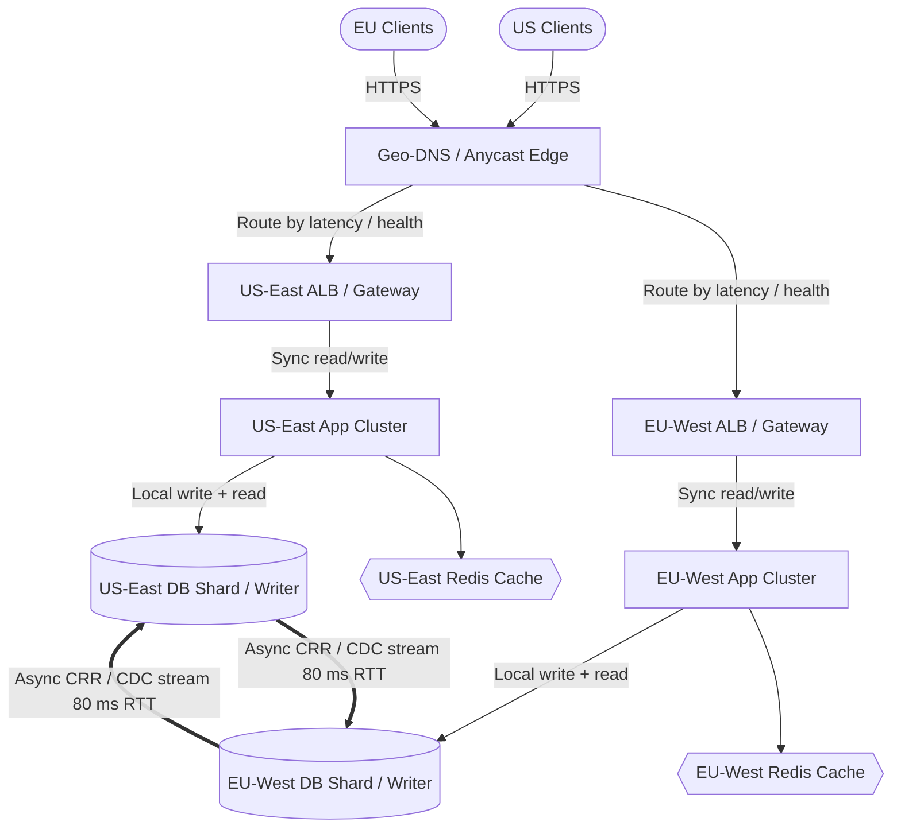

# 37 · Multi-Region Architecture, Disaster Recovery & FinOps

**Level:** Advanced · **Module:** 07 (Reliability, Security, Observability & Cloud) · **Status:** Draft

## Learning objectives

By the end of this lesson, you should be able to:
- Distinguish **multi-AZ high availability** (protects against datacenter/rack failures) from **multi-region disaster recovery** (protects against regional control-plane outages and satisfies latency/residency goals).
- Calculate realistic **`RPO`** and **`RTO`** across DNS/Anycast cutover, replica promotion, and surviving-region autoscaling.
- Architect **Active-Passive** vs. **Active-Active (Home-Region or CRDT/Multi-Master)** systems without hidden split-brain bugs.
- Measure **FinOps unit economics** (`$/1M requests`, cross-AZ/region transfer bills, and idle standby tax).

---

## 1. The Problem: Why "We're Multi-Region" Failed During an Actual Outage

A global fintech team sets up an `EU-West` standby replica for their `US-East` primary region, configures Geo-DNS with a `60 s` TTL, and writes `"RPO = 0, RTO = 1 min"` in their compliance doc. Six months later, `US-East` suffers a real outage:
1. Async replication lagged `4 s` during peak traffic (`~20,000` acknowledged transactions lost—`RPO != 0`!).
2. Corporate recursive DNS resolvers ignored the `60 s` TTL and cached the dead `US-East` IP for `10 minutes`.
3. When traffic finally shifted to `EU-West`, the standby cluster—provisioned at `25%` capacity with a cold Redis cache—collapsed immediately under `100%` global traffic + cache-miss thundering herd!
4. Worse, the multi-region setup had quietly added **`$42,000/month`** in cross-AZ and cross-region data transfer fees that nobody tracked until finance flagged the bill.

Multi-region adds **latency, consistency bugs, failover complexity, and serious cost**—only deploy it when your SLOs, latency budget, or data-residency laws genuinely require it.

---

## 2. Mental Model

First, separate **availability** from **geography**:
- **Multi-AZ (1 Region, 3 AZs, `< 2 ms` RTT):** Gives you `99.99%` availability against power, cooling, or single-datacenter failures with synchronous replication (`RPO = 0`) and fast failover. **Start here** for 90% of products!
- **Multi-Region (`80–150 ms` RTT):** Adds protection against full regional cloud outages, cuts user RTT across continents, and keeps EU/local PII inside legal borders (**GDPR residency**).

Two key disaster recovery metrics govern every multi-region design:
- **RPO (Recovery Point Objective):** *How much acknowledged data can we afford to lose?* Determined by **replication mode** (sync cross-region = `0` loss at `>= 1` WAN RTT write latency; async = seconds of lag).
- **RTO (Recovery Time Objective):** *How long until the service is healthy again?* Equal to `Detection + Routing Shift + DB Promotion + Capacity Warm-up`—**never** just `"DNS TTL"`!

---

## 3. How It Works Under the Hood

### Active-Passive vs. Active-Active Patterns
1. **Backup & Restore (`RPO: hours`, `RTO: hours`, `~1.05×` cost):** Cross-region S3 snapshots; spin up infra from IaC on disaster.
2. **Pilot Light / Warm Standby (`RPO: 1–10 s`, `RTO: 5–20 min`, `~1.3–1.6×` cost):** DB replica runs continuously in Region B; compute runs minimal (`25%`) and scales out during failover. **Danger:** must pre-warm or scale fast enough, and periodically run real failover drills!
3. **Active-Active (`RPO: 0–2 s`, `RTO: 10–60 s`, `~2.2×+` cost):** Both regions actively serve live users (`50% / 50%` headroom so either surviving region can absorb `100%` load immediately!). See [multi-region-active-active.mmd](../diagrams/multi-region-active-active.mmd):

### Handling Cross-Region Writes & Data Residency Safely
You **cannot** run synchronous `RPO = 0` multi-master writes between `US-East` and `EU-West` (`80 ms` RTT) at `10 ms` latency—speed of light in fiber forbids it. Choose one of three patterns:
- **Home-Region Partitioning (Recommended):** User `Alice` (US) has her authoritative primary shard in `US-East`; `Lukas` (Berlin) lives in `EU-West`. Writes stay local (`~10 ms`) **and** GDPR EU PII stays physically pinned in `EU-West`! If `Alice` travels to Europe, `EU-West` proxies her writes over the private backbone to `US-East` (`80 ms`).
- **Async Multi-Master + CRDTs / Conflict Rules:** Both regions accept writes to the same entity (`chat presence`, `like counts`) and merge via CRDTs or vector clocks. **Never** use async multi-master with naive LWW for bank balances or unique usernames!
- **Global Consensus (`Spanner` / `CockroachDB`):** Synchronous Raft/Paxos across `3` regions (`RPO = 0`, serializable), paying `80–150 ms` write latency for global invariants (e.g., billing ledger).

### Traffic Routing: Geo-DNS vs. Anycast Edge
- **Geo-DNS:** Simple and cheap, **but** recursive ISP resolvers often cache records past short TTLs (`30–60 s`) and health-check propagation adds `30 s` (`RTO ~ 90–300 s`).
- **Anycast Edge Proxy (`Cloudflare` / `AWS Global Accelerator`):** Clients connect to the *same static Anycast IP* at the nearest edge PoP; the edge shifts origin pools across regions in **`5–15 s`** with zero DNS caching delay—at an extra per-GB proxy cost.

### FinOps Unit Economics
Cloud network transfer and idle headroom dominate multi-region bills:
- **Hidden Cross-AZ Egress Tax:** Even inside *one* region, noisy microservices chatting `100 MB/s` across AZs (`$0.01/GB` in + `$0.01/GB` out = `$0.02/GB` round-trip) cost `100 MB/s × 86,400 × 30 × 0.02 / 1000 ≈ $5,184/month`! Prefer **AZ-aware routing** (Envoy Locality Weighted / Topology Aware Hints) for read-heavy cache/DB traffic.
- **Measure Unit Cost:** Track **`$/1M requests`** and **`$/active user/month`**, not just aggregate monthly AWS spend, so FinOps tracks efficiency as traffic grows.

---

## 4. Worked Example & Interactive Visualization

Let's work through exact **RPO, RTO, and FinOps numbers** for a **Global Chat & Messaging App** (`10M` DAU, `5,000 writes/s` at `500 B`/msg, `25,000 reads/s` at `2 KB`/resp) running across `US-East` (`60%`) and `EU-West` (`40%`), `80 ms` RTT:

1. **RPO During Instant `US-East` Blackout:**
   - Write throughput = `5,000 writes/s × 500 B = 2.5 MB/s` (`20 Mbps`).
   - With `1.5 s` steady-state async replication lag:
     $$\text{Data at risk (RPO)} = 5,000\text{ writes/s} \times 1.5\text{ s} = 7,500\text{ messages}\ (3.75\text{ MB})$$
   - Plus **fencing rule:** If `US-East` comes back online later, it **must not** accept new writes or push stale local logs without reconciling/fencing old leadership first (otherwise split-brain!).
2. **RTO Breakdown (Geo-DNS vs. Anycast):**
   - Health check failure (`3 × 10 s` probes) = `30 s`
   - DB replica promotion in `EU-West` = `25 s`
   - DNS TTL decay (`60 s`, ignoring sticky ISPs) = `60 s` (vs. **`0 s`** with Anycast origin switch!)
   - **Total RTO:** `~115 s` with compliant Geo-DNS (risking `5–10 min` with sticky resolvers) vs. **`~55 s`** with Anycast edge routing!
3. **Monthly Cross-Region Replication & Egress FinOps (`30` days):**
   - Monthly replicated write volume:
     $$2.5\text{ MB/s} \times 86,400\text{ s/day} \times 30\text{ days} = 6,480,000\text{ MB} = 6,480\text{ GB} = 6.48\text{ TB/month}$$
   - Including `1.5×` protocol/WAL overhead = `9.72 TB/month`. At `$0.02/GB` cross-region transfer: `9,720 × $0.02 = $194.40/month` (cheap for `500 B` text—**but** if messages carried `50 KB` un-offloaded media blobs, `100×` larger = **`$19,440/month`**!).
   - Internet client egress (`25,000 reads/s × 2 KB = 50 MB/s`): `50 × 86,400 × 30 = 129,600 GB/month × $0.09/GB = $11,664/month` (offload static/cacheable media to CDN at lower egress rates!).
   - Active-Active compute headroom (`2×` at `50%` utilization per region so each survives `100%` load) doubles baseline compute cost compared to single-region Multi-AZ.

> **Interactive Visualization (`anim-region-failover`):** Launch [anim-region-failover](../animations-and-visuals.md) to trigger a total blackout in `US-East`. Watch health probes fail, observe the `RPO` async replication gap, compare Geo-DNS TTL lag vs. Anycast cutover, and verify whether `EU-West` has enough pre-provisioned headroom or crashes on cold-cache failover.

---

## 5. Trade-Offs & Failure Modes

| Pattern | Benefit | Cost / Risk | Fails When |
|---|---|---|---|
| **Single-Region Multi-AZ** | Zero RPO (`sync`); `< 2 ms` RTT; simplest ops & lowest bill | Vulnerable to full-region cloud control-plane outage | Compliance or SLA demands surviving entire region loss |
| **Active-Passive (Warm Standby)** | Moderate cost (`~1.4×`); single primary avoids write conflicts | Untested standby rots; cold cache + scale-out lag blows RTO | Real failover never drilled -> permissions/quotas/scaling fail under fire |
| **Active-Active (Home-Region)** | Local `< 15 ms` writes; natural GDPR residency; `< 60 s` RTO | `~2×` compute headroom; cross-region proxy for traveling users | Single-region outage forces cross-border PII move (need GDPR legal/routing plan) |
| **Active-Active (Global Consensus)** | `RPO = 0` & strict serializability globally | `80–150 ms` cross-region write latency; complex tuning | Interactive high-write-rate apps needing `< 20 ms` write `p95` |
| **Geo-DNS Failover** | Built-in, low cost | Sticky ISP resolvers ignore TTLs (`5–15 min` real RTO) | Strict `RTO <= 60 s` SLA required (use Anycast Edge instead) |

### What changes at 10× and 100× scale?
- **At 10× (`50,000 writes/s`, `250,000 reads/s`):** Cross-region async CDC queues can back up for minutes if a single replication worker applies transactions serially. Partition replication streams by `shard_id`/`tenant_id` (`64+` parallel streams) and track per-shard `replication_lag_seconds` as a Sev-1 SLI.
- **At 100× (`500,000 writes/s` globally):** Running `2×` overprovisioned Active-Active across `2` regions wastes millions/year. Move to **3+ Regional Cells** (`US-East`, `US-West`, `EU-Central`, `AP-South`): each cell needs only **`+33%`–`+50%` headroom** (`N + 1` regional redundancy) instead of `+100%`, cutting standby compute tax in half while keeping local latency fast!

---

## 6. Practical Exercise

Complete **[Lab 14 · Multi-Region Failover Drill, RPO/RTO & FinOps Audit](../labs/14-multi-region-failover.md)** to model the exact `US-East -> EU-West` outage timeline, tune Geo-DNS vs. Anycast failover to meet `RTO <= 120 s`, and audit monthly replication & egress FinOps costs.

Then complete **[Checkpoint 05 · Reliability, Security, Observability & Cloud Operations](../assessments/checkpoint-05.md)** to verify mastery of Module 07.

---

## 7. Retrieval Practice

1. What is the difference between **Multi-AZ** and **Multi-Region**, and why do most early-stage products only need Multi-AZ?
2. Why can an Active-Active architecture with asynchronous cross-region replication *not* claim `RPO = 0`?
3. List the four sequential components of real-world **`RTO`** during a regional database outage (beyond just `"DNS TTL"`).
4. How does **Home-Region Partitioning** satisfy *both* low local write latency (`~10 ms`) and EU **GDPR data residency**?
5. Why can keeping `100%` cold standby compute in a secondary region still fail during a real disaster drill?

Hints

1. Multi-AZ spans datacenters `< 2 ms` apart inside one region (`RPO = 0` sync replication); Multi-Region spans `80–150 ms` continents, adding latency, conflict complexity, and `2×` egress/compute cost.
2. Any write acknowledged in Region A during the `1–5 s` async replication window before Region A goes dark is not yet in Region B—making `RPO > 0` (`~lag × write_rate` lost transactions).
3. (1) Health-check failure detection (`20–30 s`), (2) DNS/Anycast routing propagation (`0–300 s`), (3) DB replica promotion (`15–60 s`), and (4) Surviving-region autoscaling + cold-cache warm-up.
4. Each user's authoritative shard lives in their home region (`EU` users in `EU-West`), so local reads/writes never cross oceans and EU PII remains inside EU borders (replicate only anonymized routing index or non-PII metadata if cross-region lookup is needed).
5. Undrilled standbys suffer from stale IAM/firewall rules, cloud vCPU quota limits blocking sudden scale-out, and cold-cache thundering herds crashing the newly promoted DB.

---

## Primary Sources

- **Tier 4 (Eng Blog):** [AWS Whitepaper · Multi-Region Fundamentals](https://docs.aws.amazon.com/whitepapers/latest/aws-multi-region-fundamentals/aws-multi-region-fundamentals.html) — Active-Passive vs. Active-Active patterns, RPO/RTO math, and data residency.
- **Tier 4 (Eng Blog):** [Google SRE Book · Data Integrity & Disaster Recovery](https://sre.google/sre-book/data-integrity/) — Why backups and DR fail silently without automated continuous restore drills.
- **Tier 4 (Eng Blog):** [Cloudflare · Anycast & Origin Load Balancing](https://www.cloudflare.com/learning/cdn/glossary/anycast-network/) — Why Anycast cuts routing failover lag compared to TTL-cached DNS.
- **Tier 2 (Official Docs):** [FinOps Foundation · Cloud Unit Economics](https://www.finops.org/framework/capabilities/unit-economics/) — Measuring cost per business transaction (`$/1M requests`) rather than raw monthly bills.

---

## Next

Complete [Checkpoint 05 · Reliability, Security, Observability & Cloud Operations](../assessments/checkpoint-05.md), then advance to Module 08: [38 · Ambiguous Problem Decomposition & High-Signal ADRs](38-problem-decomposition.md).
