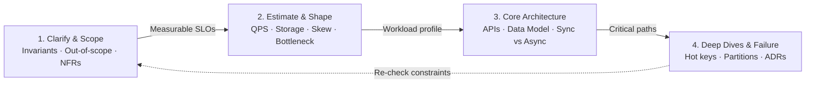

# 38 · Ambiguous Problem Decomposition & High-Signal ADRs

**Level:** Advanced / Staff · **Status:** Draft · **Module:** 08 — Architecture Mastery

---

## 1. The Problem: "Design a Collaborative Workspace"

Imagine an executive, a product manager, or a staff-level interviewer drops a single sentence on the table: *"We need a real-time collaborative notes and task platform for global teams—walk me through the architecture."*

If you immediately start drawing Kubernetes pods, Kafka topics, and Redis clusters, you are solving the wrong problem. An un-scoped prompt hides at least five different systems underneath:
- Is "real-time" sub-200 ms character-level CRDT syncing (Google Docs), or 2-second block-level saves (Notion)?
- Are 10 users editing one document concurrently, or 5,000 viewers watching a town-hall doc?
- Must edits work offline on an airplane and merge hours later, or is online-only acceptable?
- Is the system bound by regulatory data residency (EU vs US tenant isolation), or is a single primary region fine for v1?

Without structured decomposition, engineers either **over-build** (paying multi-region consensus complexity for an internal CRUD tool) or **under-build** (ignoring hot-document fan-out until launch day melts the primary database).

---

## 2. Mental Model: The Funnel of Constraints

Think of architecture design as a **constraint funnel**, not a blank canvas. You start with a wide, ambiguous product wish and progressively narrow the viable solution space using four filters:

1. **Invariants (What cannot be wrong):** Money never disappears, two users cannot book the same seat, private documents never leak across tenants.
2. **Workload Shape (Physics and numbers):** Read-to-write ratio, payload size, concurrency per hot key, and latency budget (`p95`/`p99`).
3. **Component Boundaries (Minimal sufficient mechanism):** Separate synchronous user-facing paths from asynchronous durable work.
4. **Reversibility (ADR discipline):** Lock down *one-way doors* (data model, consistency boundary, shard key, public API) with explicit trade-off records while keeping *two-way doors* (cache TTL, instance size) cheap to change.

Every box you put on a diagram must trace directly back to an invariant or a bottleneck from steps 1–2.

---

## 3. How It Works Under the Hood: The 4-Phase Design Loop

Staff engineers and strong architecture candidates run a deliberate, time-boxed loop whether they have 45 minutes in a review or 2 weeks for an RFC:

### Phase 1: Clarify & Scope (~10% of time)
- **Pin down the 3 core journeys:** e.g., *Create doc*, *Edit block*, *View/Subscribe to doc*.
- **State explicit exclusions:** *"Out of scope for v1: full-text PDF OCR, mobile offline CRDT sync, and custom SSO."* Exclusions stop scope creep before it ruins your diagram.
- **Force measurable NFRs:** Replace "low latency" with `p95 < 150 ms` for edit ACK; replace "high availability" with `99.95%` monthly for reads vs `99.9%` for writes.

### Phase 2: Estimate & Shape (~15% of time)
Do not compute 15 trivial numbers. Compute only the **three numbers that change your architecture**:
1. **Peak write vs read QPS** (decides single node vs read replicas vs sharding).
2. **Hot-entity concurrency** (decides whether a single row/partition lock or WebSocket room saturates).
3. **Working-set memory & multi-year storage** (decides RAM cache fit vs NVMe/object-store offload).

### Phase 3: Core Architecture (~35% of time)
Draw the **narrowest end-to-end skeleton** that satisfies Phase 1 and Phase 2:
- Define external APIs (`REST`, `gRPC`, `WebSocket`, or `SSE`) and **idempotency keys** for mutations.
- Define the **authoritative data model** (primary keys, access-pattern indexes, uniqueness constraints) before adding caches.
- Label **synchronous** vs **asynchronous** arrows and **trust boundaries**.

### Phase 4: Deep Dives, Failure Modes & ADRs (~40% of time)
Attack your own diagram where it hurts most:
- **Identify the #1 bottleneck** (network egress, lock contention, fan-out amplification, or GC/tail latency).
- **Trace partial failures:** What happens when the cache dies, a queue lags by 10 minutes, or a network partition splits two AZs?
- **Write high-signal ADRs** using [templates/adr.md](../templates/adr.md) for decisions that are expensive to reverse later.

> **Interactive Visual (`anim-adr-tradeoff-radar`):** In the companion slide deck and web explorer, toggle architectural choices (e.g., *CRDT vs Operational Transform vs Last-Write-Wins*) to score **Latency**, **Consistency**, **Operational Complexity**, and **Cost** side by side.

---

## 4. Worked Example: Decomposing a Live Document Sync Service

Let's apply the 4-phase loop with explicit numbers (decimal units `GB/TB` for storage, `ms` for latency):

1. **Scope & Invariant:**
   - **In scope:** Team workspace docs (`<= 2 MB` per doc), up to 50 concurrent editors per doc, live cursor/edit propagation within `p95 < 200 ms`, 30-day version history.
   - **Invariant:** No acknowledged edit may be silently lost on server restart; edits within a single document must converge to identical state across all connected clients.

2. **Workload Math (Turning assumptions into architecture triggers):**
   - Suppose **4M DAU**, **20% collaborate live**, averaging **300 edits/user/day** and **40 doc opens/user/day**.
   - **Daily edits:** `4,000,000 × 0.20 × 300 = 240,000,000 edits/day`.
   - **Average edit QPS:** `240,000,000 ÷ 86,400 ≈ 2,778 edits/s`. At **5× peak burst** (morning standup window), **Peak edit QPS ≈ 13,890 edits/s**.
   - **Broadcast fan-out:** Average **4 concurrent viewers** per active doc → `13,890 × 4 ≈ 55,560 outbound WebSocket frames/s`.
   - **Average payload:** `250 bytes` delta per edit → Inbound edit bandwidth `13,890 × 250 B ≈ 3.47 MB/s (~27.8 Mbps)`. Outbound fan-out bandwidth `55,560 × 250 B ≈ 13.89 MB/s (~111 Mbps)`.
   - **Storage growth:** Assume `500,000` new/updated document snapshots/day at `100 KB` compressed → `50 GB/day` (`18.25 TB/year` before 3× replication = `54.75 TB/year` raw provisioned).
   - **Crucial insight:** Bandwidth (`~111 Mbps`) is tiny, and `13,890` writes/s is modest if sharded—*except* if you write every 250-byte keystroke synchronously as a row update into a single unsharded relational database! That insight immediately justifies **stateful sticky room coordinators (or pub/sub channels) batching deltas to durable storage every 2–5 seconds**, plus offloading cold snapshots to object storage.

3. **Capturing the Crucial ADR (`ADR-001`):**
   - **Decision:** Route all live editors for `doc_id` to a single **Room Coordinator** shard (consistent hashing on `doc_id`) using **Operation Sequence / OT** in memory backed by an append-only WAL/stream, flushing snapshots to DB + Object Storage every 3 seconds or on room close.
   - **Rejected Alternative:** Direct client-to-DB row locking per keystroke (saturates DB IOPS and fails under `13.9k` writes/s) or full peer-to-peer WebRTC CRDT mesh (leaks auth boundaries and fails behind strict corporate NATs).

---

## 5. Trade-Offs & Failure Modes

| Choice | Benefit | Cost / Risk | Fails When |
|---|---|---|---|
| **Strict 4-phase scope lock upfront** | Prevents gold-plating; surfaces true bottleneck early | Can feel rigid if stakeholder discovers hidden requirement late | Product direction pivots mid-RFC without revisiting Phase 1 assumptions |
| **Single-writer Room Coordinator per `doc_id`** | Eliminates distributed write conflicts on hot docs; batches DB writes 10×–50× | Stateful routing requires sticky WebSockets and fast failover handoff | A town-hall doc attracts `100,000` viewers onto one coordinator pod (must split read fan-out tier) |
| **Short-form ADR per irreversible choice** | Preserves "why" for future engineers; speeds architecture reviews | Turns into bureaucracy if written for trivial library/config changes | Teams write 10-page design docs nobody updates after launch |
| **Explicit "Out of Scope" list** | Aligns reviewers on v1 boundaries and prevents endless rabbit holes | Stakeholders sometimes assume excluded items come "for free" later | Excluded feature (e.g., offline mobile sync) actually requires a different core data model (CRDT) |

### What Changes at 10× and 100× Scale?
- **At 10× (`~140k` peak edits/s, `~555k` fan-out frames/s):** A single pub/sub broker cluster hits fan-out limits; you split **Edit Ingestion Coordinators** from **Edge WebSocket Fan-Out Gateways** and shard coordinators across regions by workspace affinity.
- **At 100× (`~1.4M` peak edits/s, global orgs):** Cross-continent RTT (`~150–250 ms`) breaks single-region editing feel; you introduce **regional workspace pinning** (EU workspaces live in `eu-central-1`), **multi-tier read-only CDN/edge relays** for massive broadcast docs, and cold-storage lifecycle tiering (`> 90 days` inactive docs moved to object store).

---

## 6. Practical Exercise

Pick [Case Study 02 · Pastebin](../case-studies/02-pastebin.md) or [Case Study 05 · Social News Feed](../case-studies/05-news-feed.md) and execute a strict **25-minute timer** decomposition:
1. Write 4 functional requirements and 3 explicit v1 exclusions.
2. Fill out the measurable NFR table (`p95`, availability, durability, consistency).
3. Calculate **only** the 3 workload numbers that drive your storage and compute choice.
4. Draft one concrete ADR using [templates/adr.md](../templates/adr.md) explaining *why* you rejected the runner-up architecture.

---

## 7. Retrieval Practice & Primary Sources

1. Why should "out of scope for v1" be decided *before* drawing your first architecture diagram?
2. Which three workload estimates usually dictate whether a system needs sharding, caching, or async batching?
3. What distinguishes a **one-way door** decision (deserving an ADR) from a **two-way door** decision?
4. In our worked collaborative-doc example, why did `13,890` peak edits/s motivate an in-memory Room Coordinator even though total ingress bandwidth was only `27.8 Mbps`?

Hints

1. Exclusions prevent designing for imaginary requirements (e.g., multi-region offline CRDT sync) that radically change the data model and cost.
2. Peak read/write QPS, hot-key concurrency/skew, and working-set memory vs total durable storage growth.
3. One-way doors (shard keys, consistency models, public API contracts, data formats) are costly or risky to migrate later; two-way doors (cache TTLs, thread counts, instance types) can be tuned in minutes.
4. Relational row locks and random disk WAL fsyncs per 250-byte keystroke become IOPS/lock-bound far before network bandwidth saturates.

### Primary Sources
- **Tier 2 (Docs / Engineering Guides):** [Google SRE Book — Non-Abstract System Design & Operations](https://sre.google/resources/) — turning abstract requirements into concrete component math and failure budgets.
- **Tier 4 (Engineering Practice):** [Michael Nygard — Documenting Architecture Decisions (ADRs)](https://cognitect.com/blog/2011/11/15/documenting-architecture-decisions) — the original lightweight ADR format emphasizing context, decision, and consequences.
- **Tier 5 (Reference Book):** *Designing Data-Intensive Applications* (Martin Kleppmann, paid book / not free full-text) — Ch. 1 on reliability, scalability, and maintainability as measurable properties.

---

## Next
Continue to [39 · Modern AI & High-Throughput Workloads](39-ai-systems-architecture.md).
