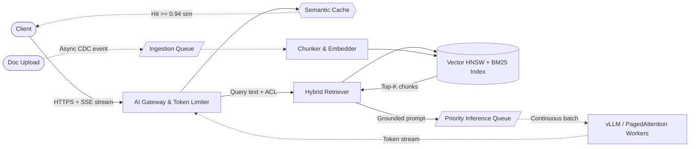

# 39 · Modern AI & High-Throughput Workloads

**Level:** Advanced / Staff · **Status:** Draft · **Module:** 08 — Architecture Mastery

---

## 1. The Problem: Why Classic Web Scaling Fails for LLM Apps

Suppose your team adds an "Ask AI across company docs" assistant for 500,000 enterprise users. You put a standard REST API behind an Application Load Balancer, auto-scale stateless Node/Python pods on CPU utilization, and set a 3-second request timeout.

Within ten minutes of launch, everything breaks in ways traditional web apps never do:
1. **CPU is 5% idle while users see 15-second timeouts:** Standard request-per-second rate limits (`100 req/min`) let one user submit a 64,000-token prompt that monopolizes a GPU for 20 seconds while another user's 20-token prompt sits starved in a FIFO queue.
2. **GPU OOM crashes under moderate concurrency:** Even though model weights fit on an 80 GB GPU, keeping the attention **KV-cache** for 64 concurrent long-context conversations exhausts VRAM.
3. **Hallucinated or stale answers:** Users ask about a policy updated 4 minutes ago, but your embedding pipeline runs as a nightly batch job—or your naive vector search misses an exact error code like `ERR_QUOTA_429` that keyword search (BM25) would have caught immediately.

Designing AI-native systems requires understanding **token economics, GPU memory physics, streaming transport, and asynchronous retrieval pipelines**.

---

## 2. Mental Model: Two Phases of Inference & Two Planes of RAG

### Inference Is Two Different Workloads in One Request
Every LLM response executes two radically different compute stages:
- **Prefill (Prompt Processing):** Reads all input tokens in parallel (`compute-bound`). Determines **Time-To-First-Token (TTFT)**.
- **Decode (Token Generation):** Generates output one token at a time autoregressively, reading model weights and the growing **KV-cache** (cached key/value attention tensors from prior tokens) from High-Bandwidth Memory (HBM) on every step (`memory-bandwidth-bound`). Determines **Inter-Token Latency (ITL)** and total **Tokens/sec**.

### RAG Separates Ingestion from Online Retrieval
Retrieval-Augmented Generation (RAG) works like a search engine paired with a synthesis model:
- **Offline/Async Ingestion Plane:** Documents → Parse/Chunk → Generate embeddings + lexical tokens → Upsert to Hybrid Index (Vector HNSW + Inverted BM25) with ACL metadata.
- **Online Query Plane:** User Query → Token Budget Check → Semantic Cache → Hybrid Retrieval + Permission Filter → Cross-Encoder Rerank → Prompt Assembly → Streamed LLM Decode.

---

## 3. How It Works Under the Hood: AI Gateway & Hybrid RAG

### Key Architectural Mechanisms
1. **Continuous Batching & PagedAttention:** Instead of waiting for an entire static batch of 16 requests to finish their longest output, an iteration-level scheduler inserts new requests into free GPU slots at every decode step. **PagedAttention** stores KV-cache tensors in fixed-size virtual memory blocks (like OS virtual memory pages) so near-zero VRAM is wasted on pre-allocated padding.
2. **Token-Bucket Rate Limiting by Tokens, Not Requests:** Enforce **Tokens Per Minute (TPM)** and **Concurrent Streams** per tenant. Reserve tokens upfront using `prompt_tokens + max_tokens_cap`, then refund unused tokens when `finish_reason` arrives via SSE.
3. **Server-Sent Events (SSE) Over Plain JSON:** Humans read at ~5–8 tokens/sec. Streaming tokens over HTTP/2 SSE makes a 6-second total generation feel responsive as long as **TTFT < 500 ms** and **ITL < 50 ms**.
4. **Hybrid Search + Pre-Filter ACLs:** Combine **BM25 lexical search** (exact IDs, names, error codes) with **dense vector HNSW** (semantic intent) via Reciprocal Rank Fusion (RRF), always applying **tenant/document ACL filters inside the index scan**—never post-filtering after fetching top-K (which leaks zero results or unauthorized chunks).
5. **Semantic Cache (With Strict Scope):** Embed frequent FAQ queries; if cosine similarity exceeds a high threshold (e.g., `>= 0.94` *within the same tenant and index version*), return the cached answer in `~25 ms` instead of burning GPU cycles.

> **Interactive Visual (`anim-llm-token-streaming`):** Step through request arrivals under **Static Batching** vs **Continuous Batching** to see why long outputs stall short queries in static batches and how TTFT vs ITL react as KV-cache utilization approaches 90%.

---

## 4. Worked Example: Sizing a Production LLM & RAG Cluster

Suppose an enterprise AI assistant serves **200,000 DAU**, averaging **10 prompts/day**, with a **4× peak burst** during business hours.

### Step 1: Request & Token Throughput
- **Daily prompts:** `200,000 × 10 = 2,000,000 prompts/day`.
- **Average QPS:** `2,000,000 ÷ 86,400 ≈ 23.15 QPS`.
- **Peak QPS (4×):** `23.15 × 4 ≈ 92.6 QPS`.
- Assume **30% Semantic Cache Hit Rate** on common queries → Origin GPU QPS drops to `92.6 × 0.70 ≈ 64.8 QPS`.
- Average prompt after RAG context = **2,500 input tokens**; average answer = **350 output tokens**.
- **Peak token demand:**
  - Input prefill: `64.8 × 2,500 = 162,000 input tokens/s`.
  - Output decode: `64.8 × 350 = 22,680 output tokens/s`.

### Step 2: GPU Sizing & KV-Cache Math (Binary GiB for VRAM)
Suppose we serve a 70B-parameter model quantized to FP8 (`~70 GB` decimal / `~65.2 GiB` weights) across **4× 80 GiB H100 GPUs** (Tensor Parallel `TP=4`, total `320 GiB` HBM):
- Model weights: `~65.2 GiB`. Runtime & activations overhead: `~25 GiB`.
- Remaining VRAM for KV-cache: `320 - 65.2 - 25 ≈ 229.8 GiB`.
- KV-cache per token (with Grouped-Query Attention GQA-8 on a 70B model, 80 layers, 8 KV heads × 128 dim × 2 bytes FP16 × 2 for K&V):
  `80 × 2 × 8 × 128 × 2 bytes = 327,680 bytes ≈ 320 KiB/token`.
- Total tokens fitting concurrently in KV-cache:
  `229.8 GiB ÷ 320 KiB ≈ 753,000 concurrent context tokens`.
- At `2,850` avg context tokens/request, one `4× H100` replica holds `~264` concurrent requests in flight without swapping.
- If one `4× H100` node sustains `~1,800` output tokens/s at `ITL < 45 ms`:
  `22,680 ÷ 1,800 ≈ 12.6` → provision **14 replicas** (`56` H100 GPUs) for peak load plus `N+2` failover headroom, or route simple classification/routing prompts to a smaller 8B model (cutting GPU count by 60%+).

### Step 3: Vector Index Memory (HNSW)
Suppose **50 million** document chunks (`1,024`-dim FP16 embeddings = `2,048 bytes` raw + `~256 bytes` HNSW graph links `M=16` + metadata = `~2.4 KB/chunk`):
- Total RAM for un-quantized HNSW: `50,000,000 × 2.4 KB = 120 GB` (decimal) / `~111.8 GiB`.
- Applying **Scalar Quantization (`int8`)** or **Product Quantization (PQ)** cuts vector memory by `4×` (`~30 GB`), fitting comfortably on 2–3 memory-optimized nodes with NVMe-backed full-precision rescoring.

---

## 5. Trade-Offs & Failure Modes

| Choice | Benefit | Cost / Risk | Fails When |
|---|---|---|---|
| **Semantic Cache (`cosine >= 0.94`)** | Drops latency from seconds to ~25 ms; cuts GPU spend | Risk of serving stale or cross-tenant responses if key lacks ACL/version | Prompt includes personal context ("summarize *my* unread emails") or fast-changing live prices |
| **Model Routing (8B small vs 70B large)** | Cuts inference cost 5×–10× on simple intents | Classifier misroutes nuanced query to weak model; extra gateway hop | Router adds `100 ms` overhead or lacks fallback escalation when confidence is low |
| **Pure Vector Search vs Hybrid (BM25 + Vector)** | Hybrid catches exact SKUs, names, and semantic intent | Higher index footprint and query fan-out latency | Pure vector alone fails horribly on exact IDs, acronyms, and boolean metadata filters |
| **In-memory HNSW vs DiskANN / IVF-PQ** | Sub-15 ms recall at high accuracy (`>95%`) | Expensive RAM scaling (`~2.4 KB` per 1k-d FP16 vector) | Corpus grows to 1B+ chunks and RAM costs exceed compute budget |

### What Changes at 10× and 100× Scale?
- **At 10× (`~650` origin QPS, `~227k` output tokens/s):** You separate **Prefill GPUs** from **Decode GPUs** (*disaggregated serving*) so massive prompt prefills never cause decode jitter (ITL spikes) for streaming users, and add prefix-cache-aware load balancing (`consistent hash on system-prompt + doc prefix`).
- **At 100× (`~6,500` QPS, multi-billion chunks):** You shard vector collections by tenant/cluster, move cold tenant indexes to disk-backed DiskANN with lazy loading, deploy **speculative decoding** (small draft model verified by target model) to double decode tokens/s, and enforce strict tiered SLA degradation (shedding non-critical summarization jobs to batch queues during peak).

---

## 6. Practical Exercise

Design an AI code-review assistant for **50,000 developers** (averaging 6 PR reviews/day, 8,000 input diff tokens + 600 output tokens per review, 5× peak burst):
1. Calculate peak input tokens/s, peak output tokens/s, and monthly token cost assuming `$1.50 / 1M input` and `$4.00 / 1M output` tokens (or equivalent self-hosted GPU count).
2. Draw a Mermaid sequence diagram showing **Token Budget Reservation → Hybrid Repo Context Retrieval → SSE Stream → Token Usage Settlement**.
3. Propose two load-shedding rules when GPU queue depth exceeds `2 seconds` TTFT (e.g., downgrade large PRs to async webhook comment instead of synchronous streaming).

---

## 7. Retrieval Practice & Primary Sources

1. Why does an LLM inference server hit **memory-bandwidth** limits during token generation (decode) even when GPU matrix compute (`TFLOPS`) appears underutilized?
2. How do **Continuous Batching** and **PagedAttention** improve both throughput and tail TTFT compared to static batching?
3. Why must tenant and document **ACL filters** be applied *during* vector/BM25 index retrieval rather than as a post-filter on top-K results?
4. When does a **Semantic Cache** cause correctness or security bugs, and what two fields must always be part of its cache key?

Hints

1. Autoregressive decoding generates one token per forward pass, requiring the GPU to stream all model weights plus the growing KV-cache from HBM for each token—low arithmetic intensity.
2. Continuous batching fills freed slots at every decode step without waiting for the slowest request; PagedAttention eliminates contiguous VRAM fragmentation so more concurrent requests fit in HBM.
3. Post-filtering top-K can return 0 accessible results if all top-K matches belong to restricted documents, whereas pre-filtering guarantees K valid, authorized candidates.
4. Personalized prompts, volatile live data, or missing tenant/index-version scope; always include `tenant_id / ACL hash` and `corpus_version` (plus model ID) in the cache key.

### Primary Sources
- **Tier 3 (Paper):** [Efficient Memory Management for Large Language Model Serving with PagedAttention (vLLM, SOSP 2023)](https://arxiv.org/abs/2309.06180) — explains KV-cache fragmentation and block-based virtual memory paging.
- **Tier 2 (Docs):** [OpenSearch / Elasticsearch Hybrid Search & k-NN Vector Docs](https://www.elastic.co/guide/en/elasticsearch/reference/current/knn-search.html) — HNSW memory vs recall trade-offs and RRF hybrid scoring.
- **Tier 4 (Engineering Guide):** [AWS Prescriptive Guidance — Generative AI & RAG Patterns](https://docs.aws.amazon.com/prescriptive-guidance/) — gateway throttling, chunking strategies, and guardrail boundaries.

---

## Next
Continue to [40 · System Evolution, Monolith Extraction & Blameless Postmortems](40-system-evolution.md).
