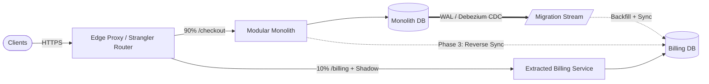

# 40 · System Evolution, Monolith Extraction & Blameless Postmortems

**Level:** Advanced / Staff · **Status:** Draft · **Module:** 08 — Architecture Mastery

---

## 1. The Problem: The Second-System Rewrite Trap

A fast-growing fintech startup has a 400,000-line Python/Rails monolith backed by one PostgreSQL primary. Deployments now take 45 minutes, a bug in invoice PDF rendering occasionally exhausts memory and crashes checkout, and five teams step on each other's migrations every week.

Leadership proposes a bold fix: *"Freeze features for 6 months and rewrite everything into 18 Go microservices from scratch."*

Six months later, the rewrite is at 60% parity, the legacy monolith still carries 100% of paying customers (and accumulated 6 months of urgent hotfixes the new services don't have), morale is cratered, and two teams have quit.

Great architectures are rarely born finished—they **evolve in production while serving live traffic**. Staff engineers know how to decouple systems safely *in flight*, when to keep a modular monolith, and how to turn outages into permanent system upgrades through blameless postmortems.

---

## 2. Mental Model: Changing Engines Mid-Flight

Think of system evolution like **converting a twin-engine propeller plane while keeping passengers safely aboard**:
- **Big-bang rewrite:** Build a brand-new jet in a hangar while trying to keep the old plane flying with zero maintenance, hoping all passengers teleport cleanly on cutover day. (Almost always overruns budget and misses undocumented edge cases.)
- **Modular Monolith first:** Put bulkheads *inside* the existing codebase—strict module interfaces, no cross-domain SQL joins, separate worker queues—so you get 80% of team isolation with 0% network tax.
- **Strangler Fig Extraction:** When one specific seam truly hits a scaling, reliability, or organizational limit (e.g., billing PDF workers or high-throughput ledger writes), wrap the boundary at an edge proxy, mirror/sync data via CDC, shadow-compare outputs, and shift traffic `1% → 10% → 50% → 100%` with instant rollback.

---

## 3. How It Works Under the Hood: Strangler Fig + Data Decoupling

Extracting stateless HTTP handlers is easy. **Extracting coupled database state without data loss or downtime** is the hard part.

### The 5-Step Safe Extraction Sequence
1. **Carve the Seam Inside the Monolith:** Enforce module boundaries (`BillingModule` owns `invoices` and `ledger_entries` tables). Eliminate cross-module foreign-key joins in favor of internal service calls or domain events.
2. **Stand Up Target Store + CDC Backfill:** Create `Billing DB`. Stream historical rows + live inserts/updates from `Monolith DB` via WAL/CDC (`Debezium`) until lag is sub-second. Verify row checksums (`count`, `sum`, hash).
3. **Dark Launch & Shadow Reads:** Route live read traffic to both Monolith and `Billing Service` asynchronously (`shadow compare` responses, logging diffs without impacting users). Fix parity bugs silently.
4. **Progressive Write Cutover with Dual-Write / Reverse Sync:** Flip writes to `Billing Service` behind a feature flag (`1% → 10% → 50% → 100%`), keeping reverse-sync (or Outbox event back to Monolith) active during the burn-in window so **rollback takes seconds, not a database restore**.
5. **Contract & Decommission:** Once `100%` stable for 2+ weeks, stop reverse sync, drop legacy tables/routes in the monolith, and celebrate deleting code.

> **Interactive Visual (`anim-strangler-cutover`):** Drag the canary traffic slider from `0%` to `100%` while toggling shadow-diff alerts and rollback triggers to observe how reverse-sync protects zero-downtime reversibility.

---

## 4. Worked Example: Decoupling a Hot Checkout Seam & Postmortem Math

Suppose our monolith processes **3,000 peak HTTP RPS**, of which **2,400 RPS** are catalog/browsing reads, **450 RPS** are cart/checkout mutations, and **150 RPS** are heavy PDF/webhook billing tasks sharing the same `32`-worker pool and `200`-connection Postgres instance.

### Why Extraction Pays Off Here (Quantitative Trigger)
- Heavy billing PDF generation averages **1,200 ms** CPU/IO per request vs **25 ms** for checkout.
- By Little's Law (`L = λ × W`), `150 RPS × 1.2 s = 180` concurrent workers occupied just by billing tasks! That saturates the shared monolith pool (`180 > 32` workers or steals DB connections), pushing checkout `p99` from `45 ms` to `4,200 ms`.
- **Intervention:** First isolate **compute & queues** (move PDF tasks to a dedicated worker deployment reading an Outbox queue—takes 3 days, not 6 months). Only extract a separate `Billing Service + DB` once billing writes exceed `30%` of primary DB IOPS or team merge conflicts block daily deploys.

### Blameless Postmortem Structure (When Extraction Goes Wrong)
Suppose during a `10% → 50%` cutover, a missing index on `Billing DB` caused `p99` to spike to `8 seconds` for 14 minutes before rollback. A **blameless postmortem** assumes every engineer acted reasonably with the information and tools available at the time, and fixes the **system**:
- **Impact:** `14 minutes` degraded checkout for `50%` of EU users; `0` lost orders; `~2.1%` error-budget burn against `99.95%` monthly SLO (`21.6 min/month` budget).
- **Root Contributing Factors (Systemic, never "Bob forgot"):**
  1. Staging dataset had `10k` rows vs `42M` rows in production, masking the sequential scan.
  2. Canary rollout gate checked `HTTP 5xx` rate (`0%`) but did **not** gate on `p99 > 500 ms`.
- **Action Items (With Owners & SLOs):**
  - Add automated `p99` latency burn gate to progressive canary controller.
  - Require `EXPLAIN ANALYZE` review on production-scale row-count estimates in CI migrations.

---

## 5. Trade-Offs & Failure Modes

| Choice | Benefit | Cost / Risk | Fails When |
|---|---|---|---|
| **Modular Monolith** | Zero network serialization tax; atomic ACID transactions; single deployment | Shared blast radius for OOM/CPU spikes unless worker pools are split | Teams exceed ~40–60 engineers on one repo or one workload needs radically different hardware (e.g., GPU) |
| **Strangler Fig Extraction** | Incremental value delivery; instant rollback; preserves undocumented edge behavior | Temporary dual-running complexity (CDC, shadow diffs, feature flags) | Teams keep the "temporary" dual-sync layer running for 3 years without finishing step 5 |
| **Big-Bang Rewrite** | Clean slate free of legacy schema baggage | Zero production validation until cutover; 2× feature drift against live system | Business cannot freeze features for 6–12 months (almost always) |
| **Blameless Postmortems** | Surfaces real systemic risks; builds psychological safety to report near-misses | Requires leadership discipline to avoid subtle blame ("should have been more careful") | Action items become performative tickets that sit unprioritized in Jira forever |

### What Changes at 10× and 100× Scale?
- **At 10×:** Organizational bottlenecks (build queues, migration lock contention, on-call noise) force clear **domain-bounded service boundaries** with independent CI/CD pipelines and SLO-backed API contracts.
- **At 100×:** Single-database CDC extraction gives way to **cell-based architectures** (sharding entire user/tenant slices into self-contained deployment cells of `N` users) so bad deployments, noisy neighbors, or schema bugs affect at most one cell (`1%–5%` blast radius) rather than the entire fleet.

---

## 6. Practical Exercise & Course Capstone

You have completed all 9 modules (`L01–L40`). Put the entire toolkit—requirements, capacity math, storage modeling, caching, sharding, async pipelines, distributed consistency, reliability, security, and evolution—into practice in the **[Course Capstone Project](../projects/04-capstone/README.md)**!

Before starting the Capstone, perform a quick **Architecture Audit** on a project you've built:
1. Identify the highest-risk coupling (shared table, shared worker pool, or missing idempotency).
2. Sketch a 3-step Strangler Fig plan to isolate that boundary without stopping feature work.
3. Draft one automated canary rollback rule (`SLI + threshold + window`) that would catch a bad migration within 2 minutes.

---

## 7. Retrieval Practice & Primary Sources

1. Why does extracting **stateless compute / worker pools** often solve an immediate reliability crisis faster than extracting a separate database?
2. What is the purpose of **shadow reads** and **reverse sync** during a Strangler Fig cutover?
3. Explain using **Little's Law (`L = λ × W`)** why mixing `1,200 ms` tasks and `25 ms` tasks in a single thread pool starves fast requests.
4. Why do **blameless postmortems** improve system reliability more effectively than punishing the engineer who merged a bad config?

Hints

1. Separating worker queues/deployments stops CPU, memory, and connection-pool starvation without requiring CDC backfill, dual writes, or distributed sagas.
2. Shadow reads verify parity on live traffic with zero user impact; reverse sync keeps the old store updated during burn-in so rolling back traffic doesn't lose writes made on the new service.
3. Slow requests stay in flight ~48× longer (`W`), consuming `λ × W` concurrency slots even at modest arrival rate `λ`, leaving zero workers for fast `25 ms` requests.
4. Blaming humans encourages hiding mistakes and produces shallow "try harder" fixes; blameless reviews uncover missing guardrails (canary gates, CI checks, bulkheads) that prevent anyone from triggering the same outage again.

### Primary Sources
- **Tier 4 (Architecture Pattern):** [Martin Fowler — Strangler Fig Application](https://martinfowler.com/bliki/StranglerFigApplication.html) & [Monolith First](https://martinfowler.com/bliki/MonolithFirst.html) — incremental extraction and modular boundaries.
- **Tier 2 (SRE Practices):** [Google SRE Book — Postmortem Culture: Learning from Failure](https://sre.google/sre-book/postmortem-culture/) — blameless review mechanics and action-item tracking.
- **Tier 4 (Zero-Downtime Migrations):** [GitHub Engineering — gh-ost & Online Migrations](https://github.blog/engineering/) / [Stripe — Online Migrations at Scale](https://stripe.com/blog/engineering) — dual-write, shadow comparison, and safe cutover patterns.

---

## Next
Complete the **[Course Capstone Project](../projects/04-capstone/README.md)** and explore the **[16 Case Studies](../case-studies/01-url-shortener.md)**.
