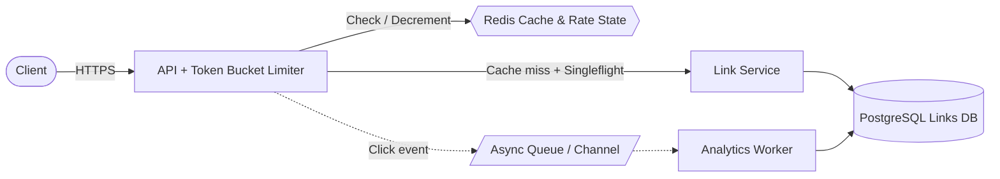

# Project 01 · Production-Spec URL Shortener & Rate Limiter Platform

**Level:** Beginner → Intermediate (Stage 1 Project · After Module 03)
**Status:** Draft

---

## Problem and motivation

Turning a long URL into a short redirect looks trivial until it hits real traffic: hot viral links overwhelm databases, bursty scrapers exhaust origin connections, and naive auto-increment codes let attackers enumerate every link ever created.

This Stage 1 project turns [Case Study 01 · URL Shortener](../../case-studies/01-url-shortener.md) and [Case Study 03 · Distributed Rate Limiter](../../case-studies/03-rate-limiter.md) into a working, load-tested vertical slice backed by an honest design doc, capacity sheet, and cache-stampede experiment.

---

## Learning outcomes

By completing this project, you should be able to:
- Translate product requirements into measurable SLIs/SLOs and a defensible capacity worksheet.
- Build a stateless HTTP service using connection pooling, collision-safe Base62/random short codes, and cache-aside reads.
- Protect write and redirect endpoints with an atomic Redis token-bucket rate limiter.
- Measure and demonstrate cache hit/miss behavior, singleflight stampede protection, and `p95`/`p99` latency under load.

---

## Scope

### Included
- `POST /v1/links` (create short link with optional TTL and idempotency key)
- `GET /{code}` (`302` redirect with cache-aside lookup + negative caching)
- `DELETE /v1/links/{code}` (owner/admin takedown with active cache invalidation)
- Atomic Redis rate limiter middleware (`Token Bucket` via Lua script)
- Asynchronous click-event counter (buffered channel / queue worker so redirects never block on analytics)
- Load test & cache-stampede experiment report

### Excluded
- Custom vanity domains and TLS certificate provisioning
- Full geo-distributed multi-region active-active replication
- Rich analytics dashboard UI (raw aggregated click counts endpoint is sufficient)

---

## Requirements and constraints

- **Latency:** `GET /{code}` `p95 < 15 ms` on cache hit, `p95 < 60 ms` on cache miss (local/containerized benchmark).
- **Correctness:** No duplicate active short codes; deleted/expired links return `404`/`410` within `5 seconds` of invalidation.
- **Rate limit:** `20 link creations/min` per IP/API key with burst capacity `10`; returns `429 Too Many Requests` + `Retry-After`.
- **Singleflight defense:** `500` concurrent cache-miss requests for the same cold key trigger at most **1** database query.

---

## Milestones

| Milestone | Deliverable | Definition of done |
|---|---|---|
| **1. Design & Math** | Design doc + [Lab 01](../../labs/01-capacity-estimation.md) sheet + 1 ADR | Completed NFRs, QPS/storage math, and ADR on Base62 code generation (`templates/adr.md`) |
| **2. Core API & Storage** | Working `POST /v1/links`, `GET /{code}`, `DELETE`, DB schema | Migrations run cleanly; integration tests cover collision retry, expiration, and takedown |
| **3. Cache, Rate Limiter & Async Analytics** | Redis cache-aside + singleflight + Lua token bucket + async click worker | `500`-concurrency stampede test hits DB once; `429` headers verified; analytics queue down does not break `302` |
| **4. Load Benchmark & Report** | `k6` / `vegeta` run report + failure test results | `p50/p95/p99` plotted before/after caching & singleflight; Redis-down fallback behavior documented |

---

## Architecture and design

- **Data model:** `links(id BIGINT PK, code VARCHAR(12) UNIQUE, long_url TEXT, expires_at TIMESTAMPTZ, status SMALLINT, created_at TIMESTAMPTZ)` with partial index on active `code`.
- **Key ADR:** Capture your choice of `64-bit random/CSPRNG Base62` vs `KGS pre-generated pool` vs `encoded sequence` in `docs/adr-001-short-codes.md` using [adr.md](../../templates/adr.md).

---

## Implementation

Suggested stack (choose any language you are productive in, e.g., Go, TypeScript/Node, Python/FastAPI, or Rust):
- **Compute:** Stateless HTTP server with bounded DB connection pool (e.g., `pgxpool` / `PgBouncer` / `SQLAlchemy` pool max 20).
- **Database:** PostgreSQL 16 in Docker Compose.
- **Cache & Rate Limit:** Redis 7 in Docker Compose using an atomic Lua script for token-bucket refill + consume.
- **Load Generator:** `k6` or `hey` / `wrk2`.

Document `docker compose up`, `.env.example`, DB migration command, and curl smoke checks in your repo `README.md`.

---

## Testing and evaluation

1. **Functional tests:** Create, redirect (`302` + `Location`), expiration (`410 Gone`), invalid URL rejection (`400`), takedown invalidation, and `429` rate-limit enforcement.
2. **Cache stampede experiment:** Evict a popular key from Redis, fire `500` concurrent `GET /{code}` requests, and inspect PostgreSQL query count (`1` with singleflight vs `~500` without).
3. **Redis failure drill:** Stop the Redis container mid-load-test (`500 RPS`). Verify whether your rate limiter fails open/closed as documented and redirects degrade gracefully to PostgreSQL without crashing.

---

## Demo and documentation

- [ ] `README.md` with one-command Docker setup and curl examples.
- [ ] Architecture diagram + data model schema.
- [ ] Capacity worksheet (`10×` and `100×` assumptions included).
- [ ] `k6` benchmark output (`p50/p95/p99` + cache hit ratio).
- [ ] Redis failure drill & singleflight before/after measurements.
- [ ] One completed ADR (`templates/adr.md`).

---

## Reflection

1. What failed first when you turned caching off under load—CPU, DB connections, or network?
2. Should your rate limiter **fail open** or **fail closed** if Redis is unreachable, and why?
3. What would you change first if traffic grew `10×` with `1%` of links serving `85%` of redirects?
