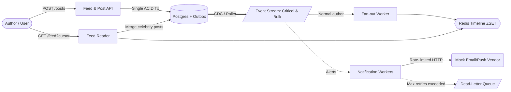

# Project 02 · Multi-Channel Notification & Activity Feed Platform

**Level:** Intermediate → Advanced (Stage 2 Project · After Module 05)
**Status:** Draft

---

## Problem and motivation

Modern apps must reliably notify users across email/push/in-app channels *and* maintain fast personalized activity feeds—without slowing down user writes or letting one dead third-party provider stall critical OTP/security alerts.

This Stage 2 project combines [Case Study 04 · Notification Service](../../case-studies/04-notification-service.md) and [Case Study 05 · Social News Feed](../../case-studies/05-news-feed.md) to practice **Transactional Outbox**, **priority queues + DLQs**, **hybrid push/pull fan-out**, and **cursor pagination**.

---

## Learning outcomes

By completing this project, you should be able to:
- Eliminate dual-write inconsistency between a database commit and an event stream using the **Transactional Outbox** pattern.
- Isolate critical notifications (`OTP`, `security`) from bulk marketing bursts using separate priority queues and token-bucket vendor throttles.
- Implement **hybrid fan-out** (fan-out-on-write for regular authors, fan-out-on-read for high-follower "celebrity" accounts).
- Design idempotent consumers, exponential backoff with jitter, Dead-Letter Queues (DLQs), and replay tooling.

---

## Scope

### Included
- Post creation API (`POST /v1/posts`) committing post + outbox event atomically
- Follow graph API (`POST /v1/follows`) + celebrity threshold flagging (e.g., `followers > 1,000` in test harness)
- Hybrid home-feed read API (`GET /v1/feed?cursor=...`) merging pre-computed Redis timeline + celebrity recent posts
- Notification dispatch pipeline with `critical` vs `bulk` topics, user opt-out preference checks, simulated flaky vendor webhook, and DLQ + replay CLI/endpoint
- Basic keyword search over posts (Postgres `tsvector` or OpenSearch/Meilisearch)

### Excluded
- Real APNs / FCM / SES paid provider credentials (use a controllable local mock HTTP receiver with configurable latency & 500/429 error injection)
- ML feed ranking models (chronological / reverse-Snowflake-ID ordering is sufficient)
- Full-text attachment OCR

---

## Requirements and constraints

- **No lost events:** Zero posts committed without a corresponding outbox dispatch (verified under simulated worker crash).
- **Idempotency:** Duplicate message delivery from the broker never sends a duplicate notification to the mock vendor (`notification_id` dedup check).
- **Priority isolation:** Injecting `10,000` bulk promo notifications and a `5s` slow bulk-vendor fault must keep `critical` OTP notification `p95 < 500 ms`.
- **Feed read latency:** `GET /v1/feed` `p95 < 40 ms` for standard users with `500` followees (including `5` celebrity accounts).

---

## Milestones

| Milestone | Deliverable | Definition of done |
|---|---|---|
| **1. Design & Schema** | System design doc + Outbox/Timeline data model + ADR on Fan-Out threshold | Clear sync/async boundary; keyset cursor spec; celebrity threshold ADR |
| **2. Outbox & Feed Fan-Out** | `posts`, `outbox_events`, `follows`, Redis `ZSET` timelines + hybrid reader | Authoring a post atomically writes outbox; normal posts fan-out to Redis; celebrity posts merged at read time |
| **3. Notification Queues & DLQ** | Priority topics (`critical`, `bulk`), preference check, retry + jitter, DLQ + replay | Simulated vendor `429`/`500` retries with backoff, quarantines poison pills to DLQ, and replays cleanly |
| **4. Search, Load & Chaos Tests** | Search endpoint + `10k` bulk storm test + crash recovery demo | `critical` latency unaffected by `bulk` backlog; killing worker mid-batch yields zero lost/duplicate sends |

---

## Architecture and design

- **ID ordering:** Use **UUIDv7** or **64-bit Snowflake IDs** for cursor pagination (`WHERE id < :cursor ORDER BY id DESC LIMIT 20`) so new inserts never shift page offsets.

---

## Implementation

- **Relational Store:** PostgreSQL (`posts`, `follows`, `outbox_events`, `notification_preferences`, `notification_deliveries`).
- **Broker:** Kafka / Redpanda / RabbitMQ / NATS JetStream in Docker Compose (at least two independent queues/topics for priority isolation).
- **Cache / Timeline:** Redis `ZSET` (`timeline:{user_id}`) capped at top `500` post IDs per active user.
- **Mock Vendor Service:** Small HTTP server exposing `/send` with flags for `?mode=slow|429|500|healthy` and an assertion log of received `idempotency_key` values.

---

## Testing and evaluation

1. **Dual-write crash test:** Kill the Outbox relay process mid-burst of `1,000` writes; restart and assert `1,000/1,000` posts appear in feeds and notifications.
2. **Duplicate delivery test:** Replay the same Kafka/queue message `5` times; assert mock vendor records exactly `1` unique delivery per `(notification_id, channel)`.
3. **Celebrity hot-key test:** Simulate a user with `50,000` followers posting; compare write amplification with pure fan-out-on-write vs hybrid fan-out.
4. **Noisy-neighbor bulk storm:** Enqueue `10,000` bulk events while vendor returns `429`; fire `50` critical OTP events and assert `critical` `p95 < 500 ms`.

---

## Demo and documentation

- [ ] `README.md` with Docker Compose stack and chaos test commands.
- [ ] Mermaid diagram showing Outbox, hybrid fan-out, and DLQ replay flow.
- [ ] Load & chaos test metrics comparing pure fan-out vs hybrid fan-out.
- [ ] ADR on hybrid fan-out threshold and queue priority isolation.
- [ ] Screenshots or recorded terminal/UI demo of DLQ quarantine + replay.

---

## Reflection

1. What breaks if you poll `outbox_events` with `SELECT ... FOR UPDATE SKIP LOCKED` at `10,000` writes/s vs using WAL CDC (`Debezium`)?
2. How would you handle a user who follows `2,000` celebrity accounts at read time without blowing your `40 ms` budget?
3. At `10×` scale, which component saturates first in your implementation?
