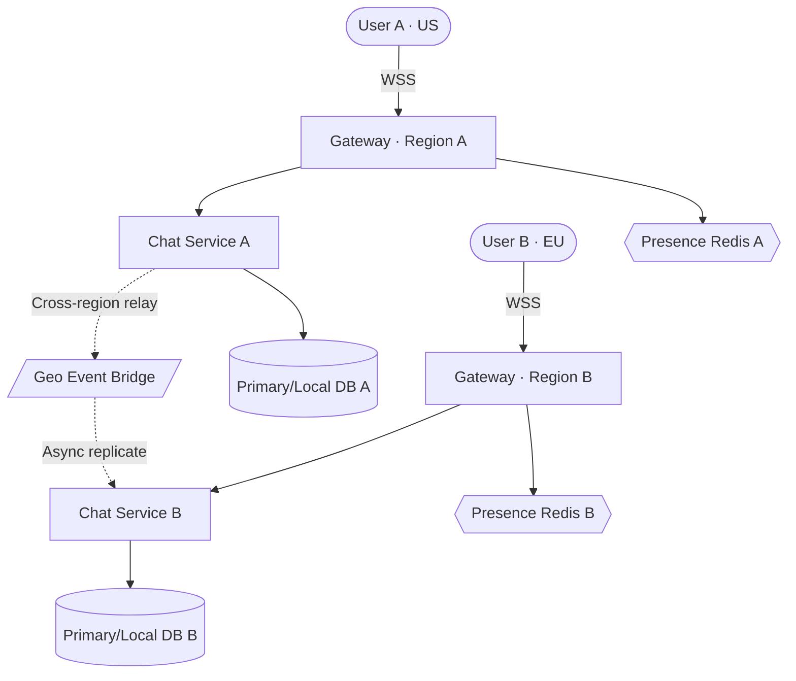

# Project 03 · Multi-Region Real-Time Chat & Presence Architecture

**Level:** Advanced (Stage 3 Project · After Module 07)
**Status:** Draft

---

## Problem and motivation

Real-time chat combines every hard distributed-systems problem in one user experience: stateful WebSocket gateways, strict per-conversation message ordering, battery-friendly presence heartbeats, offline catch-up sync, and surviving an entire cloud region going dark without split-brain corruption.

This Stage 3 project builds on [Case Study 06 · Real-Time Chat & Presence](../../case-studies/06-chat-and-presence.md) and **Module 07** (Reliability, Security, Observability, Multi-Region) to design, simulate, break, and write a blameless postmortem for a multi-region chat platform.

---

## Learning outcomes

By completing this project, you should be able to:
- Architect sticky stateful WebSocket edge gateways decoupled from durable message storage and cross-region routing.
- Guarantee causal/per-conversation message ordering using server-assigned monotonic sequence numbers (`seq_id`) and client idempotency keys.
- Design presence heartbeats with TTL leases and bounded fan-out so "last seen" storms do not melt the system.
- Execute a **multi-region failover drill**, measure real `RPO` and `RTO`, and produce a complete **STRIDE threat model** and **blameless postmortem**.

---

## Scope

### Included
- Two simulated regions (`region-a`, `region-b` via Docker Compose networks or namespaces) with Geo-routing proxy
- Authenticated WebSocket Chat Gateway (`JWT` handshake + `mTLS` or signed internal RPC between regions)
- `1:1` and small-group (`<= 100` members) message send, ACK, cross-region relay, and offline sync (`GET /conversations/{id}/messages?after_seq=N`)
- Presence service (`Redis` TTL leases + debounced subscriber push)
- OpenTelemetry trace propagation (`traceparent`) across WebSocket frame → Queue/Relay → DB write
- Controlled region-blackout failure injection + blameless postmortem

### Excluded
- Voice/video WebRTC media SFUs
- Large broadcast channels (`> 10,000` members—addressed in architecture doc only)
- Full Signal Double-Ratchet E2EE key rotation (document E2EE trust boundary in threat model)

---

## Requirements and constraints

- **Message delivery latency:** Same-region `p95 < 80 ms`; cross-region `p95 < 250 ms` (simulated WAN RTT `80 ms` via `tc netem` / proxy delay).
- **Ordering & Deduplication:** Concurrent sends in one conversation converge to an identical `seq_id` order on all clients; retries with same `client_msg_id` never create duplicate rows.
- **Failover objectives:** Target `RTO < 30 seconds` for active clients to reconnect to surviving region; measure and report actual `RPO` window under async cross-region replication.
- **Security:** Rate-limited WebSocket connections, short-lived JWTs with revocation check/refresh, TLS termination, and STRIDE threat model.

---

## Milestones

| Milestone | Deliverable | Definition of done |
|---|---|---|
| **1. Multi-Region Design & Threat Model** | Architecture doc + 2 ADRs + STRIDE threat model | Active-active vs active-passive ADR; sequence ordering ADR; trust boundaries mapped |
| **2. Chat Gateway, Ordering & Sync** | WebSocket server + durable DB + `seq_id` allocator + offline catch-up API | `1:1` & group messages ordered identically across reconnects; duplicate `client_msg_id` deduplicated |
| **3. Presence & Cross-Region Relay** | Redis TTL presence + async cross-region event bridge + OTel traces | Users in `region-a` chat seamlessly with users in `region-b`; end-to-end traces visible |
| **4. Region Blackout Drill & Postmortem** | `tc netem` / container-kill chaos drill + `RPO`/`RTO` report + Postmortem | Killed `region-a`; verified client reconnect to `region-b`; documented exact message loss/reconcile window |

---

## Architecture and design

- **Consistency decision:** Document clearly whether conversations use **Home-Region Authority** (one owning region serializes `seq_id` for a `conversation_id`, lower conflict risk) vs **Multi-Leader CRDT/HLC ordering** (survives home-region partition for writes, higher merge complexity).

---

## Implementation

- **Gateway & Core:** Go / Node (`ws` / `uWebSockets`) / Rust / Python WebSocket servers behind NGINX/Envoy L7 proxy.
- **State:** Two PostgreSQL instances + two Redis instances (one pair per simulated region) + Kafka/NATS JetStream bridge for cross-region replication.
- **Network Simulation:** Docker network pause/disconnect or `tc netem delay 80ms` between `region-a` and `region-b`.
- **Observability:** OpenTelemetry SDK exporting spans/metrics (Prometheus + Jaeger/Grafana or console JSON exporter).

---

## Testing and evaluation

1. **Reconnect storm test:** Drop `region-a` Gateway with `2,000` simulated WebSocket clients; verify clients use **exponential backoff + full jitter** rather than DDoSing `region-b` on second 0.
2. **Presence heartbeat load test:** Measure Redis CPU/ops when `5,000` users send heartbeats every `10s` vs `30s` with debounced status changes.
3. **Region-A hard blackout:** Sever network between `region-a` and `region-b` while messages are in flight; measure `RTO` (client recovery time) and `RPO` (any un-replicated messages) and verify reconciliation once `region-a` returns.

---

## Demo and documentation

- [ ] `README.md` with two-region Docker Compose setup & chaos scripts.
- [ ] Multi-region architecture diagram + trust boundary diagram.
- [ ] STRIDE threat model + 2 ADRs (`Ordering Authority`, `Active-Active vs Home-Region`).
- [ ] Reconnect storm & region-blackout benchmark results (`RPO`, `RTO`, `p95`/`p99`).
- [ ] Written **Blameless Postmortem** from the injected outage drill.

---

## Reflection

1. Why can un-jittered WebSocket reconnects after a regional outage cause a secondary cascading failure in the healthy region?
2. If you chose **Home-Region Authority**, what happens when a user's home region is unreachable? If you chose **Multi-Leader**, how did you reconcile conflicting `seq_id` order?
3. What would change at `100×` scale (`100M` concurrent WebSocket connections)?
