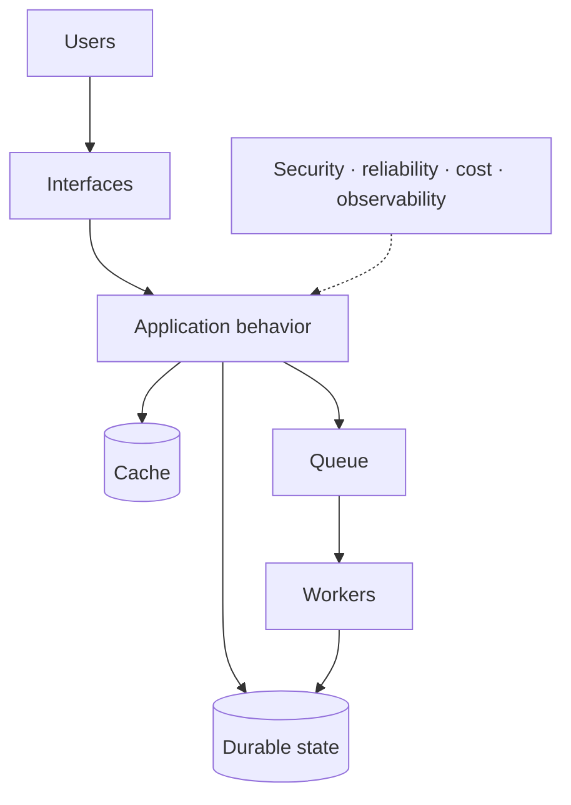

# System Design
## Beginner → Advanced

**StackShade Courses**

Learn to design systems that scale, survive failure, and make sense.

---

# What are we learning?

Not a collection of vendor products.

We are learning how to choose:
- Components and boundaries
- Communication paths
- Data models and storage
- Scaling and reliability strategies
- Security and operational practices

**The goal: explain why a design fits its constraints.**

---

# The design loop

1. Clarify the problem.
2. Set functional and quality requirements.
3. Estimate users, requests, data and bandwidth.
4. Draw the simplest architecture that could work.
5. Identify bottlenecks and failure modes.
6. Deep-dive, compare options and defend trade-offs.

---

# Start with the user journey

Example: a user uploads a photo.

- What does the user expect?
- How large is the upload?
- Does the user wait for processing?
- What data must be durable?
- Who can access the photo?
- What happens when storage is unavailable?

Requirements come before technology choices.

---

# A first mental model

A small product may combine several boxes. This is a responsibility map, not a mandatory microservice architecture.

---

# Interactive 5-Layer Request Tracer

<!-- anim: anim-request-layers -->

<!-- note: Switch between Sync Read, Sync Write, and Async Queue live while teaching to explain latency vs durability decoupling. -->

---

# Beginner to advanced

**Foundations**
- Requirements, estimates, networking, APIs, databases

**Building blocks**
- Cache, load balancing, queues, storage and scaling

**Distributed systems**
- Consistency, replication, failure handling and coordination

**Architecture mastery**
- Multi-region, security, operations, cost and capstone designs

---

# Learn by doing

For every module:

**Learn → Recall → Draw → Build → Measure → Break → Explain**

A diagram without assumptions is incomplete.
A benchmark without context is misleading.
A design without failure modes is unfinished.

---

# Your first assignment

Choose an app you use every day.

1. Identify one read and one write journey.
2. Draw the client, application, data store and external dependencies.
3. State three functional requirements and three quality attributes.
4. List three things you do not know yet.

Publish your first learning log.

---

# Course home

**Repository:** https://github.com/stack-shade/courses

**Learning hub:** https://stack-shade.github.io/courses/

Start with *01 · Thinking in Systems*.

*Build the mental model before choosing the technology.*
