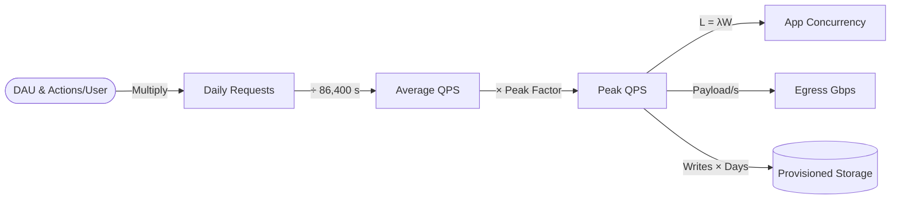

# Capacity Estimation
## Turn vague product prompts into defensible hardware budgets

StackShade · System Design · Module 00 (`EP03`)

<!-- note: Open with why order-of-magnitude math prevents both launch-day crashes and premature over-engineering. -->

---

# 1. The Launch-Week Question

**"10M MAU on a snippet-sharing app—do two DBs survive launch?"**

<!-- step -->
- Guessing "2 servers is fine" → noon outage on launch day
<!-- step -->
- Guessing "shard across 50 nodes" → wasted months & cloud budget
<!-- step -->
- Goal: **transparent math within `2×–5×`**, not fake 4-decimal precision

<!-- note: Emphasize that we estimate to identify which resource saturates first: compute, cache, disk, or egress. -->

---

# 2. The Plumbing Mental Model

Every workload maps to four budgets:

<!-- step -->
- **Flow Rate ($\lambda$):** Average & peak **QPS**
<!-- step -->
- **Pipe Volume ($L = \lambda W$):** Concurrent requests in flight
<!-- step -->
- **Tank Size:** Multi-year **storage** (logical vs. provisioned)
<!-- step -->
- **Pipe Width:** **Bandwidth** ingress & egress (`Mbps` / `Gbps`)

<!-- note: Keep the plumbing analogy crisp: QPS is flow, latency is dwell time, storage is tank capacity, network is pipe diameter. -->

---

# 3. Capacity Budget Flow

- Memorize **`86,400` seconds/day** (`~10^5` for quick mental checks)
- Separate **Read QPS** from **Write QPS** early

<!-- note: Walk left-to-right from user behavior to hardware resources. -->

---

# 4. Worked Math: Average & Peak QPS

Assumptions: **`10M` MAU**, **`30%` DAU (`3M`)**, **`10` reads + `1` write/day**, **`5×` peak**

<!-- step -->
- Daily reads = `3,000,000 × 10 = 30M / day`
<!-- step -->
- Avg Read QPS = `30,000,000 ÷ 86,400 ≈ 347 QPS`
<!-- step -->
- Peak Read QPS (`5×`) = **`1,735 QPS`**
<!-- step -->
- Avg Write QPS = `3,000,000 ÷ 86,400 ≈ 34.7` → Peak **`174 QPS`**

<!-- note: Note that 10:1 read/write immediately hints that caching reads will have outsized leverage later. -->

---

# 5. Concurrency via Little's Law (`L = λW`)

At **`1,735` peak QPS**, compare healthy vs. degraded latency:

<!-- step -->
- Healthy (`W = 40 ms = 0.040 s`): `L = 1,735 × 0.040 ≈ 69` active requests
<!-- step -->
- Slow DB (`W = 2.0 s`): `L = 1,735 × 2.0 = 3,470` active requests!
<!-- step -->
- **Insight:** Incoming QPS didn't change—yet concurrency jumped **`50×`**

<!-- note: This explains why slow dependencies exhaust thread pools and DB connections during flat traffic. -->

---

# 6. Storage: Decimal vs. Binary & Amplification

`3M` writes/day × `10.5 KB` (`10,000 B` body + `500 B` metadata) over `5 years` (`1,825 days`):

<!-- step -->
- Daily logical growth = `31.5 GB/day` (`≈ 29.3 GiB/day`)
<!-- step -->
- 5-year logical = `31.5 GB × 1,825 ≈ 57.49 TB` (`≈ 52.29 TiB`)
<!-- step -->
- Provisioned (`3×` replicas + indexes) ≈ **`~175 TB`** uncompressed
<!-- step -->
- With `3:1` text compression → logical drops to **`~19 TB`**

<!-- note: Highlight the difference between decimal 10^3 (GB/TB) and binary 2^10 (GiB/TiB) and why logical != billed disk. -->

---

# 7. Bandwidth & Interactive Calculator

**Peak Read Egress:** `1,735 QPS × 10.5 KB ≈ 18.22 MB/s ≈ 145.8 Mbps`

<!-- anim: sim-capacity-calculator -->

Slide DAU, peak multiplier, payload bytes, and retention to watch QPS, TB, and Gbps shift live.

<!-- note: Demonstrate how changing payload size from 10 KB to 2 MB (images) flips the bottleneck from DB writes to CDN egress. -->

---

# 8. Sizing Strategy Trade-Offs

| Strategy | Benefit | Cost / Risk | Fails When |
|---|---|---|---|
| **Size for Average** | Lowest baseline cost | Zero headroom | Diurnal `5×` spike saturates queues |
| **Static 20× Peak** | Absorbs huge bursts | `80%+` idle compute | Tight FinOps unit economics |
| **Reactive Autoscale** | Tracks diurnal curve | `1–5 min` cold-start lag | Flash bursts hit in `< 10 s` |

<!-- note: Point out that mixed strategies (baseline + headroom + edge caching + async queues) beat extremes. -->

---

# 9. What Changes at 10× and 100× Scale?

<!-- step -->
- **10× (`17.4k` peak read QPS, `575 TB`):** Add a **cache tier** for hot reads; move `10 KB+` bodies to **object storage + compression**
<!-- step -->
- **100× (`174k` QPS, `5.75 PB`):** **Edge CDN** absorbs egress; shard metadata; enforce **TTL/cold lifecycle tiering**
<!-- step -->
- Always ask: *Which single variable dominates my bill?*

<!-- note: Connect the math directly to architectural evolution. -->

---

# 10. Lab & Retrieval Recap

**Hands-on Lab:** [Lab 01 · Capacity Estimation](../labs/01-capacity-estimation.md)

<!-- step -->
1. Convert `43.2M` writes/day into average QPS (`43.2M ÷ 86,400`).
<!-- step -->
2. Explain how `L = λW` breaks a system when QPS is constant.
<!-- step -->
3. Name two multipliers between logical row bytes and billed disk.

<!-- note: Encourage learners to complete Lab 01 at 20x burst before moving to Lesson 04. -->
