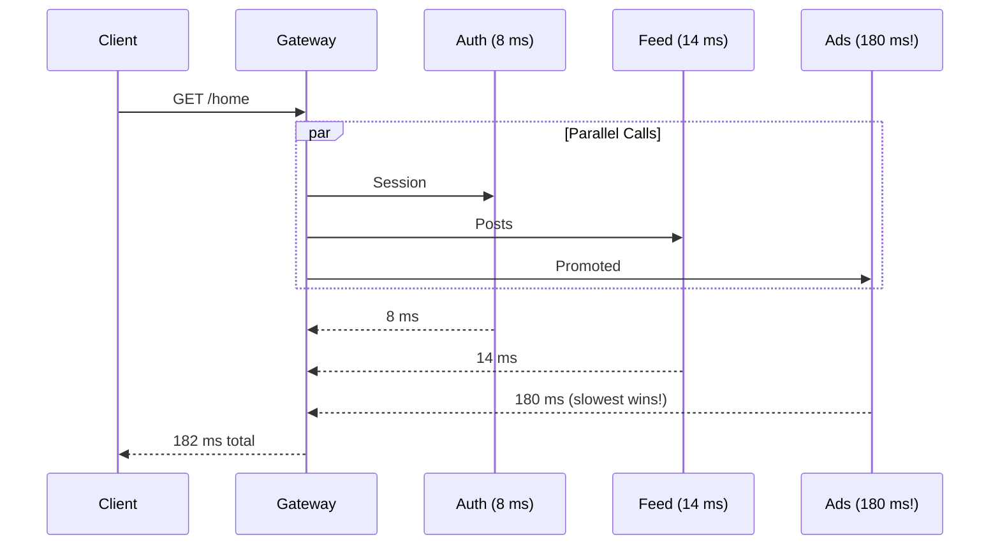

# Latency & Bottlenecks
## Why averages lie and adding servers often fixes nothing

StackShade · System Design · Module 00 (`EP04`)

<!-- note: Hook learners with the paradox of healthy p50s and low CPU alongside angry users. -->

---

# 1. The Monitoring Paradox

- Every microservice reports **`p50 = 12 ms`** and **`p99 = 50 ms`**
- Web fleet CPU sits at a relaxed **`35%`**
<!-- step -->
- Yet **`~40%` of home-page loads** cross `50 ms`!
<!-- step -->
- And **doubling app containers** does nothing during checkout spikes!

<!-- note: Ask the audience why both can be true at the same time before revealing queueing and fan-out math. -->

---

# 2. Latency vs. Throughput & Queueing

Think of a highway toll plaza:

<!-- step -->
- **Latency:** Seconds one car spends in line + at the gate
<!-- step -->
- **Throughput:** Cars/minute clearing all booths combined
<!-- step -->
- **Queue explosion:** At `50%` load, wait is ~0; at `95%` load, wait rises `~19×` ($\approx \frac{\rho}{1-\rho}$)
<!-- step -->
- **Narrowest pipe:** Adding 10 toll booths fails if all merge into a **1-lane bridge**

<!-- note: Emphasize nonlinear queueing near 100% utilization. -->

---

# 3. Parallel Fan-Out Sequence

<!-- note: In parallel fan-out, total latency equals the maximum of all child latencies, not the average. -->

---

# 4. Worked Math: `1 - (1 - p)^N`

If each service has **`p99 = 150 ms`** (`p = 0.01` slow probability):

<!-- step -->
- `N = 1` call → `1 - 0.99^1` = **`1.0%`** slow
<!-- step -->
- `N = 5` parallel calls → `1 - 0.99^5` = **`4.9%`** slow
<!-- step -->
- `N = 20` parallel calls → `1 - 0.99^{20}` = **`18.2%`** slow
<!-- step -->
- `N = 50` parallel calls → `1 - 0.99^{50}` = **`39.5%`** slow!

<!-- note: Walk through how a 1% tail becomes nearly 40% of user requests at 50-way fan-out. -->

---

# 5. Interactive Tail Amplification Explorer

<!-- anim: sim-tail-amplification -->

Adjust **fan-out count (`N = 1..50`)** and **per-node `p99`** to observe how quickly the tail becomes the common case.

<!-- note: Demo N=100 hitting >63% slow rate even when every individual node meets a 99% SLO. -->

---

# 6. Five Bottleneck Families (USE Method)

Check **U**tilization, **S**aturation, **E**rrors across:

| Resource | Saturation Signal | Common Cause |
|---|---|---|
| **CPU** | Run-queue depth | TLS, JSON parsing, GC |
| **Memory** | Swap / OOM / GC pause | Unbounded caches, leaks |
| **Disk I/O** | `iowait`, fsync queue | Missing index, full scans |
| **Network** | Retransmits, cross-AZ RTT | Chatty N+1 RPCs |
| **Locks** | **Low CPU + high latency** | Hot DB rows, pool exhaustion |

<!-- note: Highlight row 5: low CPU + high latency is the signature of lock contention or exhausted connection pools. -->

---

# 7. Worked Queueing Example

Database core runs at **`100 QPS`** (`8 ms/query`, max **`125 QPS`**, $\rho = 80\%$):

<!-- step -->
- At `80%` load: average time $\approx \frac{8\text{ ms}}{1 - 0.80} =$ **`40 ms`**
<!-- step -->
- Traffic rises just **`18%`** (`118 QPS`, $\rho = 94.4\%$)
<!-- step -->
- Average time jumps to $\frac{8\text{ ms}}{1 - 0.944} \approx$ **`143 ms`** (**`3.5×` slower!**)

<!-- note: Small traffic bumps near saturation cause disproportionate latency spikes. -->

---

# 8. Mitigations & Trade-Offs

| Lever | Benefit | Cost / Risk |
|---|---|---|
| **Scale App Fleet** | Fixes stateless CPU/RAM | Worsens DB lock/pool contention |
| **Hedged Requests** | Cuts tail latency on reads | Extra load (`~5%+`); dangerous in overload |
| **Tight Timeouts + Degrade** | Protects parent `p99` | Partial/stale non-critical UI |
| **50–65% Target Load** | Absorbs bursts smoothly | Higher steady-state infra spend |

<!-- note: Warn learners: never hedge writes unless idempotent, and disable hedging under cluster overload. -->

---

# 9. Scaling from 10× to 100×

<!-- step -->
- **10×:** Collapse chatty N+1 RPCs; enforce per-hop timeouts; drop optional widgets on slowdowns
<!-- step -->
- **100×:** Scatter-gather across 50+ shards requires **hedged reads**, **outlier ejection**, and **precomputed views**

<!-- note: Tie back to Dean & Barroso's "The Tail at Scale". -->

---

# 10. Checkpoint & Retrieval Recap

**Assessment:** [Checkpoint 01 · Foundations](../assessments/checkpoint-01.md)

<!-- step -->
1. Why can doubling app pods worsen a DB-bound outage?
<!-- step -->
2. Compute tail probability for `N = 10` parallel calls at `p = 0.02`.
<!-- step -->
3. What do **U**, **S**, and **E** stand for in bottleneck triage?

<!-- note: Direct learners to take Checkpoint 01 closed-book before starting Module 01. -->
