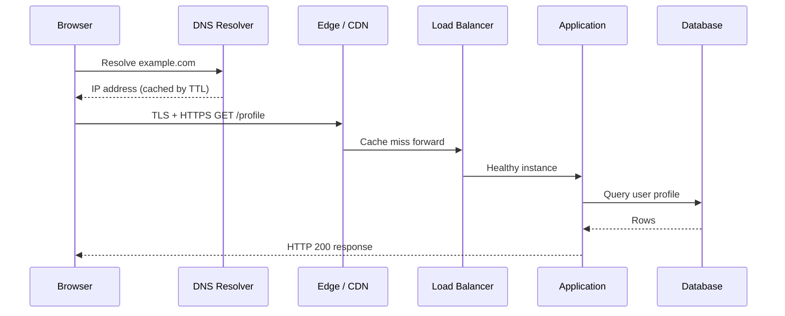
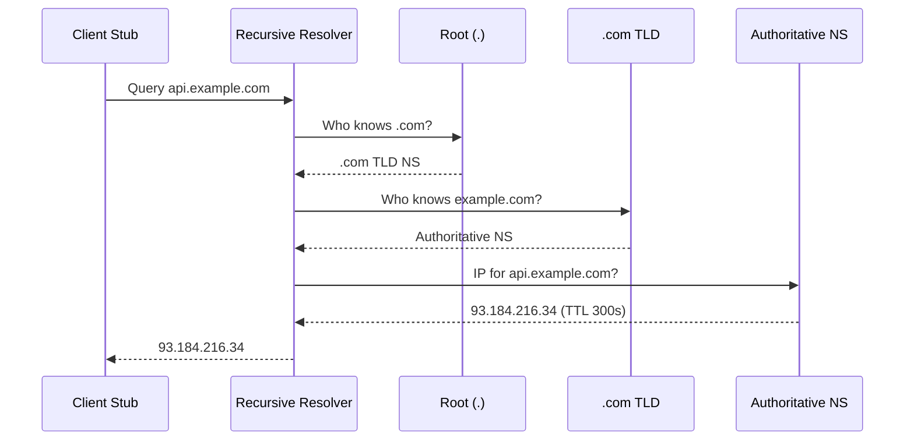

# The Web Request & DNS
## Tracing every hop from pressing Enter to pixels on screen

StackShade · System Design · Module 01 (`EP05`)

<!-- note: Kick off Module 01 by zooming in on everything that happens before and during a single HTTPS request. -->

---

# 1. What Happens When You Open a URL?

User types `https://example.com/profile`:

<!-- step -->
- Browser doesn't know `example.com`'s IP address yet
<!-- step -->
- Needs name resolution (**DNS**), secure transport (**TCP + TLS**), routing (**CDN / LB**), compute (**App**), and state (**DB**)
<!-- step -->
- Every hop adds **latency** and a potential **failure mode**

<!-- note: Keep the scope concrete: one URL, multiple independent infrastructure layers. -->

---

# 2. End-to-End Request Sequence

<!-- note: Point out that cached hits short-circuit at DNS or at the Edge CDN without ever touching the DB. -->

---

# 3. Recursive DNS Lookup

<!-- note: Clarify the difference between the ISP/public recursive resolver (8.8.8.8 / 1.1.1.1) and the domain's authoritative nameserver. -->

---

# 4. Interactive DNS Resolution Stepper

<!-- anim: anim-dns-resolution -->

Step through **Stub → Recursive → Root → TLD → Authoritative** and toggle **Cache Hit** to see how TTL caching eliminates 3 upstream hops.

<!-- note: Show that when the recursive resolver has a warm cache, DNS drops from ~60-120 ms down to ~5-15 ms. -->

---

# 5. Core DNS Record Types

| Record | Maps Name To | Example |
|---|---|---|
| **`A`** | IPv4 address (`32-bit`) | `api.example.com → 93.184.216.34` |
| **`AAAA`** | IPv6 address (`128-bit`) | `api.example.com → 2606:2800::1` |
| **`CNAME`** | Canonical hostname alias | `www.example.com → cdn.provider.net` |
| **`NS` / `TXT`** | Authoritative NS / verification | SPF, DKIM, domain ownership |

<!-- note: Remind learners that CNAME cannot be placed cleanly at the zone apex (example.com) in standard DNS; providers use ALIAS/ANAME flattening. -->

---

# 6. Why DNS Changes Take Time (TTL Limits)

Suppose you update `api.example.com` from old IP to new IP:

<!-- step -->
- Resolvers cache answers for **`TTL`** seconds (e.g., `300 s` or `3,600 s`)
<!-- step -->
- Some clients/OS caches ignore ultra-low TTLs (`< 30–60 s`)
<!-- step -->
- **Existing open TCP connections** keep talking to the old IP!
<!-- step -->
- **Rule:** Lower TTL *24h before* migration; keep old endpoint alive until traffic drains

<!-- note: DNS is not an instant failover switch or a true L7 load balancer. -->

---

# 7. Anycast Routing & Geo-DNS

Two ways to steer global users to the closest edge:

<!-- step -->
- **Geo-DNS:** Authoritative NS inspects resolver/EDNS subnet and returns a regional IP
<!-- step -->
- **Anycast:** Dozens of edge PoPs advertise the **same IP** via BGP; internet routers pick the shortest topological path

<!-- note: Mention that Anycast gives fast failover at the IP routing layer, which CDNs pair with Geo-DNS. -->

---

# 8. Where Does Request Latency Go?

Budgeting a **`200 ms` API call**:

<!-- step -->
- DNS lookup (`0 ms` cached, `20–100 ms` cold)
<!-- step -->
- TCP + TLS setup (`0 ms` reused, `40–300 ms` cold)
<!-- step -->
- Edge + LB hop (`2–10 ms`)
<!-- step -->
- App + DB query (`10–80 ms`)

<!-- note: Emphasize measuring with browser DevTools or curl before guessing which stage hurts. -->

---

# 9. Failure Points on the Wire

| Stage | Failure Mode | Mitigation |
|---|---|---|
| **DNS** | Misconfigured TTL / expired domain / NXDOMAIN | Monitoring, dual-NS, pre-lowered TTL |
| **Edge / LB** | TLS cert expiry, WAF false positive | Automated ACME renewal, canary WAF |
| **App / DB** | Pool exhaustion, slow query | Timeouts, caching, read replicas |

<!-- note: Highlight that a single expired TLS certificate or bad DNS edit bypasses all backend redundancy. -->

---

# 10. Mini Lab & Retrieval Recap

**Hands-on:** Open **Browser DevTools → Network** (cached vs. disabled cache)

<!-- step -->
1. Why doesn't a DNS change move all traffic instantaneously?
<!-- step -->
2. Contrast an `A` record with a `CNAME` record.
<!-- step -->
3. What is the difference between a **recursive** and an **authoritative** nameserver?

<!-- note: Next up: Lesson 06 dives into TCP, UDP, TLS 1.3, and HTTP/1.1 vs HTTP/2 vs HTTP/3. -->
