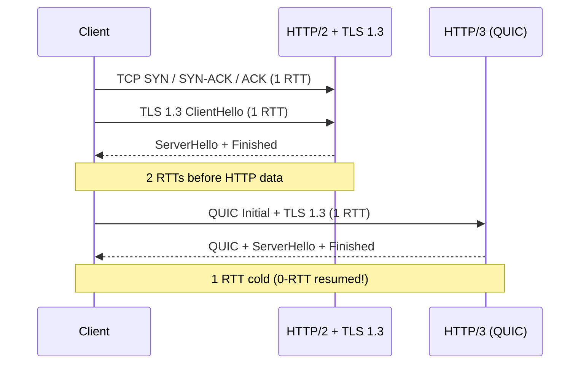

# Transport, TLS & HTTP
## Why round trips and head-of-line blocking rule mobile latency

StackShade · System Design · Module 01 (`EP06`)

<!-- note: Connect Lesson 05's sequence diagram to the exact transport and encryption round trips inside it. -->

---

# 1. The Airport Wi-Fi Problem

User in Singapore hits Frankfurt API (`170 ms` RTT):

<!-- step -->
- HTTP/1.1 + TLS 1.2 burns **`510 ms`** before sending 1 byte of HTTP!
<!-- step -->
- Dropping 1 packet on Wi-Fi freezes **every multiplexed HTTP/2 stream**
<!-- step -->
- **Question:** Why do modern protocols cut RTTs and leave TCP behind?

<!-- note: Set the stage with concrete latency on a 170 ms cross-continent link. -->

---

# 2. TCP vs. UDP Mental Model

<!-- step -->
- **UDP:** Unreliable numbered postcards—no handshake, no ordering, minimal overhead (media, gaming, **QUIC**)
<!-- step -->
- **TCP:** Reliable ordered byte stream—`SYN / SYN-ACK / ACK`, congestion control, strict in-order delivery
<!-- step -->
- **TLS 1.3:** Encrypted tunnel + server authentication + ALPN (`h2`) in **`1 RTT`**

<!-- note: Stress that TCP doesn't know what an HTTP message is—it only sees one ordered byte stream. -->

---

# 3. Handshake RTT Comparison

<!-- note: Walk through why QUIC saves an entire round trip by merging transport and TLS 1.3 setup. -->

---

# 4. Worked Math: Cold TTFB (`170 ms` RTT, `25 ms` Server)

$$\text{Cold TTFB} = (\text{Handshake RTTs} + 1) \times 170\text{ ms} + 25\text{ ms}$$

<!-- step -->
- **HTTP/1.1 + TLS 1.2 (`3` handshake RTTs):** `(4 × 170) + 25` = **`705 ms`**
<!-- step -->
- **HTTP/2 + TLS 1.3 (`2` handshake RTTs):** `(3 × 170) + 25` = **`535 ms`**
<!-- step -->
- **HTTP/3 Cold (`1` handshake RTT):** `(2 × 170) + 25` = **`365 ms`**
<!-- step -->
- **HTTP/3 `0-RTT` / Warm Pool (`0` handshake RTTs):** `(1 × 170) + 25` = **`195 ms`**

<!-- note: Point out that connection reuse + edge TLS termination reduces RTT from 170 ms to ~15 ms. -->

---

# 5. The Hidden Catch: Head-of-Line (HoL) Blocking

Compare how `HTTP/1.1`, `HTTP/2`, and `HTTP/3` handle lost packets:

<!-- step -->
- **HTTP/1.1:** Serializes requests per TCP socket; opens `6` sockets per origin
<!-- step -->
- **HTTP/2:** Multiplexes streams over **1 TCP socket** + HPACK compression—fixes HTTP HoL, **still suffers TCP HoL!**
<!-- step -->
- **HTTP/3 (QUIC):** Streams are independent over **UDP**—loss on Stream 1 never stalls Stream 3

<!-- note: Explain clearly that the OS kernel TCP buffer holds Stream 3 bytes hostage when Stream 1's packet drops. -->

---

# 6. Interactive Protocol Lane Visualizer

<!-- anim: anim-http-multiplexing -->

Toggle **`HTTP/1.1`**, **`HTTP/2`**, and **`HTTP/3`** and dial packet loss from `0%` to `3%` to watch TCP HoL vs. QUIC stream isolation.

<!-- note: Use this animation live when explaining the difference between HTTP-level and transport-level HoL. -->

---

# 7. QUIC Superpower: Connection Migration

What happens when a phone walks out of Wi-Fi onto 5G?

<!-- step -->
- **TCP** identifies connections by `(src_ip, src_port, dst_ip, dst_port)` → IP change **kills the socket**
<!-- step -->
- **QUIC** identifies connections by a cryptographic **Connection ID** → survives Wi-Fi ↔ 5G seamless switch!

<!-- note: Great concrete example for mobile engineering interviews. -->

---

# 8. Security & Replay Warning on `0-RTT`

- TLS 1.3 / QUIC **`0-RTT`** sends HTTP data in the very first packet
- **Risk:** An attacker on the wire can **replay** that first packet
<!-- step -->
- **Rule:** Allow `0-RTT` **only for idempotent `GET`s**—never `POST /payments`!

<!-- note: Highlight RFC 8446 Section 8 replay risk explicitly. -->

---

# 9. Protocol Trade-Offs & 10×/100× Scale

| Protocol | Strength | Risk / Limit |
|---|---|---|
| **HTTP/1.1** | Simple debugging | `6` sockets, HoL blocking |
| **HTTP/2** | Mature multiplexing, HPACK | TCP HoL on lossy Wi-Fi/4G |
| **HTTP/3** | `1-RTT`, QUIC streams, migration | Higher CPU; `~3–5%` networks block UDP 443 |

- **100× Scale:** Edge serves **HTTP/3 + HTTP/2 fallback**, uses **BBR congestion control**, and pools connections to origin

<!-- note: Remind learners that HTTP/3 always ships with Happy Eyeballs / Alt-Svc fallback to HTTP/2. -->

---

# 10. Lab & Retrieval Recap

**Hands-on Lab:** [Lab 02 · HTTP & TLS Timing Inspection](../labs/02-http-tls-timing.md)

<!-- step -->
1. Why does HTTP/2 still stall on packet loss?
<!-- step -->
2. How many RTTs does cold `HTTP/2 + TLS 1.3` need before HTTP data?
<!-- step -->
3. Why must `0-RTT` exclude mutating `POST` requests?

<!-- note: Direct learners to run curl -w locally in Lab 02. -->
