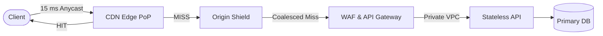

# Edge Infrastructure
## Reverse proxies, CDNs, cache headers, and API gateways

StackShade · System Design · Module 01 (`EP07`)

<!-- note: Frame edge infrastructure around two goals: moving TLS + cache hits close to users, and protecting origin compute. -->

---

# 1. Why Put Infrastructure at the Edge?

Origin in Virginia (`us-east-1`), user in Tokyo (`260 ms` RTT):

<!-- step -->
- Cold TLS 1.3 takes `~780 ms` across the Pacific
<!-- step -->
- `100%` of `500 KB` images slam origin servers & pay cloud egress (`~$0.09/GB`)
<!-- step -->
- App servers waste CPU on TLS, DDoS filtering, and rate limits

<!-- note: Show that distance + uncached static bytes kill both latency and cloud budgets. -->

---

# 2. Whose Side Is the Proxy On?

<!-- step -->
- **Forward Proxy:** Sits in front of **clients** (VPN, corporate egress)
<!-- step -->
- **Reverse Proxy:** Sits in front of **servers** (TLS termination, compression, routing)
<!-- step -->
- **CDN:** Globally distributed **reverse proxy + cache** at 100+ PoPs
<!-- step -->
- **API Gateway:** L7 reverse proxy enforcing **auth, rate limits, and API routing**

<!-- note: One tool (like Envoy/Cloudflare) can play multiple roles; teach the responsibilities clearly. -->

---

# 3. Edge & Origin Shield Architecture

- **Origin Shield** collapses `100` PoP cache misses into **`1`** origin request

<!-- note: Emphasize Origin Shield to prevent global cache-miss thundering herds on cold deploys. -->

---

# 4. Pull CDN vs. Push CDN

<!-- step -->
- **Pull CDN:** PoP fetches on first miss and caches by `Cache-Control` (best for websites, APIs, user avatars)
<!-- step -->
- **Push CDN:** CI/upload pipeline pushes large immutable files ahead of time (game patches, VOD segments)

<!-- note: Pull CDNs win for 90% of web workloads because you don't pay to store unrequested assets everywhere. -->

---

# 5. `Cache-Control` Playbook (Don't Leak Private Data!)

<!-- step -->
- **Hashed assets (`/app.8f3a.js`):** `public, max-age=31536000, immutable`
<!-- step -->
- **Public catalog (`/v1/catalog`):** `public, max-age=10, s-maxage=60, stale-while-revalidate=30`
<!-- step -->
- **User private (`/v1/me/orders`):** `private, no-store`
<!-- step -->
- **Revalidation:** `ETag` + `If-None-Match` → `304 Not Modified` (`0` body bytes)

<!-- note: Warn emphatically: caching a user-specific endpoint as public leaks User A's data to User B. -->

---

# 6. Interactive Edge PoP & Cache-Control Tracer

<!-- anim: anim-cdn-cache-flow -->

Tweak **`max-age`**, **`s-maxage`**, and **`stale-while-revalidate`** to inspect PoP hits, shield fetches, and background refresh.

<!-- note: Show how stale-while-revalidate gives users 0 ms cache hit speed while keeping data reasonably fresh. -->

---

# 7. Worked Math: Flash-Sale Offload

Peak **`20,000 QPS`**: `17,000` static (`200 KB`), `2,000` public catalog (`20 KB`), `1,000` checkout (`20 KB`)

<!-- step -->
- **Without CDN:** Origin handles `20,000 QPS` and **`3.46 GB/s` (`27.7 Gbps`)** egress
<!-- step -->
- **With CDN (`95%` static hit, `90%` catalog hit):**
  - Origin drops to **`2,050 QPS`** (**`-89.8%`**)
  - Origin egress drops to **`0.194 GB/s` (`1.55 Gbps`, `-94.4%`)**
- **Tokyo TLS handshake:** `260 ms` RTT → **`15 ms`** local PoP RTT (**`~17×` faster**)

<!-- note: Clarify that total internet traffic is still 27.7 Gbps—CDN edge serves it cheaper and closer. -->

---

# 8. Edge Security & API Gateway Boundaries

What belongs at the edge vs. inside services?

<!-- step -->
- **At Edge / Gateway:** TLS termination, WAF rules, IP/tenant rate limits, JWT signature verification, path routing
<!-- step -->
- **Inside Services:** Business authorization (*can User A edit Doc B?*), DB queries, domain invariants

<!-- note: Warn against "thick gateways" bloated with business logic that becomes a shared deployment bottleneck. -->

---

# 9. Trade-Offs & 10×/100× Scale

| Choice | Benefit | Failure Mode |
|---|---|---|
| **High `s-maxage`** | Huge origin offload | Stale prices without purge API |
| **Missing `private`** | Accidental hits | **Cross-user data leak** |
| **Thick Gateway** | Central policy | Team bottleneck & hidden coupling |

- **100× Scale:** Multi-CDN DNS steering, canary WAF deploys, internal **mTLS** after edge termination

<!-- note: Remind learners that edge termination does not forbid re-encrypting inside the VPC with mTLS. -->

---

# 10. Exercise & Retrieval Recap

**Exercise:** Inspect `Cache-Control`, `Age`, and `ETag` on a hashed asset vs. JSON API in DevTools

<!-- step -->
1. How does a forward proxy differ from a reverse proxy?
<!-- step -->
2. Why use both `max-age=10` and `s-maxage=300`?
<!-- step -->
3. How does an **Origin Shield** stop cold-cache storms?

<!-- note: Next up: Lesson 08 covers Layer 4 vs Layer 7 load balancing and routing algorithms. -->
