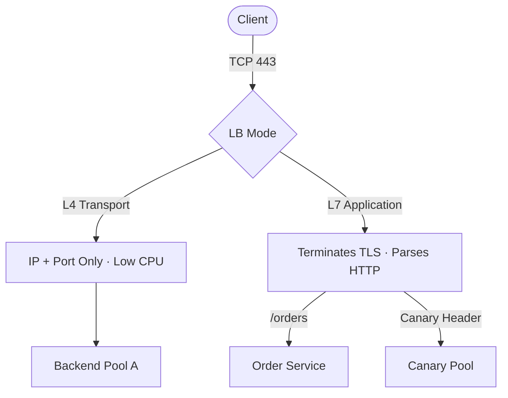

# Load Balancing
## L4 vs. L7 routing, slow-node traps, and graceful draining

StackShade · System Design · Module 01 (`EP08`)

<!-- note: Motivate why load balancing is far more subtle than picking a random server. -->

---

# 1. Two Classic Load-Balancer Failures

Scale from `1` server to `6` servers—and hit two surprises:

<!-- step -->
- **Incident 1:** One server slows to `800 ms`; **Round-Robin** keeps feeding it `1/6` of traffic until its queue explodes
<!-- step -->
- **Incident 2:** Rolling deploys trigger brief **`502 Bad Gateway`** bursts even when new containers are healthy

<!-- note: Ask learners what went wrong in both cases before unpacking algorithms and draining. -->

---

# 2. Layer 4 vs. Layer 7 Routing

<!-- note: L4 cannot read HTTP paths or headers; L7 pays TLS + parsing CPU for intelligent routing. -->

---

# 3. The HTTP/2 & gRPC L4 Trap

Why does **L4 balancing** break internal **HTTP/2 / gRPC** autoscaling?

<!-- step -->
- Client opens **1 long-lived TCP connection** and multiplexes `1,000` RPCs on it
<!-- step -->
- L4 balancer only distributes *new TCP handshakes*
<!-- step -->
- Scale pods `2 → 20`? Existing clients stay pinned to the old `2` pods!
<!-- step -->
- **Fix:** Use **L7 load balancing** (e.g., Envoy) or client-side L7 balancing

<!-- note: This is one of the most common real-world Kubernetes/gRPC scaling pitfalls. -->

---

# 4. Routing Policies Compared

<!-- step -->
- **Round-Robin:** Equal turns (`0, 1, 2...`); assumes identical nodes & uniform requests
<!-- step -->
- **Weighted Round-Robin:** Explicit capacity ratios for mixed instance sizes
<!-- step -->
- **Least-Connections:** Routes to fewest active in-flight requests—**naturally starves slow nodes**
<!-- step -->
- **P2C + Peak EWMA:** Pick `2` random nodes, choose lower active/latency—scales to `1,000+` backends

<!-- note: Highlight Power of Two Choices (P2C) used by Envoy and Linkerd to avoid O(N) scans and herd effects. -->

---

# 5. Worked Math: Round-Robin vs. Least-Connections

`4` servers (`S1–S4`), **`1,000 QPS`**, `25`-slot worker pool (`S1–S3` at `10 ms`; **`S4` throttled to `200 ms`, max `125 QPS`**):

<!-- step -->
- **Round-Robin:** Sends `250 QPS` to `S4` → queue grows `+125/s` → `25` slots fill in **`0.2 s`** → **`25%` of all users fail!**
<!-- step -->
- **Least-Connections:** `S1–S3` hold `~3.3` active reqs at `328 QPS`; `S4` hits `3` active reqs at just **`15 QPS`** (`1.5%` traffic)

<!-- note: Walk through Little's Law L = lambda * W on S4 to make the queue pileup concrete. -->

---

# 6. Interactive Load-Balancer Simulator

<!-- anim: sim-load-balancer -->

Switch between **`Round-Robin`**, **`Least-Connections`**, and **`Weighted`**, then **Inject Slow Node** to watch queues build or drain.

<!-- note: Demonstrate how Least-Connections keeps overall p99 flat while Round-Robin turns 25% of bars red. -->

---

# 7. Active vs. Passive Health Checks

<!-- step -->
- **Active (`/readyz`):** LB polls every `5–10 s`; keep lightweight (don't hammer DB on every health ping!)
<!-- step -->
- **Passive (Outlier Ejection):** Watch real user responses; eject backend for `30 s` after consecutive `5xx`/timeouts
<!-- step -->
- Separate **`/livez`** (restart dead process) from **`/readyz`** (stop sending LB traffic during startup/overload)

<!-- note: Warn against putting "SELECT 1" DB checks in /livez, which causes cascading pod restarts during brief DB blips. -->

---

# 8. Zero-Downtime Graceful Draining

How to eliminate deploy `502`s:

<!-- step -->
1. Mark pod **unready / deregister** from LB target group
<!-- step -->
2. Wait **`5–15 s`** (`preStop` hook) for LB/endpoints propagation
<!-- step -->
3. Stop new connections, send `Connection: close` / HTTP/2 `GOAWAY`
<!-- step -->
4. Let in-flight requests finish before `SIGTERM` → `SIGKILL`

<!-- note: Explain why deregistration and SIGTERM race without a preStop propagation wait. -->

---

# 9. Trade-Offs & 100× Scaling

| Choice | Benefit | Risk |
|---|---|---|
| **L4 LB** | Ultra-low latency/CPU | Pins HTTP/2 streams |
| **L7 LB** | Per-RPC HTTP/2 routing | Higher CPU; TLS termination |
| **Sticky Cookies** | Supports legacy local state | Hot-node skew; lost on deploy |

- **100× Scale:** Scale L4 horizontally with **Anycast + ECMP** (`Maglev/Katran`) in front of stateless **L7 Envoy** tiers

<!-- note: Mention Direct Server Return (DSR) for asymmetric high-egress media workloads. -->

---

# 10. Exercise & Retrieval Recap

**Exercise:** Draft `/livez`, `/readyz`, and a 4-step drain timeline for a `12`-pod service

<!-- step -->
1. Why does L4 balancing skew HTTP/2 gRPC pods after scale-out?
<!-- step -->
2. Why does Least-Connections automatically back off from a slow node?
<!-- step -->
3. How do active and passive health checks complement each other?

<!-- note: Next up: Lesson 09 covers REST, gRPC, GraphQL, SSE, WebSockets, pagination, and idempotency keys. -->
