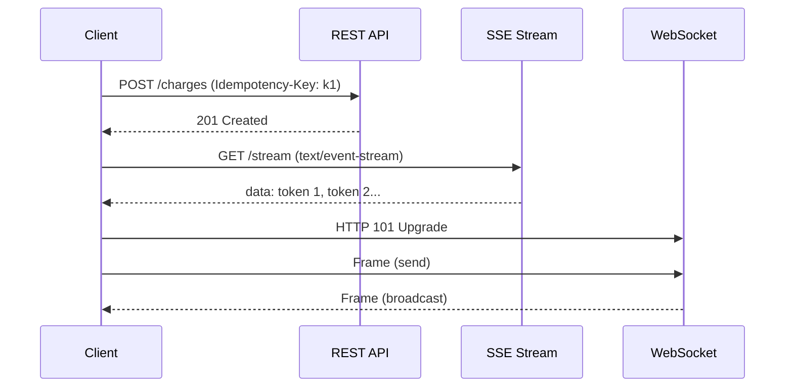

# API Design & Contracts
## Communication styles, cursor pagination, and idempotent retries

StackShade · System Design · Module 01 (`EP09`)

<!-- note: Close Module 01 by showing how application contracts survive flaky networks, evolving schemas, and real-time updates. -->

---

# 1. Two Classic API Failures

<!-- step -->
- **Double Charge:** Server debits `$49`, TCP packet carrying `201 Created` drops on 4G, client retries → user pays **`$98`**
<!-- step -->
- **Polling Storm:** `200,000` users poll `GET /orders/123` every `1 s` → **`200,000 QPS`** of empty checks

<!-- note: APIs aren't just JSON shapes—they define behavior under retries, scale, and live updates. -->

---

# 2. Choosing the Communication Style

| Pattern | Transport | Best Fit |
|---|---|---|
| **REST + JSON** | HTTP | Public APIs, CDN cacheability |
| **gRPC + Protobuf** | HTTP/2 binary | Internal high-QPS RPCs |
| **GraphQL** | HTTP | Multi-entity mobile/BFF views |
| **SSE** | HTTP 1-way | LLM token streams, live feeds |
| **WebSockets** | Full-duplex | Chat, multiplayer, live cursors |
| **Webhooks** | Async `POST` | Server-to-server event callbacks |

<!-- note: Highlight SSE vs WebSockets: pick SSE whenever only the server pushes updates. -->

---

# 3. Sync vs. Streaming Connection Flow

<!-- note: Contrast discrete request/response against 1-way SSE and 2-way WebSocket frames. -->

---

# 4. Worked Numbers: JSON vs. Protobuf

Internal service returning `20` items at **`10,000 QPS`**:

<!-- step -->
- **REST JSON:** `~2,400 B` × `10,000` = **`24 MB/s` (`192 Mbps`)**
<!-- step -->
- **gRPC Protobuf:** `~720 B` × `10,000` = **`7.2 MB/s` (`57.6 Mbps`)**
<!-- step -->
- **`~3.3×` smaller wire payload** + `3–5×` lower serialization CPU

<!-- note: Emphasize that public APIs still prefer REST/JSON for developer ergonomics; gRPC shines service-to-service. -->

---

# 5. Pagination: Offset vs. Cursor

`GET /orders?limit=20&offset=100000` on `10M` rows:

<!-- step -->
- **Offset (`OFFSET 100000`):** Scans & discards `100,000` rows (**`O(N)`**); new inserts cause **duplicate items** across pages!
<!-- step -->
- **Cursor (`WHERE (created_at, id) < (...)`):** Direct B-Tree seek (**`O(log N)`**); **stable** under concurrent writes

<!-- note: Warn that offset pagination degrades smoothly in dev with 50 rows and explodes in prod with 10M rows. -->

---

# 6. How `Idempotency-Key` Stops Double Charges

Client generates UUID `Idempotency-Key` **once per checkout intent**:

<!-- step -->
- **New key:** Acquire lock → debit once → save `(key, payload_hash, 201, body)` → return `201`
<!-- step -->
- **Same key + same payload:** Replay stored `201` immediately (**no second debit!**)
<!-- step -->
- **Same key + different payload:** Reject **`422 Unprocessable`** (client key-reuse bug)
<!-- step -->
- **Same key in flight:** Return **`409 Conflict`** + `Retry-After`

<!-- note: Walk through all 4 states cleanly; learners will implement this exact state machine in Lab 03. -->

---

# 7. Interactive Idempotency Retry Demo

<!-- anim: anim-idempotency-retry -->

Drop the `201 Created` response packet and toggle **`Idempotency-Key` OFF vs. ON** to compare double-billing against safe replay.

<!-- note: Point out that HTTP POST is NOT idempotent by default—you must build it explicitly. -->

---

# 8. Backward-Compatible Schema Evolution

Never break older mobile clients already in app stores:

<!-- step -->
- Make **additive** changes only (optional fields, new endpoints)
<!-- step -->
- **Never** rename fields, reuse Protobuf field numbers, or tighten required inputs in place
<!-- step -->
- Use explicit versions (`/v1/`), `Deprecation` / `Sunset` headers, and usage telemetry before removal

<!-- note: Remind learners that mobile users can take months to update apps. -->

---

# 9. Trade-Offs & 10×/100× Scale

| Choice | Benefit | Risk |
|---|---|---|
| **GraphQL** | Exact fields in 1 hop | N+1 resolvers & hard HTTP caching |
| **WebSockets** | Full-duplex push | Stateful connections complicate deploys |
| **Offset Paging** | Jump to Page 7 | `O(N)` scans & duplicate drift |

- **100× Scale:** TTL-expire idempotency keys (`24–72 h`), split stateful WS tiers from stateless REST, sign webhooks with HMAC + timestamps

<!-- note: Tie back to Module 02: API contracts define how clients interact with the storage layer we design next. -->

---

# 10. Lab & Retrieval Recap

**Hands-on Lab:** [Lab 03 · Building an Idempotent Payment API](../labs/03-api-idempotency.md)

<!-- step -->
1. Why must the server hash the request body alongside `Idempotency-Key`?
<!-- step -->
2. Why does `OFFSET` pagination produce duplicate items in live feeds?
<!-- step -->
3. When is **SSE** a simpler choice than **WebSockets**?

<!-- note: Next module starts Lesson 10: Data Models & Database Selection. -->
