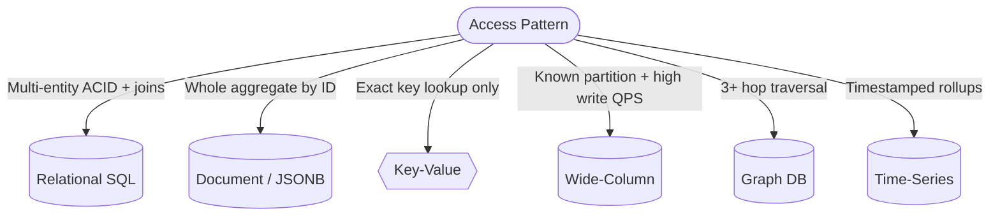

# 10 · Data Models & Database Selection
## Match access patterns to storage layout before picking a brand

StackShade · System Design · Module 02

<!-- note: Welcome to Module 02. Today we break the habit of picking databases by hype and start from query shapes and consistency boundaries. -->

---

# 1. The Problem: One Size Breaks Everything

Imagine one marketplace product with three workloads:

<!-- step -->
- **Checkouts:** Multi-item orders + wallet debits (must never double-spend)
<!-- step -->
- **Catalog Pages:** 40,000 reads/s of varied specs (shoes vs laptops)
<!-- step -->
- **Warehouse IoT:** 20,000 sensor readings/s every 5 seconds

<!-- note: Ask learners what breaks if you put all three in MongoDB or all three in an unpartitioned SQL table. -->

---

# 2. Mental Model: Filing Cabinets vs Coat Checks

<!-- step -->
- **Relational (SQL):** Cross-referenced normalized cabinets (strongest invariants)
<!-- step -->
- **Document:** Whole JSON folder fetched & replaced by ID
<!-- step -->
- **Key-Value:** Coat-check ticket (`O(1)` lookup, opaque bytes)
<!-- step -->
- **Wide-Column:** Sorted ledger keyed by `(partition_key, clustering_key)`
<!-- step -->
- **Graph / Time-Series / Vector:** Adjacency pointers / compressed time rollups / ANN embeddings

<!-- note: Define impedance mismatch (object tree in RAM vs flat rows on disk) and polyglot persistence. -->

---

# 3. Decision Flow by Access Pattern

<!-- note: Emphasize that one question drives the tree: how is data written and read? -->

---

# 4. Relational vs Document

| Dimension | Relational (SQL) | Document (JSON/BSON) |
|---|---|---|
| **Strength** | Cross-table ACID + ad-hoc joins | Single-read whole aggregate |
| **Weakness** | Sparse/variable schemas | Rewrites whole doc on tiny edit |
| **Fails When** | Single writer saturates | Many-to-many joins proliferate |

<!-- note: Mention PostgreSQL JSONB as a bridge that avoids premature polyglot complexity. -->

---

# 5. Wide-Column & Query-First Modeling

Wide-Column keys look like `PRIMARY KEY ((device_id), ts DESC)`:

<!-- step -->
- **Rule:** Design **one table per query** around its exact `partition_key`.
<!-- step -->
- **Fast:** Reading last 100 events for `device_id = 42` hits **1 shard**.
<!-- step -->
- **Trap:** Querying by `firmware_version` without a partition key triggers a full cluster scatter-gather!

<!-- note: Contrast SQL "model the entities, index later" with Cassandra/DynamoDB "model the queries first". -->

---

# 6. Specialized Models: Graph, Time-Series, Vector

<!-- step -->
- **Graph:** Index-free adjacency (`O(degree)` per hop); watch out for celebrity **supernodes**
<!-- step -->
- **Time-Series:** Gorilla/delta compression shrinks `120 B` -> `~20 B/point` (`6×` smaller)
<!-- step -->
- **Vector:** Approximate nearest neighbors (`HNSW` / `IVF`) for semantic similarity

<!-- note: Remind learners that HNSW graphs live largely in RAM (~1.5-2x raw float vector bytes). -->

---

# 7. Interactive Access Pattern Explorer

<!-- anim: anim-schema-access-patterns -->

Compare **Normalized SQL Join**, **Denormalized Document Read**, and **Wide-Column Partition Read** side by side.

<!-- note: Step through the animation to highlight round-trips and byte amplification per pattern. -->

---

# 8. Worked Numbers: 10M DAU Marketplace

<!-- step -->
- **Checkouts (Relational):** `2,000 writes/s × 450 B = 900 KB/s` (needs multi-row ACID)
<!-- step -->
- **Catalog (JSONB/Doc):** `40,000 reads/s × 4 KB = 160 MB/s` (20:1 read-heavy)
<!-- step -->
- **IoT Sensors (Time-Series):** `20,000 writes/s × 120 B = 207 GB/day` raw -> `~35 GB/day` compressed

<!-- note: Highlight explicit units: KB/s, MB/s, decimal GB/day. -->

---

# 9. Scaling from 1× to 100×

<!-- step -->
- **1× (Startup):** Put everything in **one Relational DB** (`JSONB` + partitioned tables).
<!-- step -->
- **10×:** Peel high-churn telemetry into Time-Series/Wide-Column; add read replicas.
<!-- step -->
- **100×:** Shard relational tenants or sync derived stores asynchronously via **CDC**.

<!-- note: Warn against introducing 4 databases on day one before operational maturity exists. -->

---

# 10. Recap & Exercise

**Audit an app you use daily (4 entities):**
1. Estimate record size (`bytes`) and peak `QPS`.
2. Name the top 2 query predicates.
3. Pick a data model and state **one** requirement change that would break it.

**Lesson:** [10 · Data Models](../lessons/10-data-models.md) · **Next:** [11 · Storage Engines](11-storage-engines.md)

<!-- note: Wrap up and preview Lesson 11 on B+Trees vs LSM-Trees under the hood. -->
