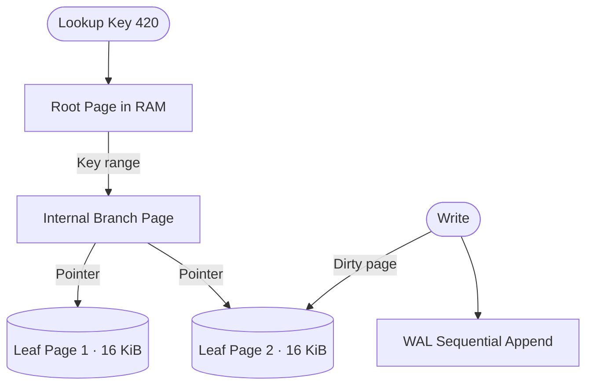
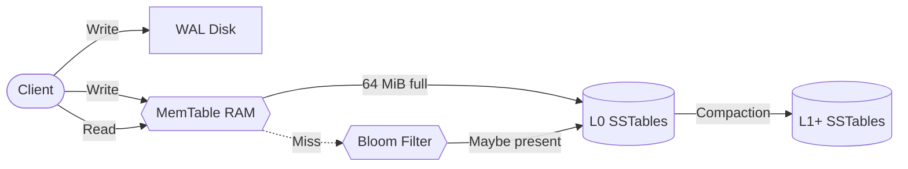

# 11 · Storage Engines: B+Trees vs LSM-Trees
## Why write latency collapses at 2 billion rows

StackShade · System Design · Module 02

<!-- note: Start with the 2B-row UUID write-cliff puzzle: why did writes get 45x slower just because the dataset grew? -->

---

# 1. The Problem: The Random-Write I/O Wall

80,000 events/s keyed by random `UUIDv4` into a B+Tree table:

<!-- step -->
- **At 10M rows:** Indexes fit in RAM -> `1 ms` writes.
<!-- step -->
- **At 2B rows (400 GiB > 64 GiB RAM):** Every insert touches a cold random disk page!
<!-- step -->
- **Result:** Disk IOPS hit 100%, write latency jumps **45×**, throughput craters.

<!-- note: Explain that SQL vs NoSQL is only the API; disk layout determines I/O behavior. -->

---

# 2. Mental Model: Update-in-Place vs Append-Only

<!-- step -->
- **B+Tree:** Rewrite fixed `8–16 KiB` binders in place on the shelf; split full binders in two.
<!-- step -->
- **LSM-Tree:** Scribble onto a fast RAM notepad (**MemTable**) + sequential **WAL**; dump sorted booklets (**SSTables**) and merge later (**Compaction**).

<!-- note: Emphasize WAL durability: fsync to append-only log before returning 200 OK. -->

---

# 3. B+Tree Under the Hood

<!-- note: Explain 3-level height math: 500 fanout -> 500^3 = 125M keys in just 3 hops (1 cold disk read). -->

---

# 4. LSM-Tree Write & Read Path

<!-- note: Reference diagrams/lsm-write-read-path.mmd. Highlight that L0 SSTables have overlapping key ranges! -->

---

# 5. Bloom Filters & Tombstones

<!-- step -->
- **Bloom Filter:** Compact RAM bitset (`10 bits/key` -> `~1%` false positive, **0% false negative**).
<!-- step -->
- **Skips missing keys:** `99%` of negative SSTable disk reads vanish.
<!-- step -->
- **Tombstones:** Deletes append a marker; range scans stall until compaction purges them.

<!-- note: Clarify that point Bloom filters do NOT speed up open-ended range scans (need prefix Bloom filters or Leveled compaction). -->

---

# 6. Compaction Strategies Compared

| Strategy | Write Amp | Space Amp | Read Amp | Fails When |
|---|---:|---:|---:|---|
| **Size-Tiered (STCS)** | Low (`4–10×`) | **High (up to 2× disk)** | Higher | Disk > 50% full during major merge |
| **Leveled (LCS)** | Higher (`10–30×`) | **Low (~10%)** | Low | Heavy write rate causes **write stall** |

<!-- note: Explain what a write stall is: L0 fills faster than compaction drains it, blocking client writes. -->

---

# 7. Interactive B+Tree vs LSM Simulator

<!-- anim: sim-btree-vs-lsm -->

Insert sequential vs random keys, probe cold reads, and trigger compaction to watch **page splits** vs **SSTable merges**.

<!-- note: Demonstrate inserting 10 keys and triggering compaction live. -->

---

# 8. Worked Math: 100M Keys (10 GB Logical)

<!-- step -->
- **B+Tree (`16 KiB` pages, ~500 fan-out):** `500³ = 125M` keys -> **3 levels**, `1` cold leaf read.
<!-- step -->
- **B+Tree Random Write Amp:** Rewriting `16 KiB` page + WAL full-page image for `100 B` row = **`20×–100×`**.
<!-- step -->
- **LSM Bloom Filter RAM:** `100M × 10 bits = 125 MB` (`~119 MiB`) eliminates 99% of cold misses.

<!-- note: Call out RUM Conjecture: you cannot simultaneously minimize Read, Update, and Memory/Space amplification. -->

---

# 9. Choosing Between Them

<!-- step -->
- **Pick B+Tree when:** Read-heavy OLTP, predictable point/range latency, monotonic keys (`UUIDv7` / `BIGINT`).
<!-- step -->
- **Pick LSM-Tree when:** High sustained random/append write QPS, time-series/logs, SSD wear reduction matters.
<!-- step -->
- **Scale tip:** At 100×, throttle LSM compaction I/O so background merges don't spike `p99` reads.

<!-- note: Remind learners that InnoDB/Postgres = B+Tree; RocksDB/Cassandra/Pebble = LSM-Tree. -->

---

# 10. Retrieval Check

1. Why do `UUIDv4` inserts hurt B+Tree throughput once indexes exceed RAM?
2. How does a Bloom filter speed up LSM point reads, and why can't it accelerate arbitrary range scans?
3. What causes an LSM **write stall**?

**Lesson:** [11 · Storage Engines](../lessons/11-storage-engines.md) · **Next:** [12 · Indexing & Query Plans](12-indexing-query-plans.md)

<!-- note: Pause for learners to answer before moving to Lesson 12. -->
