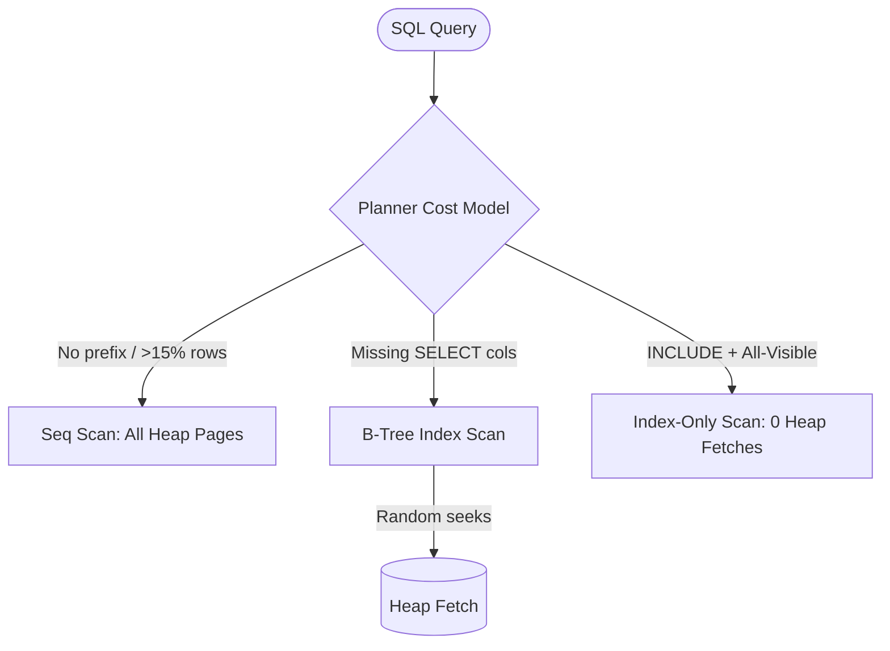

# 12 · Indexing, Query Plans & Schema Design
## Turning 4-second scans into 0.4 ms index-only lookups

StackShade · System Design · Module 02

<!-- note: Open with the 20M-row invoice dashboard story: why adding 3 separate single-column indexes still failed. -->

---

# 1. The Problem: Three Wrong Indexes

Query: `WHERE tenant_id = 8812 AND status = 'overdue' ORDER BY created_at DESC LIMIT 20`

<!-- step -->
- Three separate indexes (`tenant_id`, `status`, `created_at`) force slow bitmap merges or heap sorts.
<!-- step -->
- Write throughput drops **35%** maintaining 3 B-Trees on every insert.
<!-- step -->
- **1 right composite covering index** solves filtering, sorting, and projection in one pass.

<!-- note: Emphasize that indexes are not free—every index adds write amplification and RAM pressure. -->

---

# 2. Mental Model: Textbook Index vs Book Pages

<!-- step -->
- **Clustered Index:** Pages bound in primary-key order (InnoDB stores full rows in PK leaves).
<!-- step -->
- **Secondary Index:** Separate card catalog pointing back to table **heap** pages.
<!-- step -->
- **Composite `(a, b, c)`:** Sorted by `a`, then `b`, then `c` (**Leftmost-Prefix Rule**).
<!-- step -->
- **Covering (`INCLUDE`):** Writes extra `SELECT` columns right onto the index card!

<!-- note: Use the phone book analogy: sorted by (LastName, FirstName)—useless if you only know FirstName. -->

---

# 3. Query Execution Plans Compared



<!-- note: Explain why >10-15% selectivity flips the planner back to Seq Scan (sequential I/O beats random seeks). -->

---

# 4. Composite Index Ordering Rule

Order columns: **Equality -> Sort -> Range**

```sql
CREATE INDEX idx_invoices_cover
  ON invoices (tenant_id, status, created_at DESC)
  INCLUDE (id, total_cents);
```

<!-- step -->
- High-cardinality equality `tenant_id` first narrows the B-Tree immediately.
<!-- step -->
- Putting `created_at DESC` after equalities eliminates the `Sort` node!
<!-- step -->
- `INCLUDE` enables **Index-Only Scan** (once `VACUUM` updates the visibility map).

<!-- note: Mention non-sargable killers: wrapping indexed columns in LOWER(col) or date_trunc(...) or leading %LIKE. -->

---

# 5. Interactive Composite Index Explorer

<!-- anim: anim-composite-index -->

Toggle equality, range, and `ORDER BY` clauses on an `(a, b, c)` index to see exact **prefix hits vs full scans**.

<!-- note: Walk through dropping column 'a' and watching the B-Tree seek fail. -->

---

# 6. Worked Math: 50M-Row `invoices` (10 GB)

<!-- step -->
- **Seq Scan:** Reads `1,250,000 × 8 KiB = 10 GB` -> **`~4,000 ms`**.
<!-- step -->
- **Uncovered Index Scan:** 4-level B-Tree (`0.2 ms`) + 20 random heap pages (`~3–8 ms`).
<!-- step -->
- **Covering Index-Only Scan:** `Heap Fetches: 0` -> 4 RAM index pages (**`~0.4 ms p95`**, **10,000× faster**).

<!-- note: Highlight that at 5,000 QPS, skipping 20 heap fetches saves 100,000 random page reads/sec! -->

---

# 7. Reading `EXPLAIN (ANALYZE, BUFFERS)`

What to look for first:

<!-- step -->
- **`actual rows` vs `rows=` estimate:** Huge gap means stale `ANALYZE` stats -> wrong join plan!
<!-- step -->
- **`Buffers: shared hit / read`:** Multiply pages by `8 KiB` for true I/O footprint.
<!-- step -->
- **`Heap Fetches: 0`:** Confirms visibility map is healthy (`VACUUM`).
<!-- step -->
- **`Sort Method: external merge Disk`:** `work_mem` spilled to disk!

<!-- note: Always test with EXPLAIN (ANALYZE, BUFFERS), never plain EXPLAIN estimates alone. -->

---

# 8. Normalization vs Denormalization & Pagination

| Pattern | Benefit | Risk |
|---|---|---|
| **Normalized + Indexes** | Zero duplicate-update anomalies | Multi-table joins on hot reads |
| **Partial Index** | Tiny index (`WHERE status = 'overdue'`) | Skipped if query omits predicate |
| **Denormalized / Mat. View** | `O(1)` pre-joined read speed | Refresh lag & write fan-out |
| **Keyset Cursor (`id < $1`)** | `O(log N)` even at page 50,000 | No random page jumps (`?page=500`) |

<!-- note: Strongly warn against OFFSET 100000—it scans and discards 100,000 rows on every request. -->

---

# 9. Scaling from 1× to 100×

<!-- step -->
- **1× (1M rows):** Bad indexes hide in OS page cache.
<!-- step -->
- **10× (50M rows):** Indexes exceed `shared_buffers`; wrong prefix order causes sudden I/O cliffs.
<!-- step -->
- **100× (500M+ rows):** Partition tables by time or `tenant_id` so active hot indexes stay in RAM.

<!-- note: Remind learners that partitioning improves index cache locality and vacuum speed. -->

---

# 10. Hands-On Lab & Retrieval

**Run the local PostgreSQL lab:** [Lab 04 · Indexing & `EXPLAIN ANALYZE`](../labs/04-index-and-explain.md)

**Quick recall:**
1. Why does `Index Only Scan` still hit the heap before `VACUUM`?
2. Why does `OFFSET 100000` slow down linearly with page depth?

**Lesson:** [12 · Indexing & Query Plans](../lessons/12-indexing-query-plans.md) · **Next:** [13 · Transactions & Isolation](13-transactions-isolation.md)

<!-- note: Encourage learners to run Lab 04 before moving to Lesson 13. -->
