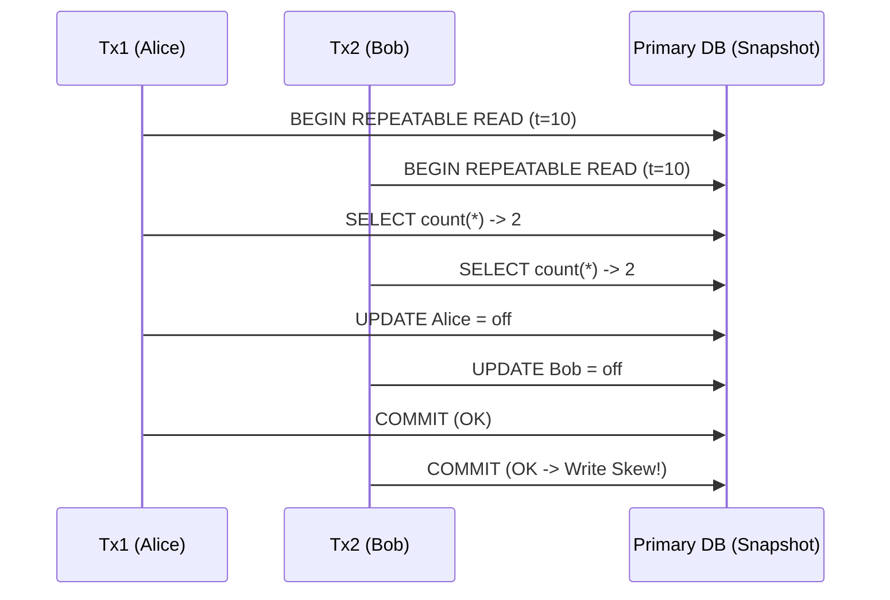

# 13 · Transactions, ACID, MVCC & Isolation
## Why `REPEATABLE READ` still allowed a double-booking bug

StackShade · System Design · Module 02

<!-- note: Hook learners with the hospital shift bug: Alice and Bob both ask for time off concurrently under REPEATABLE READ. -->

---

# 1. The Problem: Zero Doctors on Call

Invariant: **at least 1 doctor must remain on call**.

<!-- step -->
- `Tx1` (Alice) & `Tx2` (Bob) both start `REPEATABLE READ`.
<!-- step -->
- Both run `SELECT count(*) WHERE on_call = true` -> both see **`2`**.
<!-- step -->
- `Tx1` updates Alice's row; `Tx2` updates Bob's row.
<!-- step -->
- **Both commit `200 OK`** -> **0 doctors on call!**

<!-- note: Explain why neither transaction touched the other's row, so row locks never collided. -->

---

# 2. Mental Model: Locks vs Snapshots (MVCC)

<!-- step -->
- **Pessimistic 2PL:** Lock cells before reading/writing; readers block writers.
<!-- step -->
- **MVCC:** Every update writes a new version (`xmin`/`xmax` or Undo Log); readers get a **frozen snapshot**.
<!-- step -->
- **Golden benefit:** Readers **never** block writers, and writers **never** block readers!

<!-- note: Clarify ACID: Atomicity (WAL/undo rollback), Consistency (app+schema invariants), Isolation, Durability (WAL fsync). -->

---

# 3. Write Skew Under Snapshot Isolation

<!-- note: Reference diagrams/mvcc-concurrency-timeline.mmd. Point out both transactions read the same snapshot at t=10. -->

---

# 4. Isolation Levels & Anomalies

| Level | Non-Repeatable | Lost Update | Write Skew |
|---|---|---|---|
| **Read Committed** | Possible | Possible | Possible |
| **Snapshot / Repeatable Read** | Prevented | Prevented (on same row) | **Possible** |
| **Serializable (`SSI` / 2PL)** | Prevented | Prevented | **Prevented** |

<!-- note: Clarify PostgreSQL defaults to Read Committed (fresh snapshot per statement), whereas MySQL InnoDB defaults to locking Repeatable Read. -->

---

# 5. Interactive Isolation Stepper

<!-- anim: anim-isolation-anomalies -->

Step two concurrent transactions through **Read Committed**, **Repeatable Read**, and **Serializable** to watch Lost Updates and Write Skew appear or abort.

<!-- note: Highlight SQLSTATE 40001 serialization_failure retry requirement under SSI. -->

---

# 6. Fixing Lost Updates vs Fixing Write Skew

<!-- step -->
- **Lost Update (same row):** Use atomic SQL (`SET qty = qty - 1 WHERE qty >= 1`) or `version` optimistic locking.
<!-- step -->
- **Write Skew (disjoint rows):**
  1. Lock a shared parent row (`SELECT * FROM shifts WHERE id = 7 FOR UPDATE`), OR
  2. Enforce a DB unique/exclusion constraint, OR
  3. Enable `SERIALIZABLE` (`SSI`) + client retry loop!

<!-- note: Remind learners: never make external HTTP calls (like Stripe) while holding a DB transaction open. -->

---

# 7. Worked Math: 5,000 QPS Inventory Contention

<!-- step -->
- `12 ms` transaction window × `50` hot QPS = `~0.6` overlapping requests constantly.
<!-- step -->
- **Read-modify-write (`Read Committed`):** Silently drops units via Lost Updates!
<!-- step -->
- **Atomic `UPDATE`:** Holds row lock `~1–2 ms` -> zero lost updates up to `~500–1,000/s` per hot row.
<!-- step -->
- **Under `SSI`:** Expect `1–5%` `40001` aborts under contention -> **must** retry with jitter.

<!-- note: Emphasize explicit numbers and why retry loops are mandatory for optimistic/SSI patterns. -->

---

# 8. MVCC's Hidden Cost: Dead Tuples & Bloat

<!-- step -->
- Old row versions cannot be overwritten until **all older snapshots close**.
<!-- step -->
- One forgotten `idle in transaction` session stalls `VACUUM` for hours!
<!-- step -->
- **Guardrail:** Always set `idle_in_transaction_session_timeout` and `statement_timeout`.

<!-- note: Connect back to Lesson 12: table bloat degrades both sequential scans and Index-Only Scans. -->

---

# 9. Scaling from 1× to 100×

<!-- step -->
- **1×:** `Read Committed` + atomic `UPDATE` + `FOR UPDATE` covers 95% of apps.
<!-- step -->
- **10×:** Long analytics snapshots split onto read replicas so primary `VACUUM` stays fast.
<!-- step -->
- **100×:** Single-row flash-sale contention (>1,000/s) splits into `K` inventory sub-buckets or a single-writer queue.

<!-- note: Preview Module 04/05 patterns for scaling beyond single-row locks. -->

---

# 10. Retrieval Check

1. What is the exact difference between a **Lost Update** and **Write Skew**?
2. Why does `SERIALIZABLE` (`SSI`) require an application retry loop?
3. How can one idle open transaction bloat unrelated tables in PostgreSQL?

**Lesson:** [13 · Transactions & Isolation](../lessons/13-transactions-isolation.md) · **Next:** [14 · Object Storage](14-object-storage.md)

<!-- note: Wrap up transactions and transition to binary blob storage. -->
