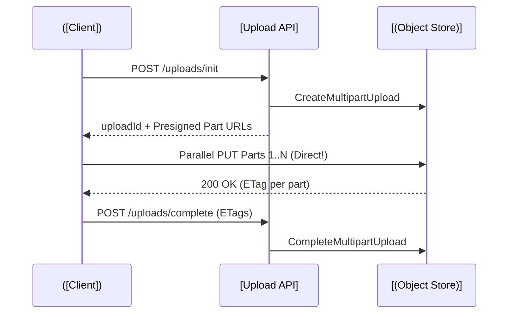

# 14 · Object, Media & Blob Storage
## Never push 2 GiB video bytes through your API server

StackShade · System Design · Module 02

<!-- note: Start with the v1 horror story: proxying 2 GiB uploads through API RAM & storing blobs in Postgres BYTEA. -->

---

# 1. The Problem: Binary Payloads Melt APIs

Proxying 2 GiB screen recordings through your API tier:

<!-- step -->
- **Memory & NIC saturation:** 10 concurrent uploads trigger `502 Bad Gateway` for logins.
<!-- step -->
- **Zero resume:** Wi-Fi drop at 92% restarts the whole 2 GiB transfer from 0%.
<!-- step -->
- **DB bloat:** Multi-TB database snapshots take 9 hours and lock I/O.

<!-- note: Separate two very different jobs: structured metadata vs immutable binary blobs. -->

---

# 2. Mental Model: Control Plane vs Data Plane

<!-- step -->
- **Control Plane (DB):** Tiny structured rows (`asset_id`, `owner_id`, `status`, `sha256`, `object_key`).
<!-- step -->
- **Data Plane (Object Store):** Flat immutable blob warehouse (`bucket/key -> bytes`) over HTTPS.
<!-- step -->
- **Presigned URL:** Short-lived HMAC/SigV4 capability token letting the client talk **directly** to S3/R2/GCS!

<!-- note: Explain why object keys should be opaque UUIDs/hashes, never raw user filenames. -->

---

# 3. Direct Presigned Multipart Flow

<!-- note: Reference diagrams/presigned-multipart-upload.mmd. Zero payload bytes pass through the API server. -->

---

# 4. Anatomy of Multipart Reliability

<!-- step -->
- **Part size rule:** Minimum **`5 MiB`** per non-final part; max **`10,000`** parts per object.
<!-- step -->
- **Parallelism:** 4–6 concurrent chunk `PUT`s saturate client uplink cleanly.
<!-- step -->
- **Resumability:** If part #14 fails, retry **only** part #14 using `ListParts` + cached `ETag`s.
<!-- step -->
- **Orphan trap:** Uncompleted parts bill forever unless `AbortIncompleteMultipartUpload` lifecycle runs!

<!-- note: Emphasize orphan cleanup—one of the most common surprise cloud bill leaks. -->

---

# 5. Interactive Proxy vs Presigned Visualizer

<!-- anim: anim-presigned-upload -->

Toggle **API Proxy** vs **Direct Presigned Multipart** to watch API memory/bandwidth stay flat while parallel chunks stream straight to storage.

<!-- note: Point out how API work drops to two tiny <2 KB JSON calls. -->

---

# 6. Worked Math: 50,000 Videos/Day @ 500 MB

<!-- step -->
- **Daily ingress:** `50,000 × 500 MB = 25 TB/day` (`~750 TB/month` decimal).
<!-- step -->
- **Peak concurrency (Little's Law, 3× peak, 80s upload):** `1.74/s × 80s ≈ 139` parallel streams = **`869 MB/s (~7 Gbps)`**!
<!-- step -->
- **Direct presigned API load:** `~3.5 KB/s` metadata JSON instead of `7 Gbps` binary proxy!
<!-- step -->
- **4 GiB max video @ 16 MiB parts:** `4,096 ÷ 16 = 256 parts` (`<< 10,000` limit).

<!-- note: Highlight both the double bandwidth savings and API RAM savings. -->

---

# 7. Erasure Coding & Storage Tiers

| Tier | Durability | Latency | Best For |
|---|---|---|---|
| **Standard** | 11 nines (multi-AZ erasure) | Milliseconds | Active media & hot assets |
| **Infrequent Access** | 11 nines | Milliseconds | Older uploads + retrieval fee |
| **Archive / Glacier** | 11 nines | Minutes–Hours | Cold masters & compliance backups |

<!-- note: Warn about minimum storage duration charges (e.g., 90 days) and per-GB restore costs on cold tiers. -->

---

# 8. Cache-Busting with Immutable Keys

<!-- step -->
- **Anti-pattern:** Overwriting `avatars/u42.webp` in place leaves stale files on CDNs.
<!-- step -->
- **Pattern:** Write immutable key `avatars/u42-v2.webp` + `Cache-Control: public, max-age=31536000, immutable`.
<!-- step -->
- **Commit:** Atomically flip `avatar_key` in PostgreSQL once upload completes!

<!-- note: Connects Object Storage directly to CDN edge caching from Module 01. -->

---

# 9. Lab 05 & Checkpoint 02

- **Hands-on Lab:** [Lab 05 · Presigned Multipart Uploads](../labs/05-presigned-multipart-upload.md) (MinIO + `boto3`, resume after part 6, inspect orphaned uploads)
- **Module 01–02 Checkpoint:** [Assessment 02 · Storage & APIs](../assessments/checkpoint-02.md)

<!-- note: Encourage learners to complete Lab 05 and Assessment 02 before starting Module 03. -->

---

# 10. Retrieval Check

1. Why must `ExpiresIn` on presigned URLs be kept short, and how do slow clients upload multi-hour files safely?
2. Why does S3 require at least `5 MiB` per non-final multipart chunk?
3. What happens to unfinished multipart chunks without a bucket lifecycle rule?

**Lesson:** [14 · Object Storage](../lessons/14-object-storage.md) · **Next:** [15 · Caching Topologies](15-caching-patterns.md)

<!-- note: Wrap up Module 02 and preview Module 03 (Caching & Stateless Compute). -->
