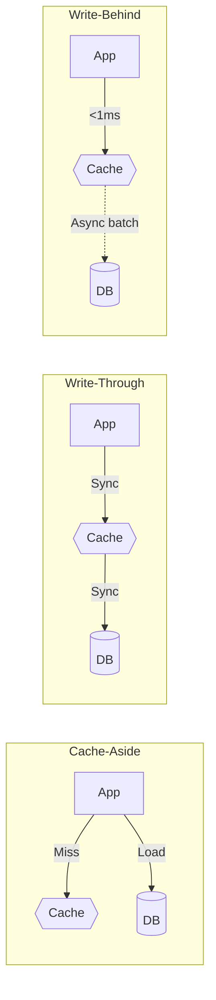

# 15 · Caching Topologies & Write Policies
## Why "just add Redis" breaks pricing pages and counters

StackShade · System Design · Module 03

<!-- note: Welcome to Module 03. Start with the price-mismatch and lost-counter incident. -->

---

# 1. The Problem: Speed vs Truth

30,000 product-page reads/s overwhelm a 16-vCPU database (`2,200` QPS ceiling):

<!-- step -->
- Adding Redis drops DB CPU from **98% to 12%**.
<!-- step -->
- **Bug 1:** Merchant edits price `$199 -> $249`; product page shows `$199` for 15 minutes!
<!-- step -->
- **Bug 2:** Redis restarts overnight and **40,000 view increments vanish** under Write-Behind!

<!-- note: Every caching pattern chooses a different point on latency vs consistency vs durability. -->

---

# 2. Mental Model: Sticky Note vs Filing Cabinet

<!-- step -->
- **Cache-Aside:** App checks desk sticky note; on miss, fetches cabinet & sticks copy on desk.
<!-- step -->
- **Read-Through:** Assistant stands in front of cabinet and loads misses for you.
<!-- step -->
- **Write-Through:** Every edit updates **both** sticky note and cabinet synchronously.
<!-- step -->
- **Write-Behind:** Scribble on sticky note (`<1 ms`), assistant flushes batches later.
<!-- step -->
- **Refresh-Ahead:** Assistant quietly refreshes popular notes at 80% TTL before expiry.

<!-- note: Emphasize Cache-Aside's delete-on-write rule rather than set-on-write. -->

---

# 3. Write Policies Side by Side

<!-- note: Highlight the dashed async arrow on Write-Behind—that is your potential data-loss window on crash! -->

---

# 4. Cache-Aside: Delete, Don't Overwrite

On DB update: `db.update(k, v2)` -> **`cache.delete(k)`**

<!-- step -->
- **Why not `cache.set(k, v2)`?**
<!-- step -->
- Concurrent slow writer (`v1`) can finish `cache.set(v1)` *after* fast writer (`v2`), pinning stale `v1` until TTL!
<!-- step -->
- Deleting keeps DB as source of truth until the next miss.

<!-- note: Preview Lesson 16: even delete has a read-miss stale-set race that needs TTLs or leases. -->

---

# 5. Interactive Topology Simulator

<!-- anim: anim-cache-aside-vs-through -->

Trace read hits, misses, synchronous writes, and a **simulated cache crash during Write-Behind**.

<!-- note: Run the crash scenario in Write-Behind to make the data-loss window visceral. -->

---

# 6. Worked Math: Why 98% vs 80% Hit Ratio Matters

50,000 reads/s · Cache = `0.8 ms` · DB = `15 ms`:

<!-- step -->
- **At `H = 80%`:** `20%` miss = **`10,000` DB reads/s** (`p99 = 15+ ms`).
<!-- step -->
- **At `H = 98%`:** `2%` miss = **`1,000` DB reads/s** (**10× lower DB load!**).
<!-- step -->
- **Average latency drops:** `3.64 ms` -> `1.08 ms`, and `p95` stays `~1 ms`!

<!-- note: Always measure origin miss rate (1 - H), not just hit rate! -->

---

# 7. Write-Behind Coalescing vs Risk

500 writes/s targeting 50 hot view counters (`5s` batch window):

<!-- step -->
- **Write-Through:** `500` DB writes/s at `12.8 ms` sync latency (`0` lost on crash).
<!-- step -->
- **Write-Behind:** Coalesces `2,500` increments into **`50` DB writes / 5s** (`10/s`, **50× fewer writes**)!
<!-- step -->
- **Risk:** Cache crash before flush loses up to `5s × 500 = 2,500` acknowledged writes.

<!-- note: Only use Write-Behind for loss-tolerant counters/telemetry, never balances or orders. -->

---

# 8. Multi-Tier Caching (`L1` + `L2` + `DB`)

| Tier | Location | Typical Latency | Typical TTL |
|---|---|---:|---:|
| **L1** | In-process pod RAM | `~0.01 ms` | `5–30 s` |
| **L2** | Shared Redis cluster | `~0.8 ms` | `1–60 min` |
| **Origin** | Primary / Read Replica | `~10–25 ms` | Source of truth |

<!-- note: L1 shields L2 Redis shards when a hot key exceeds 100k QPS. -->

---

# 9. Failure Modes & Scaling 1× -> 100×

<!-- step -->
- **Cache-Aside fails when:** Cache dies and DB cannot absorb 100% miss traffic.
<!-- step -->
- **Write-Through fails when:** Write-once records pollute cache RAM and evict hot reads.
<!-- step -->
- **100× scale:** Add `L1` per-pod caches + pre-warming before deploys/failovers.

<!-- note: Remind learners: always ask "what happens when the cache is completely empty?" -->

---

# 10. Retrieval Check

1. Why does raising hit ratio from `95%` to `99%` cut origin DB load by **5×**?
2. Why is `cache.delete(k)` safer than `cache.set(k, v)` after updating the DB?
3. Name one safe workload and one unsafe workload for **Write-Behind**.

**Lesson:** [15 · Caching Topologies](../lessons/15-caching-patterns.md) · **Next:** [16 · Eviction & Invalidation](16-eviction-invalidation.md)

<!-- note: Transition to Lesson 16 on how caches pick victims and stay fresh. -->
