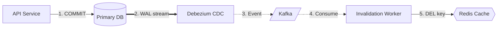

# 16 · Eviction, Expiration & Invalidation
## How one batch job drops cache hit rate from 96% to 54%

StackShade · System Design · Module 03

<!-- note: Start with the 02:00 UTC scan-pollution outage and the stale shipping address bug. -->

---

# 1. The Problem: Full RAM & Stale Reads

<!-- step -->
- **02:00 UTC Scan Pollution:** Batch export reads 500k archived items once -> evicts hot catalog from **LRU** (`96% -> 54%` hit rate!).
<!-- step -->
- **Stale Address:** User updates address, API runs `redis.del(key)`, yet old address stays cached for 55 minutes!

<!-- note: Both failures stem from eviction policy mismatch and concurrency races. -->

---

# 2. Mental Model: Choosing Books to Toss

| Policy | Keeps | Weak Spot |
|---|---|---|
| **FIFO** | Newest insertions | Evicts busy hot items blindly |
| **LRU** | Recently touched | **Scan pollution** wipes working set |
| **LFU** | Highest frequency | Old viral hits linger forever |
| **Window-TinyLFU** | Hot + fresh arrivals | Slightly more metadata (`~8 B/key`) |

<!-- note: Explain how W-TinyLFU uses a 1% Window LRU + Count-Min Sketch admission filter + 99% Segmented LRU. -->

---

# 3. Interactive Eviction Policy Simulator

<!-- anim: sim-eviction-policies -->

Stream a **Zipfian 80/20 workload + sequential scan** across **FIFO**, **LRU**, **LFU**, and **Window-TinyLFU** to compare hit ratios live.

<!-- note: Trigger the sequential scan to show LRU collapsing while LFU/TinyLFU hold steady. -->

---

# 4. The Cache-Aside Stale-Set Race

Even with `UPDATE db` -> `redis.del(key)`:

<!-- step -->
1. **Reader A** misses cache -> queries DB -> gets old **`V1`**.
<!-- step -->
2. **Writer B** updates DB to **`V2`** -> runs `DEL key` (empty!).
<!-- step -->
3. **Reader A** wakes up -> runs `SET key V1 TTL=3600` -> **stale `V1` pinned for 1 hour!**

<!-- note: Trace this step-by-step; this is a classic senior interview question. -->

---

# 5. Stopping Stale Sets: Leases, Versions & CDC

<!-- step -->
- **TTL Jitter:** `base + random(0, jitter)` caps blast radius and avoids mass expiry.
<!-- step -->
- **Monotonic Version Guard:** Lua `SET` rejects writes if `incoming_ver <= cached_ver`.
<!-- step -->
- **Versioned Keys (`item:42:v19`):** New writes bump the key version -> **0 race conditions**!

<!-- note: Immutable versioned keys are the cleanest fix wherever pointers can advance atomically. -->

---

# 6. WAL / CDC-Driven Cache Invalidation

<!-- note: Catches updates from ANY service, cron job, or manual SQL migration, though with ~50-500ms async lag. -->

---

# 7. How Redis Actually Expires Keys

Redis does **not** run a timer per key:

<!-- step -->
- **Lazy check:** Deletes expired key when a client runs `GET`.
<!-- step -->
- **Active sampling:** Every 100 ms (`hz 10`), samples 20 random TTL keys; repeats if `>25%` expired.
<!-- step -->
- **Trap:** Millions of unread expired keys waste RAM until sampled!

<!-- note: Also mention Redis allkeys-lfu packs a 24-bit Morris probabilistic counter + decay timer with zero extra bytes. -->

---

# 8. Worked Math: Sizing a 50M-User Redis Cache

Zipf skew: **10% (5M hot users)** = **90% of reads**:

<!-- step -->
- `400 B` payload + `41 B` key + `~90 B` Redis/jemalloc overhead = **`~531 bytes/entry`**.
<!-- step -->
- `5,000,000 × 531 B = 2.655 GB` (`~2.47 GiB`) raw hot set.
<!-- step -->
- Add `~30%` headroom (fragmentation + fork CoW + buffers) -> **`~4 GiB` cache RAM** + `allkeys-lfu`.

<!-- note: Always include Redis object/jemalloc overhead (~90 bytes) when sizing small keys! -->

---

# 9. Scaling from 1× to 100×

<!-- step -->
- **1× (4 GiB):** `allkeys-lfu` + jittered TTLs + `DEL` on write.
<!-- step -->
- **10× (40 GiB):** Centralize invalidation with **WAL/CDC** (`Debezium -> Kafka`) + versioned keys.
<!-- step -->
- **100× (400+ GiB):** Add **Memcache-style leases** and regional invalidation pipelines.

<!-- note: Remind learners: CDC invalidation has ~100-300ms async lag; handle read-your-own-writes separately if needed. -->

---

# 10. Retrieval Check

1. Why does `allkeys-lfu` survive a 02:00 UTC batch scan better than `allkeys-lru`?
2. Trace the 3-step race where `redis.del()` still leaves stale data in cache.
3. Why does Redis use a 24-bit logarithmic **Morris counter** for LFU?

**Lesson:** [16 · Eviction & Invalidation](../lessons/16-eviction-invalidation.md) · **Next:** [17 · Cache Failure Modes](17-cache-failure-modes.md)

<!-- note: Preview Lesson 17: what happens when keys expire under 10,000 QPS? -->
