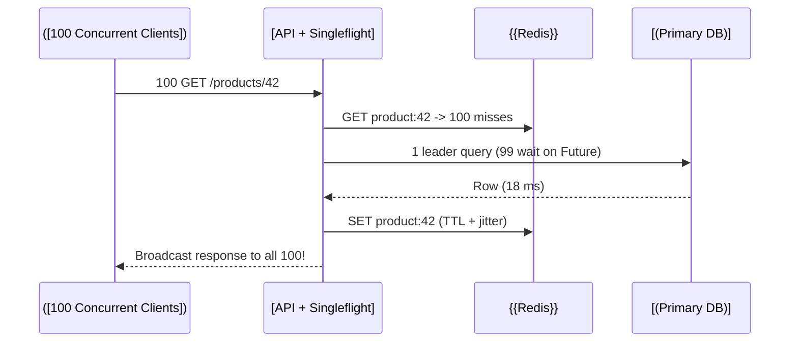

# 17 · Cache Stampedes, Hot Keys & Penetration
## When caching creates a 100× database cliff

StackShade · System Design · Module 03

<!-- note: Start with the flash-sale homepage outage: 12,000 QPS hits 1 expired key for 150ms = 1,800 simultaneous DB queries. -->

---

# 1. The Problem: Four Distinct Cache Outages

<!-- step -->
- **Stampede (Thundering Herd):** *One* hot valid key expires; 1,800 callers rebuild it at once.
<!-- step -->
- **Penetration:** Attackers probe **non-existent keys** (`user:-999`); nothing ever gets cached!
<!-- step -->
- **Avalanche:** *Millions* of keys expire at the exact same second (or Redis restarts cold).
<!-- step -->
- **Hot Key:** *One* valid key (`300k QPS`) melts a single Redis shard even at 100% hit rate!

<!-- note: Emphasize that each failure mode needs a different defense—TTL jitter alone won't stop a hot key or penetration. -->

---

# 2. Singleflight (Request Coalescing)

<!-- note: Reference diagrams/singleflight-coalescing.mmd. Remind learners: per-pod singleflight still allows up to P queries across P pods. -->

---

# 3. Probabilistic Early Expiration (`XFetch`)

Don't wait for hard TTL expiry at `t = expiry`!

<!-- step -->
- Each reader checks: `now - delta * beta * ln(rand()) >= expiry`
<!-- step -->
- Closer to `expiry` (and larger recompute time `delta`), higher probability **one** caller refreshes early.
<!-- step -->
- **Zero follower blocking:** Everyone else reads the still-valid cache entry!

<!-- note: Contrast XFetch (proactive, zero pause) with Singleflight (reactive, followers pause 18-150ms). -->

---

# 4. Stopping Cache Penetration

Why naive negative caching (`SET fake "__NULL__"`) isn't enough:

<!-- step -->
- Random fake-ID flood fills Redis with millions of `__NULL__` keys, **evicting real hot data**!
<!-- step -->
- **Defense 1:** **Bloom Filter** in RAM (`~10 bits/key` = `12.5 MB` for 10M IDs at `1%` FPR).
<!-- step -->
- **Defense 2:** Short-TTL (`30s`) negative cache for repeated misses on the *same* missing ID.

<!-- note: Note Bloom filter limitation: standard Bloom filters don't support deletes cleanly (periodic rebuild or Cuckoo filter). -->

---

# 5. Stopping Hot Keys & Avalanches

<!-- step -->
- **Cache Avalanche:** Add **TTL Jitter** (`base + rand`) + circuit breaker + warm read-only standbys.
<!-- step -->
- **Hot Key (`>100k QPS` on 1 Redis shard):**
  1. **L1 in-process micro-cache** (`1–5s` TTL per API pod), OR
  2. **Salted key replicas** (`hot:42#0..#7`) spread across shards.

<!-- note: Remind learners that Redis executes commands on a single main thread per shard (~80-120k ops/s ceiling). -->

---

# 6. Interactive Stampede Simulator

<!-- anim: sim-cache-stampede -->

Trigger key expiry under **2,000 QPS** and toggle **Singleflight** and **TTL Jitter** to watch DB QPS spike vs stay flat at `1`.

<!-- note: Show both Singleflight ON/OFF and Jitter ON/OFF live. -->

---

# 7. Worked Math: 4,000 QPS & 30 DB Conns

Key `product:42` expires (`150 ms` DB query, `30`-conn pool):

<!-- step -->
- **Unprotected (Little's Law):** `4,000 × 0.15 = 600` concurrent misses -> **570 fail/queue (`503`)**!
<!-- step -->
- **Per-Pod Singleflight (20 pods):** Collapses `600` -> **`20` DB calls** (fits in 30-conn pool).
<!-- step -->
- **Coalescing Proxy or XFetch:** Collapses `600` -> **`1` DB call**!

<!-- note: Show how Little's Law turns a 150ms window into 600 simultaneous DB queries. -->

---

# 8. Failure Mode Matrix

| Failure Mode | Trigger | Primary Defense | Watch Out For |
|---|---|---|---|
| **Stampede** | 1 hot key expires | Singleflight / XFetch | Leader timeout hangs all followers |
| **Penetration** | Fake non-existent IDs | Bloom Filter + Negative TTL | Stale Bloom filter on new signups |
| **Avalanche** | Mass expiry / cold Redis | TTL Jitter + Circuit Breaker | Cold DB overload on restart |
| **Hot Key** | Extreme skew on 1 key | L1 pod cache / Key salting | Short L1 staleness (`1–5s`) |

<!-- note: Emphasize bounded timeouts and `finally:` cleanup inside singleflight maps. -->

---

# 9. Hands-On Lab 06

Run **[Lab 06 · Cache Stampedes, Singleflight & Penetration](../labs/06-cache-stampede.md)**:

<!-- step -->
- Crash a 10-connection semaphore with 150 concurrent misses.
- Fix it to **1 DB query** using `asyncio` `singleflight` (with `try ... finally` cleanup).
- Test TTL jitter on 500 keys + Bloom filter on 200 fake IDs.

<!-- note: Ask learners what happens if the singleflight leader raises an exception without `finally: inflight.pop()`. -->

---

# 10. Retrieval Check

1. Why can negative caching alone make a random-ID penetration attack worse?
2. What is the difference between a **Cache Avalanche** and a **Hot Key** outage?
3. Across 50 API pods, how many DB calls can *per-pod* singleflight still emit on expiry?

**Lesson:** [17 · Cache Failure Modes](../lessons/17-cache-failure-modes.md) · **Next:** [18 · Stateless Concurrency](18-stateless-concurrency.md)

<!-- note: Transition to Lesson 18 on scaling stateless API pods and sizing DB connection pools. -->
