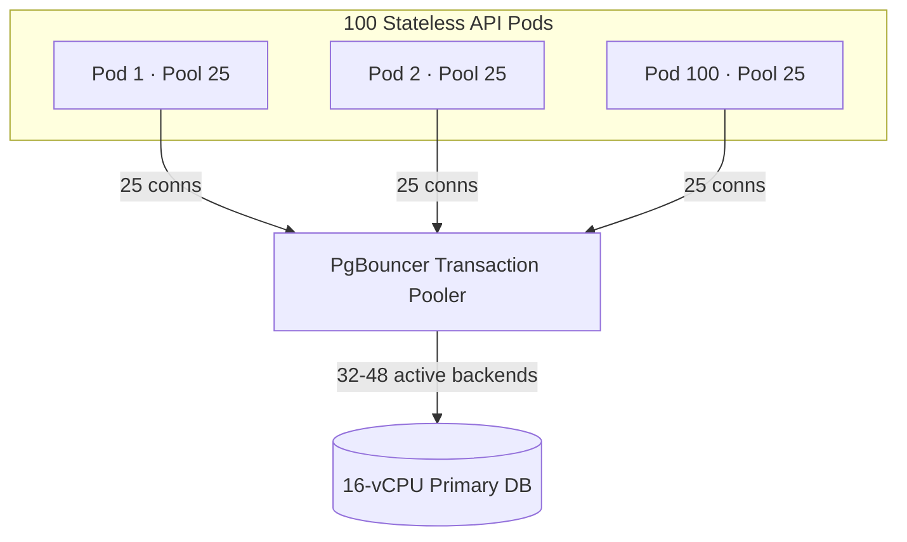

# 18 · Stateless Services, Concurrency & Pools
## Why autoscaling from 10 to 120 pods crashed the database

StackShade · System Design · Module 03

<!-- note: Hook with the launch-day incident: autoscaling compute worked, then 3,600 DB connections killed Postgres. -->

---

# 1. The Problem: Compute Scales, Connections Don't

Autoscale API from **10 -> 120 pods** (`30` DB connections/pod):

<!-- step -->
- `120 × 30 = 3,600` connections hit a 16-vCPU PostgreSQL (`max_connections = 500`).
<!-- step -->
- Bumping `max_connections = 4000` triggers **context-switch & spinlock thrashing** (`4×` slower!).
<!-- step -->
- Meanwhile, pods holding sessions in local RAM log users out on every scale-in!

<!-- note: Two lessons in one: externalize pod state AND multiplex DB connections. -->

---

# 2. Mental Model: Waiters & Stoves

<!-- step -->
- **Stateless Waiters:** Write orders on a shared board (Redis/cookie)—any waiter serves any table.
<!-- step -->
- **Thread-per-Request:** 500 waiters each idle at the grill for 40 ms (`~1–2 MB` stack RAM each).
<!-- step -->
- **Event Loop (`epoll`/`kqueue`):** 1 fast coordinator handles thousands of I/O sockets—unless blocked by CPU!
<!-- step -->
- **PgBouncer:** Queues 2,500 waiter requests cleanly onto **32–48 active stoves**.

<!-- note: Use the kitchen analogy to make OS context switching intuitive. -->

---

# 3. Externalizing Session State

| Approach | Validation Latency | Instant Revocation? | Risk |
|---|---|---|---|
| **Redis Session ID** | `~0.8 ms` network hop | **Yes** (delete key) | Redis outage logs users out |
| **Stateless JWT** | `~0.05 ms` local verify | **No** until `exp` | Stolen long-lived token stays valid |
| **Hybrid (Short JWT + Refresh)** | `~0.05 ms` (`5–15m` TTL) | Within `5–15 min` | Slightly richer auth client flow |

<!-- note: Never store sessions in sticky load-balancer local server RAM in cloud autoscaling groups. -->

---

# 4. Connection Pool Exhaustion & PgBouncer

<!-- note: Explain transaction pooling: client holds a real DB backend ONLY during BEGIN..COMMIT (~5ms), not while idle! -->

---

# 5. The HikariCP Pool Sizing Formula

Optimal active connections are **far smaller** than most devs guess:

<!-- step -->
- Formula: `connections ≈ (core_count × 2) + effective_spindle_count`
<!-- step -->
- **16-core SSD primary:** Optimal active pool is **`~32–64` connections**—not `2,000`!
<!-- step -->
- More active backends than CPU cores only adds **context switching & lock contention**.

<!-- note: Remind learners: each Postgres backend process uses ~5-10 MB RAM plus ProcArray lock overhead. -->

---

# 6. Interactive Thread vs Event Loop Sim

<!-- anim: anim-thread-vs-eventloop -->

Inject **80 ms slow DB I/O** vs **20 ms CPU JSON/bcrypt work** into a Thread Pool and an Event Loop to watch starvation vs loop stalls.

<!-- note: Demonstrate how 1 CPU-heavy handler freezes all I/O on a single-threaded event loop. -->

---

# 7. Worked Math: 10,000 QPS Across 80 Pods

125 QPS/pod · `W = 40 ms` total (`8 ms` inside SQL tx):

<!-- step -->
- **In-flight per pod (`L = λW`):** `125 × 0.04 = 5` concurrent reqs (`~15–25` peak).
<!-- step -->
- **Active DB connections needed:** `10,000 × 0.008 = 80` total (split Primary + Replica).
<!-- step -->
- **Without PgBouncer:** `80 × 20 = 1,600` Postgres backends (`~12.8 GiB` wasted RAM!).
<!-- step -->
- **With PgBouncer:** `5,000` client sockets multiplexed onto **`40` Primary + `40` Replica** backends.

<!-- note: Emphasize setting strict pool acquire timeouts (e.g. 200ms) so requests fail fast under overload. -->

---

# 8. Concurrency Model Trade-Offs

| Model | Best Workload | Failure Mode | Guardrail |
|---|---|---|---|
| **Thread-per-Request** | Mixed CPU + simple blocking libs | Thread pool exhausted by slow I/O | Downstream timeouts + bulkheads |
| **Event Loop** | High-concurrency I/O (`10k+` sockets) | Sync CPU work stalls entire loop | Offload `bcrypt`/PDF/JSON to worker pool |
| **PgBouncer Tx Mode** | Hundreds of pods hitting Postgres | Breaks session `SET`/temp tables | Use `SET LOCAL` inside transactions |

<!-- note: Note Go goroutines / Java virtual threads bridge blocking ergonomics with M:N lightweight scheduling, but still need DB pool caps! -->

---

# 9. Scaling from 1× to 100×

<!-- step -->
- **1× (10 pods):** Direct pools (`5–10` conns/pod) work fine.
<!-- step -->
- **10× (100 pods):** Deploy **PgBouncer** transaction pooling + strict acquire timeouts.
<!-- step -->
- **100× (1,000+ pods):** Per-AZ/sidecar PgBouncer tier + offload CPU tasks + **Module 04 replication & sharding**.

<!-- note: Connect directly to Stage 1 Case Study 01 and Module 04! -->

---

# 10. Stage 1 Project & Next Module

Apply **Modules 00–03** end-to-end in **[Case Study 01 · URL Shortener](../case-studies/01-url-shortener.md)**:
- Capacity sizing, data models & covering indexes, Cache-Aside + Singleflight, and stateless pool sizing.

**Lesson:** [18 · Stateless Concurrency](../lessons/18-stateless-concurrency.md) · **Next:** [19 · Data Replication](../lessons/19-replication.md)

<!-- note: Celebrate finishing Module 03 and Stage 1! -->
