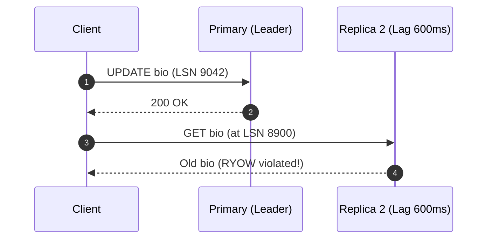

# Data Replication & Lag
## Scale reads and survive node loss without serving ghosts

StackShade · System Design · Module 04

<!-- note: Welcome to Module 04. We move from single-node caching to scaling durable data across machines. -->

---

# The Problem: The Disappearing Profile Edit

A developer updates their bio, receives **200 OK**, hits refresh—and sees the **old bio**.

<!-- step -->
- Refresh #2 shows the **new bio**.
<!-- step -->
- Refresh #3 shows the **old bio** again!
<!-- step -->
- Why? Reads are round-robin balanced across **asynchronous read replicas**.

<!-- note: Start with this concrete bug. Nothing crashed, yet users think your save button is broken. -->

---

# Why Replicate Data?

1. **Read scaling** — spread `18,000 reads/s` across multiple followers
<!-- step -->
2. **High availability** — promote a replica if the primary dies
<!-- step -->
3. **Geographic proximity** — place read copies closer to regional users

<!-- note: Emphasize what replication does NOT fix: write throughput on a single leader. -->

---

# Three Replication Topologies

| Topology | Who Accepts Writes? | Key Challenge |
|---|---|---|
| **Single-Leader** | One Primary; Followers read-only | Lag & failover promotion |
| **Multi-Leader** | Multiple regional Leaders | Concurrent write conflicts |
| **Leaderless (`N,R,W`)** | Any `W` replicas via client/coord | Stale reads if `R+W <= N` |

<!-- note: Compare the three topologies cleanly before diving into mechanisms. -->

---

# Sync vs. Semi-Sync vs. Async

- **Async:** Leader commits immediately; ships WAL later (`1–3 ms`, `RPO > 0`)
<!-- step -->
- **Semi-Sync:** Leader waits for **1** healthy follower flush (`~3 ms`, `RPO = 0` for 1-node loss)
<!-- step -->
- **Full Sync:** Leader waits for **all** followers (1 dead node halts writes!)

<!-- note: Highlight why production HA Postgres/MySQL almost always chooses async or 1-follower semi-sync, never full-sync across all nodes. -->

---

# Replication Lag Anomalies

- **RYOW Violation:** Write to leader, immediately read stale follower.
<!-- step -->
- **Monotonic Read Violation:** Bounce from fast replica (`10 ms` lag) to slow replica (`600 ms` lag).

<!-- note: Walk through the diagram step by step: write hits LSN 9042, read hits Replica 2 at LSN 8900. -->

---

# Interactive Lag Explorer

<!-- anim: anim-replication-lag -->

Toggle **Async**, **Semi-Sync**, and **LSN-Pinned Routing** to watch the stale-read window open and close.

<!-- note: Live demo moment: pause when Replica 2 lags behind LSN 9042 and show how pinning the writer's session fixes RYOW. -->

---

# Three Production Fixes for Lag

1. **Leader-pin own mutations:** Route user's edits/profile reads to Leader for `T = 5 s`
<!-- step -->
2. **LSN / Version tokens:** Client carries `min_lsn = 9042`; skip replicas behind `9042`
<!-- step -->
3. **Replica session affinity:** Hash `user_id` to one replica (fixes monotonic reads)

<!-- note: Remind learners that pinning ALL reads to the leader defeats read scaling—only pin the writer or critical flows. -->

---

# Worked Math: WAL Bandwidth & Sync Penalty

Assume **1,200 peak writes/s**, **1,800 bytes/WAL record**, **3 replicas**:

<!-- step -->
- **WAL stream rate:** `1,200 × 1,800 B = 2.16 MB/s` (`17.3 Mbps`)
<!-- step -->
- **Leader outbound to 3 replicas:** `3 × 2.16 = 6.48 MB/s` (`51.8 Mbps`)
<!-- step -->
- **Intra-AZ semi-sync (`1.2 ms` RTT):** `~2.7 ms` write commit
<!-- step -->
- **Cross-region sync (`75 ms` RTT):** `~76.5 ms` write commit (`>25×` slower!)

<!-- note: Point out how cross-region synchronous commit kills OLTP p95 latency, and how 400 ms lag risks losing ~480 writes on ungraceful crash. -->

---

# Failure Mode: Split-Brain

If a partitioned old leader keeps accepting writes after a follower is promoted, **two leaders diverge silently**.

<!-- step -->
- **Defense:** Quorum consensus (Raft/etcd) + **fencing tokens / STONITH**
<!-- step -->
- **Rule:** Never auto-promote without fencing the old primary

<!-- note: Connect forward to Lesson 29 & 31 where fencing tokens and Raft are covered deeply. -->

---

# At 10× and 100× Scale

- **10× (`12k writes/s`):** Star-topology WAL shipping saturates leader NIC → use **cascading replication** or shared page-log storage.
<!-- step -->
- **100× (`120k writes/s`):** A single leader's CPU and disk `fsync` saturate → **replication can no longer scale writes; shard the data!**

<!-- note: Smooth bridge into Lesson 20 on sharding and consistent hashing. -->

---

# Retrieval Check

1. Why can't adding 10 read replicas scale write throughput?
<!-- step -->
2. How can **monotonic reads** break for a user who never writes?
<!-- step -->
3. Why prefer **semi-sync (1 follower)** over full sync across 3 followers?

**Next:** [20 · Partitioning, Sharding & Consistent Hashing](../lessons/20-sharding-hashing.md)

<!-- note: Pause after each question for learner recall before revealing the answer verbally. -->
