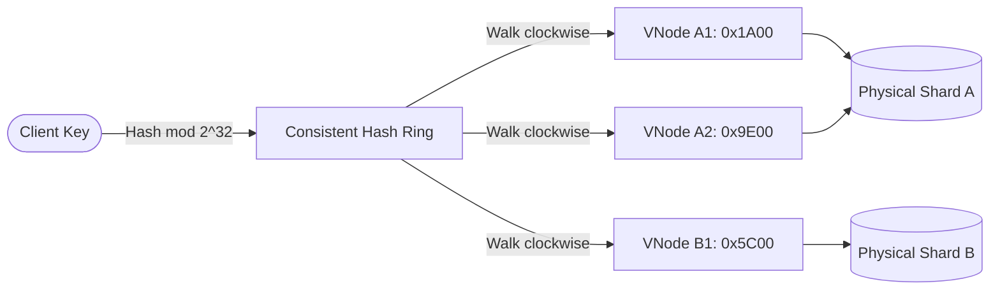

# Partitioning & Sharding
## Split data across machines when one leader hits a wall

StackShade · System Design · Module 04

<!-- note: Lesson 20 tackles horizontal data partitioning and why consistent hashing matters for elastic clusters. -->

---

# The Problem: 14 TB & 65,000 Writes/s

Read replicas can't save a saturated primary:

<!-- step -->
- Every replica still executes **100% of writes**
<!-- step -->
- `2.2 TB` B+Tree indexes spill out of `512 GiB` RAM → NVMe thrashing
<!-- step -->
- Snapshot restore violates a `15-minute` RTO (`6+ hours` for `14 TB`)
<!-- step -->
- **Solution:** Partition keys across `N` independent shards

<!-- note: Ground sharding in three real physical limits: write IOPS, index working-set RAM, and recovery time. -->

---

# Three Partitioning Strategies

| Strategy | Routing Rule | Strength | Weakness |
|---|---|---|---|
| **Range** | `[min, max)` key spans | Fast range scans | Monotonic write hotspots |
| **Modulo Hash** | `hash(k) % N` | Even distribution | `~(N-1)/N` churn on resize |
| **Consistent Hash** | Ring `0..2^32-1` + vnodes | Only `~1/N` keys move | No native range scans |

<!-- note: Emphasize that you rarely shard by date for high-ingest writes because all writes hit today's single partition. -->

---

# Why `hash(k) % N` Fails on Scale-Out

Suppose we store **10M keys (`40 GB`)** across **8 shards** and add **Shard 9**:

<!-- step -->
- Under `hash(k) % 9`, **`~88.9%` (`8.89M` keys / `35.6 GB`)** remap at once!
<!-- step -->
- In a cache cluster, an `89%` miss cliff triggers a **database stampede**
<!-- step -->
- **Consistent Hashing** keeps **`88.9%` in place** and moves only **`~11.1%` (`1/9`)**

<!-- note: Pause on 88.9% vs 11.1%—an 8x reduction in rebalance churn. -->

---

# Consistent Hash Ring & Virtual Nodes

- **VNodes (`100–150` per node):** Smooth out arc skew from `2.5×` down to `< 8%`.
<!-- step -->
- **Replication (`RF = 3`):** Walk clockwise and skip duplicate physical hosts!

<!-- note: Warn learners about the classic bug: placing two replicas on two consecutive vnodes owned by the same physical server. -->

---

# Interactive Ring Explorer

<!-- anim: sim-consistent-hashing -->

Add/remove shards and sweep **Virtual Nodes (`1..100`)** to watch skew flatten and `% keys remapped` stay near `1/N`.

<!-- note: Demo vnodes=1 (huge skew!) vs vnodes=100 (balanced ring), then add a 9th node and inspect remapped percentage. -->

---

# Secondary Indexes Across Shards

Querying `WHERE customer_id = 789` when sharded by `order_id`:

<!-- step -->
- **Local Index:** Fast single-shard writes, **scatter-gather** across all `N` shards on read
<!-- step -->
- **Global Index:** Sharded by `customer_id` → 1-shard read, **async lag or 2PC** on write

<!-- note: Most systems either co-locate related tables on the same shard key (merchant_id) or maintain async global indexes. -->

---

# Worked Math: Scatter-Gather Tail Latency

Suppose single-shard read `p99 = 4 ms` across **32 shards**:

<!-- step -->
- Each shard has `p = 0.01` chance of exceeding `4 ms`
<!-- step -->
- Probability *all 32* stay fast: `(0.99)^32 = 0.725`
<!-- step -->
- Probability **at least 1** hits `p99+`: `1 - 0.725 = 27.5%`!

<!-- note: Over 1 in 4 scatter-gather queries now suffers tail latency! Always include the shard key on hot paths. -->

---

# What Changes at 100× Scale? (`1,000+` Shards)

- `1,000 shards × 150 vnodes = 150,000` ring tokens slows gossip convergence
<!-- step -->
- Production clusters switch to **fixed logical hash slots** (e.g., Redis `16,384` slots)
<!-- step -->
- Co-locate child tables (`orders`, `order_items`) under the same shard key for **single-shard ACID**

<!-- note: Distinguish dynamic random vnode rings from fixed slot tables used by Redis Cluster and DynamoDB. -->

---

# Lab & Retrieval Check

1. Why does `hash(k) % N` cause outages when scaling a cache cluster?
<!-- step -->
2. How do virtual nodes solve uneven load across `8` physical shards?
<!-- step -->
3. What happens to `p99` when a query lacks a shard key across `32` shards?

**Hands-on:** [Lab 07 · Consistent Hashing Ring & Skew](../labs/07-consistent-hashing.md)

<!-- note: Encourage learners to run Lab 07 in Python/Go and compare their measured std-dev across vnodes=1, 10, 150. -->
