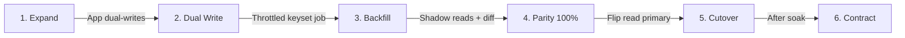

# Hot Partitions & Zero-Downtime Migrations
## Split celebrity load and re-shard live databases safely

StackShade · System Design · Module 04

<!-- note: Even a perfect hash function fails when one single key dominates traffic. And eventually, you will need to re-shard live data. -->

---

# The Problem: Celebrity Drops & Frozen Shards

- `creator_99` launches a flash drop: **48,000 writes/s** + **320,000 reads/s**
<!-- step -->
- Consistent hashing sends 100% of `creator_99` to **Shard 17** (`100%` CPU!)
<!-- step -->
- Meanwhile, Shards `0..63` sit idle at `12%` CPU
<!-- step -->
- Later: changing the shard key on `4 TB` without downtime

<!-- note: Contrast skewed keys (hot partitions) with growing datasets (online resharding). -->

---

# Hot Reads vs. Hot Writes

- **Hot Reads (`320k/s`):** Absorb in CDN, Redis, or in-memory L1 cache + `singleflight`
<!-- step -->
- **Hot Writes (`48k/s`):** Cannot skip durable storage → **Key Salting (`creator_99#0..K-1`)**
<!-- step -->
- **Trade-off:** Salting spreads writes across `K` shards, but forces `K`-way read fan-out

<!-- note: Never default to salting cold keys—only salt hot keys flagged by a rate detector or directory! -->

---

# Interactive Key Salting Explorer

<!-- anim: anim-key-salting -->

Toggle `K = 1`, `K = 8`, and `K = 16` on a Zipf-skewed stream to watch Shard 17 flatten—and inspect read fan-out cost.

<!-- note: Show visually how salting 1 hot key across 16 buckets eliminates the single red spike. -->

---

# Worked Math: Hot-Key Salting & Backfill

- Peak writes on `creator_99`: `48,000/s`; single Postgres shard ceiling: `4,000/s`
<!-- step -->
- Minimum salt `K = 48,000 ÷ 4,000 = 12` → pick **`K = 16`** (`3,000 writes/s` per shard)
<!-- step -->
- **Live backfill (`300M` rows):** `1,500 rows` per `100 ms` = **`15,000 rows/s`**
<!-- step -->
- Duration: `300,000,000 ÷ 15,000 = 20,000 s ≈ 5.56 hours` (throttled!)

<!-- note: Emphasize why unthrottled backfills saturate WAL replication and cause production p95 spikes. -->

---

# Zero-Downtime Expand-Contract Migration

- Never run big-bang maintenance windows or unguarded `OFFSET` scans!

<!-- note: Walk through all 6 stages left-to-right, noting that rollback stays instant up through stage 5. -->

---

# The Backfill Overwrite Race Condition

Suppose backfill runs alongside live dual-writes on **Order 42**:

<!-- step -->
1. `t = 01`: Backfill reads stale `status = "pending"` (`v1`)
<!-- step -->
2. `t = 02`: User pays → Dual-write sets `status = "paid"` (`v2`)
<!-- step -->
3. `t = 03`: Slow backfill writes `"pending"` (`v1`) over `"paid"`!
<!-- step -->
- **Fix:** `ON CONFLICT (id) DO UPDATE ... WHERE new.version < EXCLUDED.version`

<!-- note: This single race condition corrupts data in almost every naive migration. Highlight the version/timestamp guard. -->

---

# Choosing a Migration Strategy

| Approach | Latency Impact | Complexity | Best For |
|---|---|---|---|
| **App Dual-Write + Keyset Backfill** | `+1` write RTT | Medium | Cross-DB re-sharding & schema flips |
| **CDC (`gh-ost` / Debezium)** | Zero user-path impact | Higher ops | Massive single-cluster table alters |
| **Uniform Salting (All Keys)** | `K×` read fan-out | Low | Pure write-only logs (no point reads) |
| **Adaptive Hot-Key Salting** | `1` hop for cold keys | Hot-key detector | Mixed celebrity + normal-tenant SaaS |

<!-- note: Compare operational effort vs user-path latency cleanly. -->

---

# Safe Cutover & Instant Rollback

- Keep **reverse dual-write (`new -> old`)** briefly after read cutover
<!-- step -->
- Gate traffic ramps (`1% → 10% → 50% → 100%`) on shadow-read diff `== 0` and SLO `p95`
<!-- step -->
- Only drop `old` (**Contract**) after the rollback window closes cleanly

<!-- note: Remind learners that deleting the old column/table too early destroys your only fast rollback path. -->

---

# At 10× and 100× Scale

- **10× (`500k writes/s` hot key):** Buffer/aggregate increments in Kafka + Flink `1 s` windows before flushing `1` delta write
<!-- step -->
- **100× (`30B` rows):** Run **parallel range backfill workers** throttled automatically by replica WAL lag and DB CPU

<!-- note: Connect forward to Module 05 streaming aggregation for extreme write hotspots. -->

---

# Lab & Retrieval Check

1. Why use keyset pagination (`WHERE id > last_id`) instead of `OFFSET` during backfill?
<!-- step -->
2. How does a timestamp/version guard prevent stale backfill overwrites?
<!-- step -->
3. Why keep reverse sync active briefly *after* cutting reads to the new shard?

**Hands-on:** [Lab 08 · Zero-Downtime Migration](../labs/08-zero-downtime-migration.md)

<!-- note: Lab 08 lets them actually inject a kill mid-backfill and prove zero mismatches. -->
