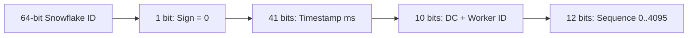

# Distributed ID Generation
## Globally unique, compact, B+Tree-friendly primary keys

StackShade · System Design · Module 04

<!-- note: Final lesson of Module 04: how to generate unique IDs across sharded databases without killing B+Tree performance. -->

---

# The Problem: Random `UUIDv4` Tripled Disk IOPS

Your `messages` table hits **600M rows** across 16 shards using random `UUIDv4`:

<!-- step -->
- Every insert lands on an arbitrary cold B+Tree leaf page
<!-- step -->
- Buffer pool hit rate collapses → random disk page reads + **page splits**
<!-- step -->
- Write `p99` jumps **4×** even though QPS never increased!

<!-- note: Connect directly back to storage engine B+Tree internals from Module 02. -->

---

# Mental Model: Timestamp Filing vs. Blindfolding

- **Time-ordered IDs (Snowflake, UUIDv7, ULID):** Every insert appends to the **rightmost leaf page**, which stays hot in RAM!
<!-- step -->
- **Random UUIDv4:** Every insert runs to a random cabinet across the warehouse, pulling cold pages off NVMe.

<!-- note: Simple visual metaphor explaining why locality dominates disk write amplification once indexes exceed RAM. -->

---

# Interactive B+Tree Locality Visual

<!-- anim: anim-uuid4-vs-uuid7-btree -->

Compare **500 inserts** under **UUIDv4** (scattered page splits) vs. **UUIDv7 / Snowflake** (clean sequential append).

<!-- note: Point out the page-split flash under UUIDv4 vs single hot rightmost leaf under UUIDv7. -->

---

# 64-Bit Snowflake Bit Layout

- `41 bits` ms timestamp = **`69.7 years`** from custom epoch
<!-- step -->
- `10 bits` worker ID = **`1,024` workers**; `12 bits` seq = **`4,096 IDs/ms/worker`**

<!-- note: Mention the JavaScript Number.MAX_SAFE_INTEGER (2^53 - 1) trap: always serialize 64-bit Snowflakes as JSON strings! -->

---

# UUIDv7 (RFC 9562) & ULID

- **UUIDv7:** `[48-bit Unix ms][4-bit ver=7][12-bit rand/seq][2-bit var][62-bit rand]`
<!-- step -->
- **Key win over Snowflake:** **Zero worker-ID coordination** needed!
<!-- step -->
- **Cost:** `128 bits` (`16 bytes`) vs. Snowflake's `64 bits` (`8 bytes`)

<!-- note: Highlight RFC 9562 (standardized 2024): UUIDv7 is now the clean default when 16-byte UUID columns are acceptable. -->

---

# Worked Math: Index Size at 1 Billion Rows

Compare primary key footprint across **`1,000,000,000` rows**:

<!-- step -->
- **64-bit Snowflake (`8 B` raw):** `8 GB` keys → **`~20–24 GB`** B+Tree PK index
<!-- step -->
- **128-bit UUIDv7 (`16 B` raw):** `16 GB` keys → **`~32–36 GB`** PK index
<!-- step -->
- **Naive `VARCHAR(36)` string:** `36 GB` keys → **`~60+ GB`** index (avoid!)
<!-- step -->
- **Throughput:** `1` Snowflake worker emits up to **`4,096,000 IDs/sec`**

<!-- note: Remind learners that in InnoDB/clustered indexes, every secondary index also embeds the primary key! -->

---

# Clock Skew & Range-Sharding Traps

1. **NTP Backward Jump:** If wall clock steps back `5 ms`, a naive generator duplicates IDs!
   - *Fix:* Wait out small drifts (`< 10 ms`), fail closed on big jumps, or use `CLOCK_MONOTONIC`.
<!-- step -->
2. **Range-Sharding Anti-Pattern:** Never range-shard by UUIDv7/Snowflake—100% of writes hit the newest shard. **Hash** the ID (or shard by `tenant_id`).

<!-- note: Crucial distinction: time-ordered IDs give local B+Tree append locality, while hash-sharding on top still spreads writes across shards. -->

---

# Comparison Matrix

| ID Scheme | Size | Coord Needed? | B+Tree Locality | Watch Out For |
|---|---|---|---|---|
| **Hi/Lo DB Sequence** | `8 B` | Central DB | Sequential | Leaks volume; central SPOF |
| **UUIDv4** | `16 B` | None | Poor (random) | Page splits past RAM size |
| **UUIDv7 (RFC 9562)** | `16 B` | None | Sequential | `2×` size; leaks timestamp |
| **Snowflake** | `8 B` | Worker lease | Sequential | Clock skew; JS `53-bit` truncation |

<!-- note: Summarize all four options concisely so learners can pick cleanly in interviews. -->

---

# Retrieval & Checkpoint 03

1. Why does switching `UUIDv4 -> UUIDv7` cut write IOPS at 600M rows?
<!-- step -->
2. Why must Snowflake IDs be sent as strings in browser JSON APIs?
<!-- step -->
3. How do you get sequential B+Tree inserts *without* creating a hot range shard?

**Assessment:** [Checkpoint 03 · Caching, Replication & Sharding](../assessments/checkpoint-03.md)

<!-- note: Direct learners to complete Checkpoint 03 before entering Module 05. -->
