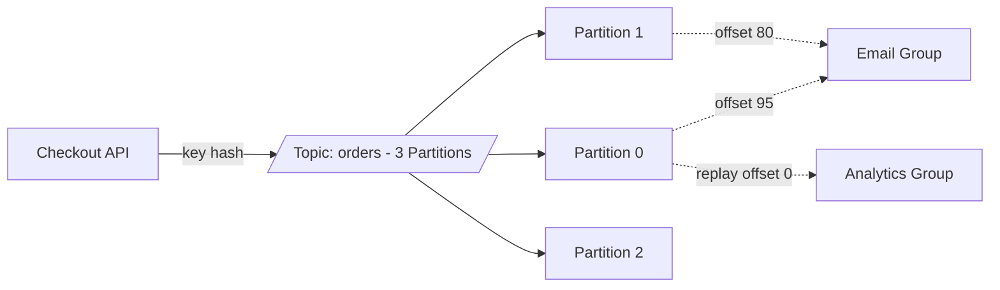

# Message Queues vs. Event Streams
## Task distribution vs. durable, replayable partitioned logs

StackShade · System Design · Module 05

<!-- note: Welcome to Module 05: Asynchronous Systems, Streaming & Search. Start by clarifying the difference between a queue and a log. -->

---

# The Problem: The Deleted Receipt Event

- Checkout pushes `OrderPlaced` to a shared queue; Email worker ACKs and **deletes it**
<!-- step -->
- Analytics & Fraud teams want the same events—and need to **replay Tuesday's data** after a bug
<!-- step -->
- Once a queue deletes an ACKed task, history is gone forever!

<!-- note: Frame the difference cleanly: queues track per-message completion; event streams store an immutable timeline. -->

---

# Mental Model: Support Inbox vs. Ledger Archive

- **Message Queue (SQS / RabbitMQ):** Workers grab tickets, hold a **visibility timeout**, and shred upon `ACK`. Elastic worker scaling, no replay.
<!-- step -->
- **Event Stream (Kafka / Redpanda):** Appends numbered records (`offset 0, 1, 2...`) to **partitions**. Multiple **consumer groups** track independent bookmarks and can rewind anytime.

<!-- note: Emphasize that reading from an event stream does not mutate or delete the stream. -->

---

# Partitioned Log Architecture

- **Per-key ordering:** `partition_key = order_id` keeps all events for an order FIFO.
<!-- step -->
- **Parallelism rule:** At most **1 consumer per partition** inside a consumer group!

<!-- note: Trace how Email Group and Analytics Group read the same partitions at completely independent offsets. -->

---

# Interactive Consumer Group Sim

<!-- anim: sim-consumer-group -->

Add/kill consumers on a 6-partition topic—observe idle pods when `consumers > partitions` and watch lag build on stall.

<!-- note: Great visual moment: spawn an 8th consumer on 6 partitions and show 2 consumers sitting idle. -->

---

# Queue vs. Stream Comparison

| Dimension | Message Queue (SQS/RabbitMQ) | Event Stream (Kafka) |
|---|---|---|
| **Retention** | Deleted on `ACK` | Immutable TTL (`7 days+`) |
| **Subscribers** | Competing consumers (`1×`) | Multi-group fan-out & replay |
| **Ordering** | Best-effort (or limited FIFO) | Strict FIFO *within* partition |
| **Max Workers** | Unlimited (`500+` dynamic) | Capped at **Partition Count `P`** |

<!-- note: Warn against picking Kafka for variable 30-second jobs (like PDF/video rendering) where head-of-line partition blocking hurts. -->

---

# Worked Math: Kafka Bandwidth, Disk & Partitions

Assume **25,000 events/s**, **1,200 bytes/event**, **7-day retention**, **`RF = 3`**, **2 consumer groups**:

<!-- step -->
- **Ingress:** `25,000 × 1,200 B = 30 MB/s` (`240 Mbps`)
<!-- step -->
- **Cluster NIC (ingress + 2× RF + 2× reads):** `5 × 30 = 150 MB/s` (`1.2 Gbps`)
<!-- step -->
- **7-day disk (`RF = 3`):** `30 MB/s × 86,400 × 7 × 3 ≈ 54.4 TB` raw (`~15 TB` w/ Zstd)
<!-- step -->
- **Partitions (`2,000 events/s` per worker):** `25,000 ÷ 2,000 = 12.5` → pick **`P = 32`** for headroom

<!-- note: Point out why you over-provision partition count modestly upfront: resizing partitions later breaks hash(key) % P affinity! -->

---

# Rebalancing Storms

When a consumer misses a heartbeat (`session.timeout.ms`), the group rebalances:

<!-- step -->
- **Eager Rebalance:** Stop-the-world pause across *all* consumers → lag spikes
<!-- step -->
- **Cooperative Sticky Rebalance:** Only moved partitions pause briefly; unaffected partitions keep streaming

<!-- note: Always configure cooperative sticky assignors and tune max.poll.interval.ms so slow batches don't trigger false rebalances. -->

---

# At 10× and 100× Scale

- **10× (`250k events/s`, `544 TB`):** Enable **Zstd producer batch compression** and **tiered storage** (NVMe for tailing, S3 for older segments).
<!-- step -->
- **100× (`2.5M events/s`):** Enforce **Protobuf/Avro Schema Registry** contracts and alert on **Consumer Lag (seconds behind tip)** as a tier-1 SLO.

<!-- note: Bridge to Lesson 24: now that events flow through streams and queues, how do we survive duplicates and poison pills? -->

---

# Retrieval Check

1. Why does scaling to 16 consumers on an 8-partition Kafka topic yield zero speedup?
<!-- step -->
2. When is SQS/RabbitMQ a better fit than Kafka?
<!-- step -->
3. What breaks if you double partition count from `8` to `16` on a stateful `user_id`-keyed stream?

**Next:** [24 · Delivery Semantics, Ordering & Idempotent Consumers](../lessons/24-delivery-semantics.md)

<!-- note: Check understanding of partition-to-consumer exclusivity and key-hash stability. -->
