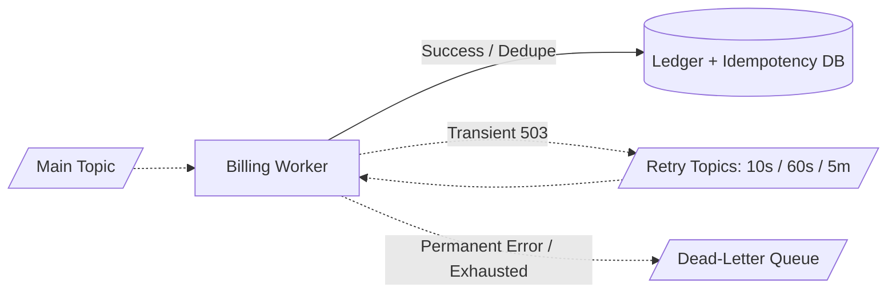

# Delivery Semantics & Idempotency
## Make retries safe and isolate poison pills without halting streams

StackShade · System Design · Module 05

<!-- note: Lesson 24 covers why exactly-once delivery over a network is a myth and how we achieve effectively-once processing in practice. -->

---

# The Problem: Double Credits & Poison-Pill Deadlocks

Two billing failures in one morning:

<!-- step -->
1. Worker credits `$50` to Postgres, crashes **before** `ACK` → restarted worker credits `$50` **again**!
<!-- step -->
2. A malformed message (`amount: null`) crashes the worker in an infinite retry loop → **100,000 valid invoices stall behind it**.

<!-- note: Emphasize that retries solve transient faults, while poison pills need quarantine. -->

---

# Delivery Semantics Matrix

| Guarantee | ACK Timing | Failure Risk | Use Case |
|---|---|---|---|
| **At-Most-Once** | ACK *before* work | Silent data loss | Lossy metrics, non-critical logs |
| **At-Least-Once** | ACK *after* work | Duplicate side effects | Almost all reliable pipelines |
| **Effectively-Once** | At-least-once + **Idempotency** | Needs `event_id` store | Payments, ledgers, state updates |

<!-- note: Clarify that Kafka EOS only spans Kafka->Kafka; once you touch Postgres or Stripe, you MUST build idempotency yourself. -->

---

# Interactive Crash Window Stepper

<!-- anim: anim-delivery-semantics -->

Step through **crash-before-commit**, **crash-between-commit-and-ACK**, and **atomic SQL idempotency** preventing the double-credit.

<!-- note: Pause between DB commit and broker ACK to show why duplicate delivery is inevitable in distributed systems. -->

---

# Atomic Idempotency (One Database!)

**Never** check Redis and write PostgreSQL separately—two stores can diverge on crash!

<!-- step -->
```sql
BEGIN;
  INSERT INTO processed_events (event_id, processed_at)
  VALUES ($1, NOW())
  ON CONFLICT (event_id) DO NOTHING;
  -- If rows_affected == 0: skip update, COMMIT & ACK!
  UPDATE wallets SET balance_cents = balance_cents + $2
  WHERE user_id = $3;
COMMIT;
```

<!-- note: Keep processed_events inside the exact same ACID transaction as the state mutation. -->

---

# Non-Blocking Retry & DLQ Pipeline



- **Permanent errors (`400`, bad JSON):** Straight to **DLQ** on attempt 1!
<!-- step -->
- **Transient errors (`503`, timeout):** Tiered delayed retry topics + jitter, then DLQ.

<!-- note: Warn about the ordering trade-off: retrying order_42 out-of-band lets newer events for order_42 overtake it—guard with monotonic entity_version! -->

---

# Worked Math: Idempotency Table Bloat

Assume **4,000 events/s** (`345.6M/day`), **`0.5%` duplicates**, **`64 bytes`/row**, **30-day retention**:

<!-- step -->
- **Effective deliveries:** `4,000 + 20 dupes + 44 retries = 4,064/s` (`+1.6%`)
<!-- step -->
- **30-day rows:** `345.6M × 30 = 10.37 billion rows`
<!-- step -->
- **30-day storage:** `10.37B × 64 B ≈ 663.5 GB`!
<!-- step -->
- **Ops fix:** Partition `processed_events` **by day** and `DROP TABLE` old partitions instantly.

<!-- note: An unbounded idempotency table will silently destroy SSD IOPS via B+Tree bloat. Always time-partition and bound TTL! -->

---

# Trade-Offs: In-Place Retry vs. Retry Topics

| Approach | Ordering | Head-of-Line Impact | Best For |
|---|---|---|---|
| **In-Place Blocking Retry** | Strict FIFO | 1 slow item freezes partition | Tiny low-rate queues (`< 10/s`) |
| **Non-Blocking Retry + Version Guard** | Monotonic `version` | Healthy keys flow cleanly | High-throughput streams |

<!-- note: Show how version checks (`WHERE version < incoming_version`) give you non-blocking retries without state regression. -->

---

# At 10× and 100× Scale

- **10× (`40k events/s`):** Shard consumer state DB by `partition_key` and use `UUIDv7` `event_id`s for sequential B+Tree inserts.
<!-- step -->
- **100× (`400k events/s`):** Replace heavy `processed_events` tables with **natural idempotency** (`PUT`, `version < N`) or Flink RocksDB TTL state.

<!-- note: Natural idempotency is the cheapest idempotency when your domain allows it. -->

---

# Lab & Retrieval Check

1. Why does putting `processed_events` in Redis alongside a Postgres ledger still risk double-charges?
<!-- step -->
2. How does a non-blocking retry topic cause a state-regression bug, and how do you guard it?
<!-- step -->
3. Why should `processed_events` be time-partitioned?

**Hands-on:** [Lab 09 · Idempotent Consumer & DLQ Worker](../labs/09-idempotent-dlq-worker.md)

<!-- note: Lab 09 implements this entire pipeline in SQLite/Python with fault injection and DLQ replay. -->
