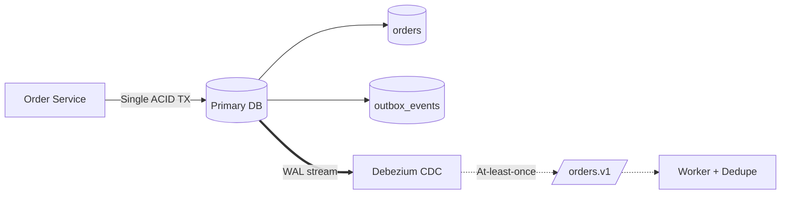

# Outbox, CDC, Sagas & CQRS
## Atomic event publishing and cross-service workflows without 2PC

StackShade · System Design · Module 05

<!-- note: Lesson 25 bridges database transactions and event-driven microservices safely. -->

---

# The Problem: The Dual-Write Split

```python
db.execute("INSERT INTO orders ...")
db.commit()
kafka.send("orders.created", ...)  # <- Pod crashes or times out here!
```

<!-- step -->
- **DB first, Kafka second:** Order saved, event lost → warehouse never ships!
<!-- step -->
- **Kafka first, DB second:** DB rolls back → warehouse ships a phantom order!
<!-- step -->
- Two independent stores cannot be made atomic with a `try/catch`.

<!-- note: Emphasize that dual-writes are one of the most common silent data-corruption bugs in distributed backends. -->

---

# Transactional Outbox + WAL CDC



- Order row + Outbox row commit **atomically in one DB transaction**.
<!-- step -->
- CDC tails the DB WAL and relays events in `10–50 ms` with zero polling load.

<!-- note: Mention the Postgres safety guard: always set max_slot_wal_keep_size so a dead Debezium connector can't fill primary disk! -->

---

# Worked Math: Outbox WAL & Slot Sizing

Assume **3,000 orders/s**, **600 B** order row + **900 B** outbox event:

<!-- step -->
- **Outbox WAL addition:** `3,000 × 900 B = 2.7 MB/s` (`4.5 MB/s` total WAL)
<!-- step -->
- **10-minute Kafka outage WAL retention:** `4.5 MB/s × 600 s = 2.7 GB`
<!-- step -->
- **Outbox cleanup:** `3,000 × 86,400 = 259M rows/day` (`~233 GB/day`!)
<!-- step -->
- **Trick:** Partition `outbox_events` hourly or `DELETE` immediately in the same TX (WAL still captures the `INSERT`!).

<!-- note: The immediate-delete outbox trick surprises many engineers—explain that Debezium reads the WAL commit log, not the live table rows. -->

---

# Sagas: Coordinating Across Services

When a workflow spans **Orders → Inventory → Payment** (3 separate DBs):

<!-- step -->
- No global ACID isolation → use a sequence of **local transactions**
<!-- step -->
- If Step 3 fails, execute **compensating transactions** in reverse (`ReleaseInventory` → `CancelOrder`)
<!-- step -->
- **Pivot Transaction:** Point of no return; steps *after* it must retry forward

<!-- note: Place irreversible external side effects (e.g., sending receipt email) AFTER the pivot transaction. -->

---

# Interactive Saga Compensation

<!-- anim: anim-saga-compensation -->

Run the **Success Path** vs. **Fail Payment** to trace forward execution and reverse compensating rollbacks.

<!-- note: Highlight that compensating transactions are NEW forward transactions—not database rollbacks—and must be idempotent! -->

---

# Choreography vs. Orchestration

| Style | Coordinator | Pros | Cons |
|---|---|---|---|
| **Choreography** | None (pub/sub) | Decoupled for 2 steps | Hidden flow; hard to debug `4+` steps |
| **Orchestration** | Temporal / State Machine | Clear graph, timeouts, retries | Extra control-plane service |

<!-- note: Rule of thumb: Choreography for 2–3 simple decoupled reactions; Orchestration for multi-step checkout/booking flows. -->

---

# CQRS & Event Sourcing (Use Sparingly!)

- **CQRS:** Separate normalized **Write Model** from optimized **Read Projections** (Elasticsearch, Redis) fed via CDC/Outbox.
<!-- step -->
- **Event Sourcing:** Store immutable domain events instead of current state; derive state by folding (+ snapshots).
<!-- step -->
- **Caution:** Event Sourcing brings schema upcasting pain—reserve for ledgers, audit logs, or collaborative history.

<!-- note: Don't confuse CQRS (separate read/write models) with Event Sourcing (storing state as an event log). You can use CQRS without Event Sourcing! -->

---

# At 10× and 100× Scale

- **10× (`30k orders/s`):** Shard the primary DB and run **one CDC connector per shard** feeding partitioned Kafka topics.
<!-- step -->
- **100× (`300k workflows/s`):** Use a partitioned durable **workflow engine** (Temporal / timer wheels) rather than polling Saga DB rows.

<!-- note: Connect back to Lesson 20 sharding: CDC scales horizontally per database shard. -->

---

# Retrieval Check

1. Why does `db.commit()` followed by `kafka.send()` cause silent data loss?
<!-- step -->
2. What Postgres setting prevents a stalled Debezium connector from crashing the primary DB disk?
<!-- step -->
3. Why must every Saga compensating action be **idempotent**?

**Next:** [26 · Full-Text Search, Inverted Indexes & Autocomplete](../lessons/26-search-pipelines.md)

<!-- note: Prompt learners to connect Outbox + Idempotent Consumers (Lesson 24 + 25) into a complete end-to-end reliable pipeline. -->
