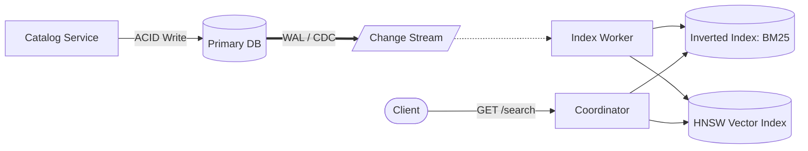

# Full-Text Search & Autocomplete
## Inverted indexes, BM25, hybrid vector search & sub-50ms typeahead

StackShade · System Design · Module 05

<!-- note: Lesson 26 shows why relational databases choke on substring text search and how search + typeahead engines stay fast. -->

---

# The Problem: `ILIKE '%wireless%'` Froze Postgres

- Catalog grows to **12M products**; users expect search + **50 ms** typeahead
<!-- step -->
- B+Tree only accelerates left-anchored prefixes (`'wire%'`), NOT `'%wireless%'`
<!-- step -->
- Full sequential scans hit **`3.8 s p95`**, burning DB CPU without relevance ranking

<!-- note: Contrast B+Tree prefix range lookups against inverted indexes and prefix tries. -->

---

# Mental Model: Index at the Back of a Textbook

- **Table Scan:** Read all 800 pages to find `"quorum"`
<!-- step -->
- **Inverted Index:** Map `term -> sorted posting list of doc IDs` (`"quorum" -> [42, 118, 305]`)
<!-- step -->
- **Prefix Trie (Typeahead):** Path `w -> i -> r -> e` caches **top-5 popular queries** right on the node (`< 1 ms` lookup!)

<!-- note: Keep the intuition concrete: inverted index for full-text search, top-K trie/FST for autocomplete. -->

---

# Async CDC-to-Search Indexing Pipeline

- Never dual-write DB + Elasticsearch synchronously on the write path!

<!-- note: Highlight near-real-time consistency (~1 s Lucene segment refresh + CDC lag) vs zero OLTP coupling. -->

---

# Inside BM25 & Posting List Intersection

1. **Analyzer:** Lowercase → strip punctuation → stopwords → stem (`"Running" -> "run"`)
<!-- step -->
2. **Intersection (`AND`):** Start from the **shortest posting list** and skip-pointer jump (`advance()`)
<!-- step -->
3. **BM25 Ranking:** Balances **IDF rarity**, **saturated term frequency (`k1 = 1.2`)**, and **length normalization (`b = 0.75`)**

<!-- note: Mention why BM25 outperforms raw TF-IDF: repeating "headphones" 50 times in a spam footer saturates quickly. -->

---

# Interactive Search & Trie Explorer

<!-- anim: anim-inverted-index-lookup -->

Watch posting-list intersection (`"noise" ∩ "cancel"`) and compare naive Trie DFS vs. `O(prefix_len)` Top-K lookup.

<!-- note: Demo a 1-character prefix ("s") where DFS visits thousands of leaves vs O(1) node cache read. -->

---

# Sub-50ms Typeahead Architecture

- **Precomputed Top-K Trie / FST:** Build offline every `15–60 min` from weighted query logs
<!-- step -->
- **FST Compression:** Shares both prefixes and suffixes → shrinks RAM `5–10×`
<!-- step -->
- **Edge Protection:** Client `100–150 ms` debounce + CDN cache for `1–3` char prefixes (`"i"`, `"ip"`, `"iph"`)

<!-- note: Caching 1–3 char prefixes at the CDN absorbs a massive share of keystroke QPS! -->

---

# Worked Math: Hybrid Search & Trie Sizing

Assume **12M products (`18 GB` text)** + **768-dim float32 vectors**, **`RF = 2`**:

<!-- step -->
- **Lexical index (`~1.8×`):** `32.4 GB` × 2 = **`64.8 GB`** → fits 4 shards (`32 GiB` RAM each)
<!-- step -->
- **Vector index (`12M × 768 × 4 B`):** `36.9 GB` raw (`~55 GB` HNSW) × 2 = **`110 GB`** → **6–8 shards** (`64 GiB` RAM so HNSW stays in RAM!)
<!-- step -->
- **Autocomplete (`5M` phrases FST + Top-5):** `~1.5–2.5 GiB` RAM per stateless pod (`< 1.5 ms p99`)

<!-- note: Warn that HNSW graph search degrades 10–50x if graphs spill from RAM to SSD! -->

---

# Lexical vs. Vector vs. Hybrid

| Method | Great At | Weak At |
|---|---|---|
| **BM25 (Lexical)** | Exact SKUs (`"ERR-504"`), names | Synonyms (`"ANC"` vs `"noise block"`) |
| **HNSW Vector** | Semantic intent, paraphrases | Exact IDs, rare tokens, filters |
| **Hybrid + RRF** | Best of both rankings | `3–5×` RAM cost + two-stage merge |

<!-- note: Reciprocal Rank Fusion (RRF) merges two ranked lists cleanly without fragile score calibration. -->

---

# At 10× and 100× Scale

- **10× (`120M` docs, `30k` QPS):** Cache top Zipf head queries; route isolated tenants to dedicated shards to prevent scatter-gather.
<!-- step -->
- **100× (`1.2B` docs):** Apply **Scalar (`int8`) / Product Quantization** (`4–16×` smaller vectors) + two-phase rescoring, and shard tries by prefix.

<!-- note: Connect forward to Lesson 39 (AI & RAG retrieval pipelines) where hybrid search returns at massive scale. -->

---

# Lab & Retrieval Check

1. Why do B+Trees fail on `LIKE '%wireless%'`?
<!-- step -->
2. How does storing top-5 results at every Trie node reduce latency?
<!-- step -->
3. Why must HNSW vector indexes stay resident in RAM?

**Hands-on:** [Lab 10 · Inverted Index & Sub-50ms Autocomplete](../labs/10-search-autocomplete.md)

<!-- note: Lab 10 benchmarks both BM25 posting-list search and Top-K Trie latency in Python/Go. -->
