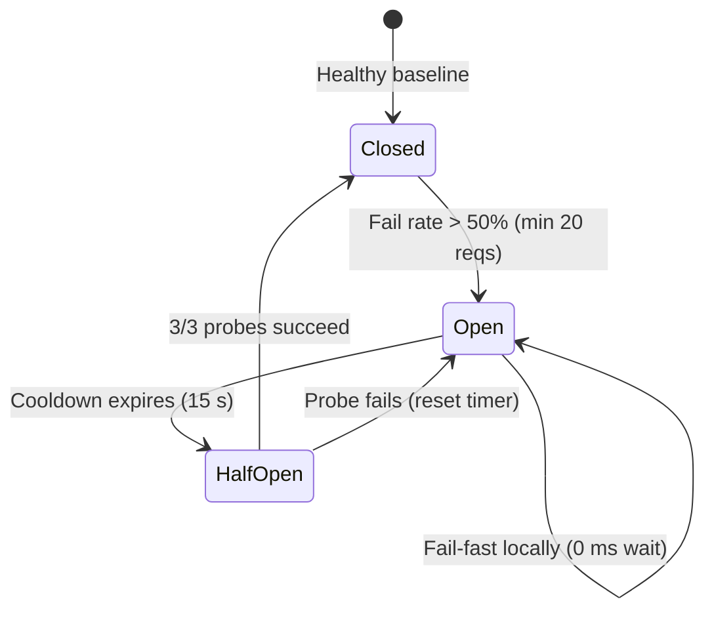

# Partial Failure & Retry Storms
## Keep brief glitches from turning into 45-minute outages

StackShade · System Design · Module 06

<!-- note: Welcome to Module 06. Today we examine why networks fail partially, how retries create metastable outages, and how timeouts, Full Jitter, budgets, and circuit breakers stop cascading collapse. -->

---

# 1. The 10-Second Glitch Problem

Suppose Checkout serves `1,000 req/s` and Payment Ledger stalls for `10 s`:

<!-- step -->
- Ledger latency jumps `25 ms -> 4,500 ms`; capacity drops to `150 req/s`
<!-- step -->
- Clients time out at `2,000 ms` and fire **3 immediate retries**
<!-- step -->
- Offered load explodes `1,000 -> 4,000 req/s`
<!-- step -->
- Lock clears at `t = 10 s`, **yet the outage lasts 45 minutes**

<!-- note: Emphasize metastable failure: the original database lock is gone, but the retry feedback loop pins the dependency above 100% saturation. -->

---

# 2. Mental Model: Highway Toll Plaza

On one machine, functions crash cleanly. Over a network, failure is **partial and slow**.

<!-- step -->
- **Timeouts:** Stop waiting at a broken toll booth forever
<!-- step -->
- **Exponential Backoff:** Wait longer after each rejection
<!-- step -->
- **Full Jitter:** Randomize wakeups so 1,000 cars don't arrive together
<!-- step -->
- **Retry Budget + Circuit Breaker:** Close the on-ramp until backlog drains

<!-- note: Define partial failure and gray failure explicitly—healthy /health endpoints can hide 4.5 s database stalls. -->

---

# 3. Retry Amplification Across Hops

Chain: `Gateway -> Order -> Inventory -> DB` (`500 req/s` baseline)

<!-- step -->
- Suppose **each of 3 hops** retries `3` times on timeout (`4×` per hop)
<!-- step -->
- Worst-case DB load = `4 × 4 × 4 = 64×` (`32,000 req/s`!)
<!-- step -->
- Little's Law (`L = λW`): `2.0 s` stalls tie up `1,000` threads/tier (`100×` surge)

<!-- note: Walk through (1 + R)^H math slowly; stress why retries should happen at only one outermost idempotent layer or under strict budgets. -->

---

# 4. Defense 1: Propagate Deadlines

Don't give a hop a fresh `1,000 ms` timeout when `850 ms` are already spent.

<!-- step -->
- Edge sets `deadline = now + 1,000 ms` (`Grpc-Timeout` / header)
<!-- step -->
- Downstream computes `remaining = deadline - now`
<!-- step -->
- Abort before hitting DB if `remaining < 50 ms`

<!-- note: Mention separate connect timeout (100-300 ms) vs request timeout, and always use CLOCK_MONOTONIC. -->

---

# 5. Defense 2: Exponential Backoff + Full Jitter

Pure exponential backoff (`100, 200, 400 ms`) still synchronizes waves.

<!-- step -->
- **Formula:** `sleep = random(0, min(cap, base * 2^attempt))`
<!-- step -->
- Example (`base = 50 ms, cap = 1,000 ms`): spreads retries flat across `[0, cap]`
<!-- step -->
- **Retry Budget:** Cap retries at `10%` of successful calls (`1.1^3 = 1.33×` max)

<!-- note: Cite Marc Brooker's AWS experiment showing Full Jitter cuts total work and completion time dramatically compared to No Jitter or Equal Jitter. -->

---

# 6. Circuit Breaker State Machine

<!-- note: Point out min_samples=20 so low overnight QPS does not trip on one stray error, and jittered cooldown across pods. -->

---

# 7. Interactive Sim: Retry Storm vs. Circuit Breaker

<!-- anim: sim-retry-jitter-circuit -->

Inject a `10 s` downstream brownout across `1,000` clients and compare **Immediate Retry**, **Full Jitter**, and **Full Jitter + Circuit Breaker**.

<!-- note: Demonstrate how Immediate Retry stays pinned at 100% saturation after t=20s, while Full Jitter + Circuit Breaker recovers within seconds. -->

---

# 8. Split Comparison: Retries vs. Hedging

| Pattern | Benefit | Risk |
|---|---|---|
| **Full Jitter + Budget** | Masks transient blips safely | Requires `Idempotency-Key` on writes |
| **Circuit Breaker** | Saves caller threads in `< 1 ms` | Pod-level state can drift across 500 pods |
| **Hedged Requests** | Cuts `p99` tail via backup call | Adds `5–10%` load; **fatal during overload** |

<!-- note: Warn learners: never enable hedged requests without a strict budget, and turn hedging OFF when error rates rise. -->

---

# 9. Scaling Beyond 100 Pods

- **10× (`5,000 req/s`):** Pair local breakers with adaptive concurrency limits
- **100× (`500` pods):** `500` pods probing `Half-Open` together = mini-stampede
- **Fix:** Add `±30%` jitter to `Open` cooldown + slow-start warm-up at L7 mesh

<!-- note: Briefly contrast client-side breakers vs Envoy outlier detection at L7 proxy layer. -->

---

# 10. Lab & Retrieval Check

**Hands-on:** [Lab 11 · Retry Storms, Jitter & Circuit Breakers](../labs/11-retry-storm-circuit-breaker.md)

<!-- step -->
1. What is the DB amplification across `4` hops with `2` retries each?
<!-- step -->
2. Why does pure exponential backoff without jitter fail during recovery?
<!-- step -->
3. What prerequisite makes retrying `POST /payments` safe?

<!-- note: Recap answers: (1) 3^4 = 81x, (2) synchronized wake-up waves, (3) atomic Idempotency-Key. -->
