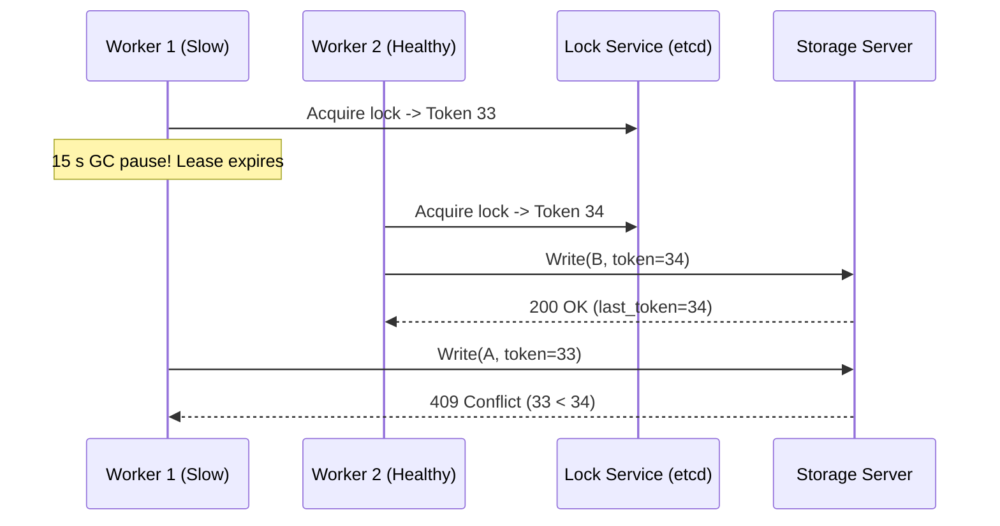

# Time, Clocks & Fencing Tokens
## Why distributed locks lie unless storage checks the token

StackShade · System Design · Module 06

<!-- note: Today we tackle why wall clocks break distributed systems, how logical clocks and TrueTime order events, and why fencing tokens are mandatory for real mutual exclusion. -->

---

# 1. The Ghost Write Incident

Worker A holds a `10 s` Redis lock to compact a billing ledger:

<!-- step -->
- `t = 0.0 s`: Worker A acquires lease (`TTL = 10 s`)
<!-- step -->
- `t = 0.2 s`: Worker A hits a **`15 s` stop-the-world GC pause**
<!-- step -->
- `t = 10.0 s`: Lock expires -> Worker B acquires lock and writes safely
<!-- step -->
- `t = 15.2 s`: Worker A wakes up and **silently overwrites Worker B**

<!-- note: Emphasize that checking local clock before writing is NOT enough because network/OS stalls can happen right after the check. -->

---

# 2. Physical Clocks: Wall vs. Monotonic

| Clock | Behavior | Safe For | Unsafe For |
|---|---|---|---|
| **Wall (`CLOCK_REALTIME`)** | NTP steps forward/backward | Human log timestamps | Timeouts, lock TTLs, latency |
| **Monotonic (`CLOCK_MONOTONIC`)** | Never jumps backward on host | Latency, backoff, leases | Comparing events across nodes |

<!-- note: Highlight NTP leap seconds and VM pause/resume jumps; always measure durations with CLOCK_MONOTONIC. -->

---

# 3. Logical Clocks: Ordering Without Wristwatches

When physical clocks disagree, count **cause-and-effect** (`happens-before: a -> b`):

<!-- step -->
- **Lamport Clock:** `C = max(C, C_msg) + 1` on receive -> `a -> b => C(a) < C(b)`
<!-- step -->
- **Lamport Gap:** `C(a) < C(b)` does **not** prove `a` caused `b` (could be concurrent)
<!-- step -->
- **Vector Clock:** Array `V[1..N]` distinguishes causal order from true conflict (`a || b`)

<!-- note: Connect Vector Clocks back to Dynamo-style conflict detection and note O(N_actors) metadata growth. -->

---

# 4. Google TrueTime (`[earliest, latest]`)

Instead of pretending skew is zero, Spanner exposes uncertainty `ε` (`1–7 ms`):

<!-- step -->
- GPS + atomic clocks in every DC bound error to `±ε`
<!-- step -->
- **Commit Wait:** Wait `2ε` (`~2–14 ms`) after picking `s = TT.now().latest`
<!-- step -->
- Guarantees any causally later transaction gets `s' > s` globally

<!-- note: Show the trade-off: external consistency without central lock bottlenecks, at the price of 2*epsilon latency per write. -->

---

# 5. How Fencing Tokens Fix Stale Locks



<!-- note: Point out that the storage server itself must enforce `token > last_token` atomically. -->

---

# 6. Interactive Sim: Stale Lock Race

<!-- anim: anim-fencing-tokens -->

Trigger a `15 s` GC pause on Worker 1 and toggle **Storage Fencing Check ON/OFF** to watch silent corruption turn into clean `409 Conflict` rejection.

<!-- note: Walk through both toggles so learners see that Redlock or Redis Lua DEL scripts alone never stop stale writes. -->

---

# 7. Enforcing Fencing in Real Databases

8 bytes per row (`last_fencing_token BIGINT`) stops stale writes with zero extra hops:

```sql
UPDATE tenant_ledgers
SET balance_cents = $1, last_fencing_token = $2
WHERE tenant_id = $3 AND last_fencing_token < $2;
```

<!-- step -->
- `rows_affected == 0` -> lease was superseded; abort safely
<!-- step -->
- On S3/Object Stores -> use `If-Match: <etag>` optimistic CAS

<!-- note: Give learners the concrete SQL and S3 patterns they can actually ship in production. -->

---

# 8. Worked Numbers: LWW Skew vs. Commit Wait

- **NTP LWW Risk:** `200 ms` clock skew at `5,000 writes/s` puts `1,000 writes/s` in the silent-overwrite ambiguity window
- **TrueTime Cost:** `ε = 3 ms` -> `2ε = 6 ms` wait caps single hot-row throughput at `~166 tx/s`
- **Fencing Token Overhead:** `8 B/row`, `0` extra RPCs on write path

<!-- note: Emphasize why Last-Write-Wins with wall-clock timestamps drops causally newer writes silently. -->

---

# 9. Trade-Offs & Scale Limits

| Approach | Strength | Weakness |
|---|---|---|
| **Wall-Clock LWW** | Zero coordination | Silent data loss on skew |
| **Vector Clocks** | Exact causal conflict detection | Metadata explodes with client IDs |
| **Fencing Tokens** | Strict safety across GC pauses | Requires linearizable token generator + DB check |

<!-- note: At 100x scale, if external 3rd-party sinks ignore tokens, use Idempotency Keys or single-writer partitioned consumers. -->

---

# 10. Recap & Retrieval Check

<!-- step -->
1. Why must timeouts use `CLOCK_MONOTONIC` instead of `Date.now()`?
<!-- step -->
2. Why doesn't a safe Redis Lua `unlock` script prevent stale-writer corruption?
<!-- step -->
3. How can Amazon S3 enforce fencing without a custom integer column?

<!-- note: Answers: (1) NTP backward jumps, (2) pause occurs after lock check and before DB write, (3) conditional PUT with If-Match: <ETag>. -->
