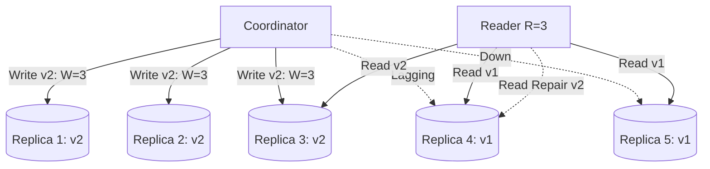

# Consistency, Quorums & CRDTs
## Trading latency, freshness, and availability with math

StackShade · System Design · Module 06

<!-- note: Today we organize consistency models from strongest to weakest, inspect Dynamo R + W > N quorums (and their hidden loopholes), and see how CRDTs converge without locks. -->

---

# 1. The Vanishing Shopping Cart

Suppose `N = 3` replicas serve a cart with `W = 1, R = 1`:

<!-- step -->
- User adds `"Headphones"` -> `Replica 1` ACKs in `5 ms`
<!-- step -->
- `10 ms` later, refresh hits `Replica 2` -> **cart appears empty!**
<!-- step -->
- Concurrent add on `Replica 3` + LWW overwrites `"Headphones"` forever

<!-- note: Frame the two distinct problems: stale reads (solved by overlap) and lost concurrent writes (solved by versioning or CRDTs). -->

---

# 2. The Consistency Spectrum

From strongest (slowest/coordination-heavy) to weakest:

<!-- step -->
1. **Linearizable:** Global real-time single-copy illusion
<!-- step -->
2. **Sequential:** Global total order, may lag real-time slightly
<!-- step -->
3. **Causal:** Preserves cause-and-effect (`Q -> A`), concurrent ops unordered
<!-- step -->
4. **Eventual:** Converges if writes stop; arbitrary intermediate states

<!-- note: Use the Alice-phones-Bob example to make Linearizable vs Sequential crystal clear. -->

---

# 3. Quorum Overlap (`R + W > N`)

<!-- note: By the Pigeonhole Principle, W + R > N forces at least (W + R) - N overlapping replicas holding the latest version. -->

---

# 4. Healing Replicas: Read Repair & Merkle Trees

- **Digest Reads:** Fetch full payload from `1` replica + hashes from `R - 1` (`-66%` bandwidth)
<!-- step -->
- **Read Repair:** Coordinator pushes newest `v2` back to stale replicas inline
<!-- step -->
- **Merkle Trees:** Background anti-entropy compares key-range hashes in `O(log K)`

<!-- note: Explain why Merkle trees avoid scanning entire terabytes over the WAN when comparing replicas. -->

---

# 5. Interactive Sim: Quorum `R + W > N` Explorer

<!-- anim: sim-quorum-rw -->

Adjust `N`, `W`, and `R` sliders and take replicas offline to inspect **overlap guarantees**, **fault tolerance**, and **stale read cases**.

<!-- note: Demo N=5, W=3, R=3 vs N=5, W=2, R=2 vs N=5, W=5, R=1 (0 write fault tolerance!). -->

---

# 6. Why `R + W > N` Is NOT Linearizable Alone

Three real-world loopholes in leaderless quorums:

<!-- step -->
1. **Sloppy Quorums:** Writes land on fallback nodes outside home `N`
<!-- step -->
2. **Concurrent LWW:** Two coordinators interleave timestamps across replicas
<!-- step -->
3. **Partial Write Failure:** Write fails `W` (`500`), yet `1` node kept it -> subsequent readers disagree!

<!-- note: Remind learners: strict linearizability requires consensus/Paxos or reader-driven synchronous repair before returning. -->

---

# 7. Worked Tuning Matrix (`N = 5` across 3 AZs)

| Config | Overlap? | Write Fault Tolerance | Read Wait |
|---|---:|---:|---|
| **`W=3, R=3`** | Yes (`6 > 5`) | `2` nodes down | `3rd` fastest (`~3–5 ms`) |
| **`W=5, R=1`** | Yes (`6 > 5`) | **`0` nodes down** | `1st` fastest (`1 ms`) |
| **`W=1, R=5`** | Yes (`6 > 5`) | `4` nodes down | Slowest (`p99` spike!) |
| **`W=2, R=2`** | **No (`4 <= 5`)** | `3` nodes down | `2nd` fastest (`~2 ms`) |

<!-- note: Highlight why W=5, R=1 is fragile for availability: one dead node stalls all writes. -->

---

# 8. CRDTs: Convergence Without Locks

Make `merge(A, B)` **commutative, associative, and idempotent**:

<!-- step -->
- **G-Counter / PN-Counter:** Per-replica vector (`sum(P) - sum(N)`); `merge = max` per slot
<!-- step -->
- **OR-Set:** Tags each `add(x)` with unique token; concurrent `add` beats `remove`
<!-- step -->
- **Metadata Rule:** Bound actor slots to server replicas (`<= 50`), never millions of clients (`800 KB/key`!)

<!-- note: Contrast CvRDT (ship full state, idempotent merge) vs CmRDT (ship ops over causal delivery). -->

---

# 9. Where CRDTs Break

- **Great for:** Likes, view counts, shopping carts, collaborative text, presence sets
- **Fails for:** Hard global invariants like `balance >= 0` or unique usernames!
- **Rule:** Use CRDTs for **availability + convergence**; use **consensus** for exclusivity

<!-- note: A classic interview trap: trying to build a bank account balance with a PN-Counter across partitions causes overdrafts. -->

---

# 10. Recap & Retrieval Check

<!-- step -->
1. With `N = 7` and `2`-node write fault tolerance, what is the smallest `R` for overlap?
<!-- step -->
2. How do **digest reads** cut quorum read network traffic?
<!-- step -->
3. Why does a **sloppy quorum** break `R + W > N` freshness?

<!-- note: Answers: (1) W=5 -> R=3 (5+3 > 7), (2) 1 full payload + R-1 SHA hashes, (3) writes go to non-owner fallback nodes outside the read set. -->
