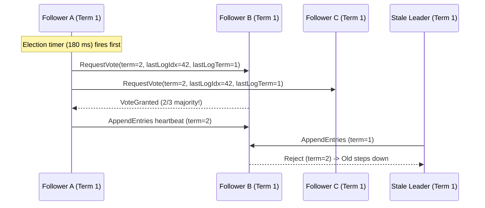

# CAP, PACELC & Raft Consensus
## Electing one leader and surviving partitions without split-brain

StackShade · System Design · Module 06

<!-- note: Today we replace the "pick 2 of 3" CAP myth with accurate CAP + PACELC reasoning, then trace Raft leader election and log safety end-to-end. -->

---

# 1. The Split-Brain Problem

`5` cluster nodes span `AZ-1` (`3` nodes) and `AZ-2` (`2` nodes). Fiber is cut:

<!-- step -->
- If `AZ-2` stays "available" and elects a second leader -> **corrupted split-brain**
<!-- step -->
- If the whole cluster halts on any `1` node reboot -> **fragile availability**
<!-- step -->
- Goal: **`AZ-1` (`3/5` majority) keeps running; `AZ-2` (`2/5`) halts cleanly**

<!-- note: Ask learners what happens when the fiber heals if both sides wrote different values for the same key. -->

---

# 2. CAP & PACELC Without the Myth

Networks **always** partition (`P` is not optional!).

<!-- step -->
- **CAP:** During a **Partition (`P`)**, choose **Consistency (`C`)** or **Availability (`A`)**
<!-- step -->
- **PACELC:** **Else (`E` = normal)**, choose **Latency (`L`)** or **Consistency (`C`)**
<!-- step -->
- `etcd` / `Spanner` = **`PC / EC`** · `Cassandra (ONE)` = **`PA / EL`**

<!-- note: Clarify that CAP's C means linearizability and A means every non-failing node responds. -->

---

# 3. Majority Quorums & Odd Cluster Sizes

Quorum size = $\lfloor N / 2 \rfloor + 1$:

| Nodes (`N`) | Quorum | Failures Tolerated | Verdict |
|---:|---:|---:|---|
| **`3`** | `2` | `1` | Minimal HA (`0` spare during upgrade!) |
| **`4`** | `3` | `1` | **Wasteful** (same tolerance as `3`!) |
| **`5`** | `3` | **`2`** | Standard production sweet spot |

<!-- note: Point out that any two majorities intersect in at least 1 node—the foundation of consensus safety. -->

---

# 4. Raft Leader Election Sequence

<!-- note: Stress the three safeguards: randomized timeouts (150-300 ms), 1 vote per term, and log up-to-dateness check. -->

---

# 5. Interactive Sim: Raft Election & Partitions

<!-- anim: sim-raft-election -->

Kill the Leader or partition the `5`-node cluster (`3 vs 2`) to watch randomized election timers, `RequestVote`, and minority halt in real time.

<!-- note: Show what happens during a tie vote and how randomized timeouts break symmetry on the next term. -->

---

# 6. Log Replication & The Figure 8 Rule

1. Leader appends `(term, index, cmd)` to local WAL and sends `AppendEntries`
<!-- step -->
2. Followers check `(prevLogIndex, prevLogTerm)` match; overwrite conflicts
<!-- step -->
3. Majority `fsync` -> advance `commitIndex`, apply to state machine, reply `OK`
<!-- step -->
4. **Safety Rule:** Leader only commits **current-term** entries by counting replicas (indirectly committing older entries)

<!-- note: Explain briefly why directly counting replicas on an old-term entry can allow a future leader to overwrite it (Raft paper Figure 8). -->

---

# 7. Preventing Stale Reads (`ReadIndex` vs. Leases)

Even a real Leader can be partitioned before its heartbeat timeout expires!

<!-- step -->
- **`ReadIndex`:** Leader notes `commitIndex`, sends 1 heartbeat round to confirm majority, then reads (`1` RTT, zero clock assumptions)
<!-- step -->
- **Leader Lease:** Reads locally within bounded monotonic timer (fast, risks stale read on extreme VM pause)

<!-- note: Compare ReadIndex reliability with lease speed; production etcd defaults to ReadIndex (linearizable). -->

---

# 8. Worked Math: Raft Latency & Batching (`5` Nodes)

Assume cross-AZ RTT = `2.0 ms`, NVMe `fsync` = `1.5 ms`:

<!-- step -->
- Single write = Leader `fsync` (`1.5 ms`) + parallel peer RTT/fsync (`~3.0 ms`) ≈ **`4 ms`**
<!-- step -->
- Unbatched single-key writes cap at `1,000 / 4 = 250 writes/s`
<!-- step -->
- Pipelining `100` commands per `fsync` batch lifts throughput to **`~22,000 writes/s`**

<!-- note: This explains why batching and Multi-Raft range sharding are essential in CockroachDB and TiKV. -->

---

# 9. Scaling Consensus: Multi-Raft & Learners

- **10× (`50k+ writes/s`):** Shard keyspace into `1,000` independent `64 MiB` **Multi-Raft** groups
- **100× (Geo-distributed):** Pin `3/5` voters in home region + non-voting **Learner** replicas remotely (`~4 ms` local writes)

<!-- note: Highlight how Multi-Raft avoids a single-leader bottleneck while keeping strong per-range consistency. -->

---

# 10. Recap & Retrieval Check

<!-- step -->
1. Why is a `4`-node Raft cluster strictly worse than `3` or `5` nodes?
<!-- step -->
2. How does Raft prevent a leader with a missing committed entry from winning an election?
<!-- step -->
3. What does `ReadIndex` guarantee that reading directly from leader RAM does not?

<!-- note: Answers: (1) 4 tolerates only 1 failure (same as 3) at higher cost, (2) RequestVote rejects candidates whose log is less up-to-date, (3) confirms leader wasn't silently deposed by a partition. -->
