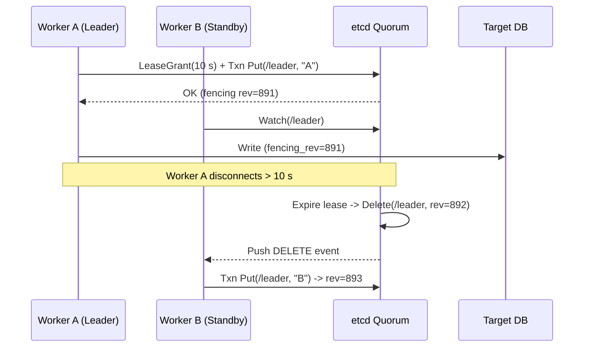

# Distributed Coordination & Leases
## Air-traffic control for leaders, shards, and configuration

StackShade · System Design · Module 06

<!-- note: Today we bridge theory into production coordination services (etcd, ZooKeeper, Chubby): how TTL leases, watches, and revision fencing work, and why business traffic must stay out of etcd. -->

---

# 1. The Leaderless Worker Chaos

Suppose `20` stateless shard-manager workers need **1 active Controller**:

<!-- step -->
- Hardcoding `worker-0` breaks on crash
<!-- step -->
- Polling PostgreSQL every `1 s` misses failures or hammers DB connections
<!-- step -->
- Storing `50 KB` user session blobs in `etcd` causes compaction stalls and takes down cluster scheduling!

<!-- note: Establish the central rule early: etcd/ZooKeeper are control-plane towers, not data-plane cargo planes. -->

---

# 2. Mental Model: Control Plane vs. Data Plane

| Plane | QPS & Payload | Consistency | Examples |
|---|---|---|---|
| **Control Plane** | Low QPS, tiny KB keys | Linearizable Raft (`etcd`/`ZK`) | Leader leases, shard maps, config |
| **Data Plane** | High QPS, GB–TB payloads | Sharded SQL / KV / Streams | User sessions, orders, clicks |

<!-- note: Reinforce Chubby's lesson: use coarse-grained advisory locks held for minutes/hours, never per-request locks. -->

---

# 3. Core Primitives (`etcd` / `ZooKeeper`)

- **Atomic CAS (`Txn`):** `If(create_revision == 0) Then(Put)` elects at most `1` leader
<!-- step -->
- **TTL Lease / Ephemeral Node:** Server auto-deletes keys if `KeepAlive` heartbeats stop
<!-- step -->
- **Watch Stream:** Push `gRPC` notifications from exact `revision` without polling
<!-- step -->
- **Built-in Fencing:** `mod_revision` (`891, 892, 893`) is a Raft-ordered fencing token!

<!-- note: Note how etcd unifies CAS, TTL leases, watches, and fencing tokens into one Raft revision stream. -->

---

# 4. Leader Election & Lease Expiry Flow

<!-- note: Point out client-side self-stepping-down: Worker A also tracks monotonic KeepAlive ACK time and steps down proactively at ~8 s. -->

---

# 5. Interactive Sim: Lease Expiry & Handoff

<!-- anim: anim-lease-expiry -->

Watch a `10 s` lease refresh on `3 s` `KeepAlive` beats, sever the Leader's network, and trace automatic revocation, `Watch` wake-up, and `fencing_rev` handoff.

<!-- note: Highlight the trade-off between short TTL (fast failover, false flaps) and long TTL (stable, slower recovery). -->

---

# 6. Eliminating the Herd Effect

If `500` workers watch `/locks/job-1`, releasing the lock wakes all `500` (`O(N^2)` RPCs):

<!-- step -->
- Create sequential keys per waiter (`/locks/job-1/<lease_id>`, ordered by `create_revision`)
<!-- step -->
- Each waiter watches **only its immediate predecessor** (`103` watches `102`)
<!-- step -->
- Wakeups drop from `O(N)` per release to **`O(1)`**

<!-- note: Mention ZooKeeper's EPHEMERAL_SEQUENTIAL recipe and etcd's concurrency.Mutex package. -->

---

# 7. Worked Sizing: KeepAlive vs. Watch Fan-Out

Cluster managing `15,000` service endpoints + `200` leaders (`10 s` lease, `3 s` KeepAlive):

<!-- step -->
- `KeepAlive` rate = `15,200 / 3 s ≈ 5,067 RPCs/s` (lightweight multiplexed stream)
<!-- step -->
- **Trap:** Replacing leases with `Put` writes generates `5,000` Raft `fsync`s/s -> disk stall!
<!-- step -->
- **Watch Fan-Out:** `500` pod restarts × `1,000` watchers × `500 B` = `50 MB/s` (`400 Mbps`) from `1` leader

<!-- note: Solution to watch fan-out: place an xDS / aggregator cache tier between etcd and 1,000+ app pods. -->

---

# 8. Common Anti-Patterns to Reject

- **Data-plane sessions in `etcd`:** Exceeds `2–8 GiB` quota and stalls Raft snapshots
- **Sub-second TTLs (`500 ms`):** Normal GC/cross-AZ blips cause nonstop leadership flapping
- **Unfenced leases:** Advisory lock without DB `WHERE rev < $new` still allows split-brain

<!-- note: Connect directly back to Lesson 29's fencing tokens—coordination services issue the token, databases enforce it. -->

---

# 9. Scaling Coordination (`10×` and `100×`)

- **10× (`2,000` watchers):** Put stateless xDS/discovery aggregators in front of `etcd`
- **100× (`500k` jobs/tenants):** Partition into **cell-based coordination clusters** or move per-job locks to sharded SQL/Kafka consumer groups

<!-- note: Explain why Kubernetes scales to 5,000+ nodes using apiserver watch caches in front of etcd. -->

---

# 10. Checkpoint 04 & Retrieval Check

**Assess:** [Checkpoint 04 · Distributed Failure, Consistency & Coordination](../assessments/checkpoint-04.md)

<!-- step -->
1. Why use TTL leases instead of permanent lock keys?
<!-- step -->
2. How does watching only your immediate predecessor stop the herd effect?
<!-- step -->
3. Why should `100k` user shopping carts live in Redis/DynamoDB instead of `etcd`?

<!-- note: Answers: (1) auto-release on worker crash, (2) O(1) wakeup instead of O(N) stampede, (3) etcd serializes writes through one Raft leader and caps DB size at a few GiB. -->
