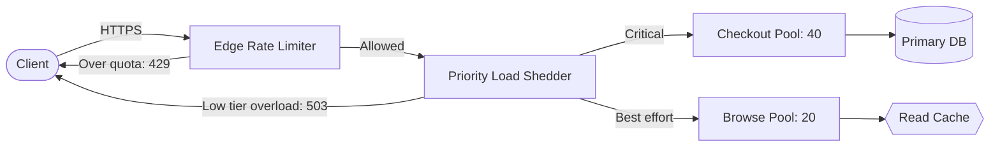

# SLIs, SLOs & Overload Control
## Why FIFO queues collapse at 130% load and how load shedding saves goodput

StackShade · System Design · Module 07

<!-- note: Welcome to Module 07. Today we connect reliability economics (SLIs, SLOs, error budgets) with mechanical overload survival (bounded queues, LIFO, priority shedding, bulkheads, and adaptive concurrency). -->

---

# 1. The 130% Capacity Cliff

Your API serves `1,000 req/s` cleanly. A flash sale sends `1,300 req/s`:

<!-- step -->
- Unbounded FIFO queue buffers `+300 req/s` -> `3,000` queued in `10 s`
<!-- step -->
- Wait time hits `3,000 / 1,000 = 3.0 s` (`> 1.0 s` client timeout!)
<!-- step -->
- **100% of CPUs burn work on already-abandoned requests -> `0%` goodput**
<!-- step -->
- Low-priority `GET /recommendations` starves `POST /checkout`

<!-- note: Emphasize Little's Law (L = lambda * W): unbounded queues turn excess arrival rate directly into unbounded latency. -->

---

# 2. Reliability Economics: SLI, SLO & Error Budget

| Term | Meaning | Example |
|---|---|---|
| **SLI** | Measured user-facing ratio | `% of /checkout requests < 300 ms & non-5xx` |
| **SLO** | Target over rolling window | `99.95%` over `30` days (`43,200 min`) |
| **Error Budget** | `100% - SLO` allowance | `21.6 minutes/month` to spend on releases/incidents |

<!-- note: Error budgets replace endless conflict between "ship faster" and "don't touch anything" with an objective shared quota. -->

---

# 3. Layered Overload Architecture

<!-- note: Walk left-to-right: reject bad actors at edge, triage criticality before compute, isolate pools with bulkheads. -->

---

# 4. Priority Triage & Bulkheads

Think of an **emergency room + ship watertight compartments**:

<!-- step -->
- **Criticality Tiers:** `CRITICAL` (`checkout`) never dropped while `SHEDDABLE` (`recs`) takes load
<!-- step -->
- **Bulkheads:** Dedicated thread/DB connection pools prevent slow `recs` from exhausting `checkout`
<!-- step -->
- **Fail-Fast `503`:** Rejecting at ingress costs `< 0.2 ms` vs `20 ms` DB execution

<!-- note: Mention Google SRE's 4 criticality tiers: CRITICAL_PLUS, CRITICAL, SHEDDABLE_PLUS, SHEDDABLE. -->

---

# 5. Why LIFO + CoDel Beat FIFO Under Overload

When arrival rate `λ > μ`, the oldest item in FIFO has already timed out!

<!-- step -->
- **Bounded Queue:** Cap depth to `~50 ms` of capacity (`L_max = 50` at `1k req/s`)
<!-- step -->
- **Deadline Check:** Pop from queue -> drop in `O(1)` if `now > request_deadline`
<!-- step -->
- **LIFO / CoDel:** Serve newest requests first so completed work meets client SLAs

<!-- note: Clarify that LIFO only triggers during overload queuing; at normal load, queue depth is ~0 so FIFO vs LIFO is identical. -->

---

# 6. Interactive Sim: FIFO Collapse vs. Priority Shedding

<!-- anim: sim-load-shedding -->

Push traffic to `120%` and `150%` capacity. Watch unbounded FIFO `p99` explode past client timeout (`0` goodput), then enable **Priority + Bounded LIFO Shedding**.

<!-- note: Show learners how useful goodput snaps back to 100% of true server capacity (1,000 req/s) with flat <50 ms p99. -->

---

# 7. Worked Math: `1,300 req/s` Flash Sale

Capacity `μ = 1,000 req/s`; Offered `λ = 1,300 req/s` (`260` checkout + `1,040` browse):

<!-- step -->
- **FIFO (`10 s` in):** `L = 3,000`, wait `W = 3.0 s` > `1.0 s` SLA -> **`0 req/s` useful**
<!-- step -->
- **Shedder (`L_max = 50`):** drops `300 req/s` of `browse` (`< 0.2 ms` per `503`)
<!-- step -->
- **Result:** `260/260` checkout (`100%`) + `740` browse = **`1,000 req/s` goodput (`p99 = 35 ms`)**

<!-- note: Contrast wasted CPU at 0% goodput against work conservation at 100% goodput. -->

---

# 8. Adaptive Concurrency Limits (AIMD / Gradient)

Static `max_inflight = 100` breaks when DB latency shifts `20 ms <-> 200 ms`:

<!-- step -->
- **AIMD:** `limit += 1` when healthy; `limit *= 0.85` on latency spike / `503`
<!-- step -->
- **Gradient (`Little's Law`):** Compare `RTT_sample` vs `RTT_no_load` baseline
<!-- step -->
- Shrinks concurrency *before* queues saturate without manual magic constants

<!-- note: Reference Netflix's concurrency-limits library; warn to exclude keepalive/health checks from RTT_no_load. -->

---

# 9. Scaling Beyond Single Nodes

- **10× (`50` pods):** Pair per-pod shedding with `Peak EWMA` L7 load balancing
- **100× (`100k req/s`):** Push coarse priority shedding to **Envoy/API Gateway edge**
- Saves origin TLS + JSON parsing CPU when shedding `50,000 req/s`

<!-- note: Highlight that shedding inside Python/Node workers after JSON parsing still burns substantial CPU. -->

---

# 10. Lab & Retrieval Check

**Hands-on:** [Lab 12 · Load Shedding, Backpressure & Rate Limiting](../labs/12-load-shedding-rate-limiter.md)

<!-- step -->
1. How many minutes/month is the error budget of a `99.95%` SLO?
<!-- step -->
2. Why does an unbounded FIFO queue hit `0%` useful goodput during `120%` load?
<!-- step -->
3. How does a **bulkhead** differ from a **circuit breaker**?

<!-- note: Answers: (1) 21.6 min/month, (2) wait time W = L/mu exceeds client timeout so every response finishes after disconnect, (3) bulkhead isolates resource pools proactively vs reactive breaker trips. -->
