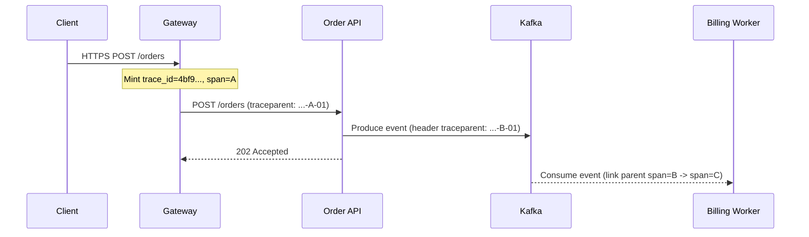

# Observability & Chaos Testing
## Logs, RED/USE metrics, OTel traces, burn-rate alerts & GameDays

StackShade · System Design · Module 07

<!-- note: Today we separate the three telemetry signals, prevent high-cardinality metric OOMs, wire up multi-window SLO burn alerts, and design safe Chaos GameDays. -->

---

# 1. "All Dashboards Are Green, Yet VIP Checkout Fails"

Enterprise users hit `504` timeouts, and on-call is blind:

<!-- step -->
- CPU is `32%`; static threshold alerts never fired
<!-- step -->
- Someone added `user_id` as a Prometheus label -> `2.4M` series OOM-crashed TSDB
<!-- step -->
- `8` microservices log separately with **zero shared `trace_id`**

<!-- note: Contrast monitoring (checking known thresholds) with observability (explaining unknown failure modes in production). -->

---

# 2. The Three Telemetry Signals

| Signal | Best For | Safe Dimensions |
|---|---|---|
| **Metrics (`RED` / `USE`)** | Cheap real-time dashboards & SLO alerts | `service`, `route`, `status_class` (low cardinality!) |
| **Distributed Traces** | Cross-service critical path & `N+1` DB latency | `trace_id`, `span_id`, `db.statement` |
| **Structured Logs** | High-cardinality audit & failure payloads | `user_id`, `order_id`, `trace_id`, `error_code` |

<!-- note: Mention RED (Rate, Errors, Duration) for services and USE (Utilization, Saturation, Errors) for infrastructure pools/CPUs. -->

---

# 3. High-Cardinality Trap (Worked Math)

Prometheus indexes every unique `(metric, label_set)` in RAM (`~3 KB`/series):

<!-- step -->
- **Safe:** `10` services × `20` routes × `4` statuses × `12` buckets = `9,600` series (**`28.8 MB` RAM**)
<!-- step -->
- **Unsafe (`+ user_id`):** `500,000` users × `12` buckets = `6,000,000` series (**`18 GB` RAM -> OOM!**)
<!-- step -->
- **Bridge:** Use **Metric Exemplars** to link a histogram bucket to `1` sample `trace_id`

<!-- note: Exemplars give you the best of both worlds: cheap low-cardinality p99 graphs with one-click jump to a slow trace. -->

---

# 4. OpenTelemetry Trace Propagation (`traceparent`)

<!-- note: Stress propagating W3C traceparent through BOTH HTTP/gRPC headers and async Kafka/SQS message headers. -->

---

# 5. Interactive Sim: Trace Waterfall Explorer

<!-- anim: anim-distributed-trace -->

Inspect a `1,420 ms` distributed trace across Gateway, Auth, Order, Inventory, and Kafka to spot a hidden `12 × 45 ms` sequential **`N+1` DB loop** and queue lag.

<!-- note: Show learners how metrics show p99 = 1.4s, while the trace waterfall pinpoints the exact N+1 SQL spans. -->

---

# 6. Taming Trace Cost: Head vs. Tail Sampling

At `5,000 req/s` (`6 KB`/trace), `100%` tracing costs `30 MB/s` (`~77.8 TB/month`):

<!-- step -->
- **Head Sampling (`1–2%`):** Decided at edge; cheap, **but misses rare `500`s**
<!-- step -->
- **Tail Sampling (Collector):** Buffers `15–30 s`, keeps **`100%` of errors & `> p99`**, `1%` of fast OKs
<!-- step -->
- **Result (`~3%` kept):** Drops volume to `0.9 MB/s` (`-97%` spend) while keeping every bug!

<!-- note: Note the operational cost of tail sampling: collectors must route all spans for a trace_id to the same collector instance via consistent hashing. -->

---

# 7. Multi-Window SLO Burn-Rate Alerting

Stop paging at `3 AM` for `CPU > 80%` or `1`-minute blips that self-healed:

<!-- step -->
- **Sev-1 Page:** `14.4×` burn rate (`2%` monthly budget burned in `1 h`) **AND** still burning in last **`5 m`**
<!-- step -->
- **Sev-2 Page:** `6×` burn rate (`5%` burned in `6 h`) **AND** last **`30 m`**
<!-- step -->
- Both windows required -> fast detection with near-zero false resets!

<!-- note: Explain why the short 5-minute confirmation window stops paging after a brief spike already ended 40 minutes ago. -->

---

# 8. Hypothesis-Driven Chaos & GameDays

Verify resilience before `3 AM` real outages do:

<!-- step -->
1. **Steady State:** Define healthy SLI baseline (`checkout >= 99.9%`)
<!-- step -->
2. **Hypothesis:** *"Killing `1/3` Redis nodes recovers in `< 5 s` with `< 0.5%` error bump"*
<!-- step -->
3. **Blast Radius:** Limit to `1%` canary or `1` non-primary AZ
<!-- step -->
4. **Auto-Abort:** Instant kill switch if error burn exceeds cap

<!-- note: Never run chaos experiments on un-backed-up stateful primaries or without an automated halt trigger. -->

---

# 9. Scaling Telemetry (`10×` and `100×`)

- **10× (`50k req/s`):** Consistent-hash OTel Collectors by `trace_id` for tail sampling
- **100× (`500k req/s`):** Replace noisy multi-line `INFO` logs with **wide canonical log lines** (1 structured JSON summary per request/service)

<!-- note: Canonical log lines (Stripe pattern) compress 20 scattered log lines into 1 indexed JSON event with all dimensions. -->

---

# 10. Recap & Retrieval Check

<!-- step -->
1. Where do `user_id` and `request_id` belong: Prometheus labels or logs/spans?
<!-- step -->
2. Why do multi-window burn alerts check both `1 h` and `5 m` windows?
<!-- step -->
3. Name two mandatory guardrails before injecting faults in a GameDay.

<!-- note: Answers: (1) Logs/spans/exemplars, never metric labels, (2) detect fast outages while confirming it's still burning right now, (3) bounded blast radius + automated abort trigger. -->
