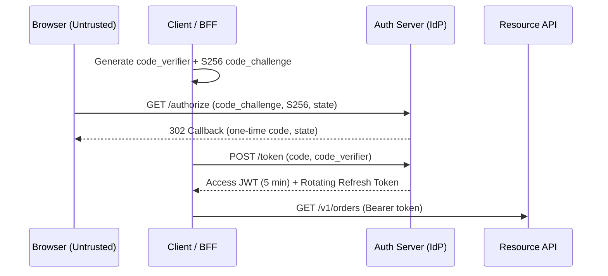

# System Security & Abuse Prevention
## OAuth 2.1 + PKCE, JWTs vs. opaque tokens, ReBAC, mTLS & rate limiting

StackShade · System Design · Module 07

<!-- note: Today we trace OAuth 2.1 + PKCE across trust boundaries, close JWT and BOLA authorization gaps, compare RBAC/ABAC/ReBAC, and benchmark rate-limiter algorithms. -->

---

# 1. Three Real-World Launch Bugs

An API validates every JWT signature cleanly—yet fails a security audit:

<!-- step -->
1. Changing `/v1/invoices/9041` -> `9042` leaks **another tenant's PDF (`BOLA`)**
<!-- step -->
2. Revoking a fired user's session still leaves their `60 min` JWT active
<!-- step -->
3. A bot exploits a **Fixed Window** limiter (`:59` + `:01`) to send **`2×` burst in `2 s`**

<!-- note: Emphasize that cryptographic signature checks are only one piece of security—object ownership, revocation, and abuse limits are equally critical. -->

---

# 2. OAuth 2.1 + PKCE (`S256`) Across Trust Boundaries

<!-- note: Explain why RFC 9700 mandates PKCE for ALL Authorization Code clients and bans Implicit flow. -->

---

# 3. Hardening JWTs & Token Revocation

Verifying the signature alone is **not enough**:

<!-- step -->
- Enforce `alg` allowlist (`EdDSA` / `RS256` only — block `alg: none`!)
<!-- step -->
- Verify `iss`, `aud` (stops cross-service token replay), `exp`, `nbf`, `scope`
<!-- step -->
- **Immediate Revocation:** Use `5 min` JWT + rotating refresh tokens (reuse revokes family), OR **opaque tokens** backed by regional Redis introspection

<!-- note: Contrast stateless JWT latency (~0.08 ms local) vs opaque token instant revocation (~0.4 ms Redis lookup). -->

---

# 4. Authorization Models & BOLA Defense

| Model | Best For | Fails When |
|---|---|---|
| **RBAC** | Coarse org roles (`admin`, `viewer`) | Per-folder/document sharing (`role explosion`) |
| **ABAC** | Policy rules (`dept == doc.dept`) | Hard to answer *"who can view doc X?"* |
| **ReBAC (Zanzibar)** | Nested groups & per-resource ACLs | Simple single-role apps (overkill) |

**Mandatory BOLA rule:** Always enforce `WHERE id = $1 AND org_id = $token_org_id`!

<!-- note: BOLA (Broken Object Level Authorization) is #1 on OWASP API Top 10 because teams trust IDs from URL paths/bodies. -->

---

# 5. Zero-Trust mTLS & KMS Envelope Encryption

- **East-West mTLS (SPIFFE / Envoy):** Every microservice authenticates via short-lived `X.509` workload certs (`VPC IP != trust`)
<!-- step -->
- **KMS Envelope Encryption:** App gets `(plaintext_DEK, KMS_encrypted_DEK)` once per object/batch
<!-- step -->
- Encrypts bulk bytes locally (`AES-256-GCM`); wipes `plaintext_DEK` from RAM

<!-- note: Envelope encryption prevents hammering KMS over the network for 100 MB/s file streams while enabling fast KEK rotation. -->

---

# 6. Rate Limiting Algorithms Compared

- **Fixed Window:** `O(1)` RAM, **but** allows `2×` boundary burst (`00:59 + 01:01`)
<!-- step -->
- **Sliding Window Log (`ZSET`):** Exact, **but** `O(limit)` RAM (`4 GB` at `1M` users × `100` reqs!)
<!-- step -->
- **Sliding Window Counter:** `O(1)` (`~80 B`/user), blends adjacent windows (`< 0.5%` error)
<!-- step -->
- **Token Bucket (Redis Lua):** `O(1)` (`~80 B`/user), allows bounded burst + smooth sustained cap

<!-- note: Emphasize atomic Redis Lua execution so concurrent requests cannot race GET->compute->SET. -->

---

# 7. Interactive Sim: Rate Limiter Burst Tester

<!-- anim: sim-rate-limiter-algorithms -->

Fire a double-burst across the `:00` minute boundary to contrast **Fixed Window (`2×` spike leak)**, **Leaky Bucket**, **Token Bucket**, and **Sliding Window Counter**.

<!-- note: Point out how Token Bucket cleanly absorbs small user page-load bursts up to bucket_capacity while rejecting sustained floods. -->

---

# 8. Worked Memory Math (`1M` Active API Keys)

Target: `100 req/min`, `burst = 25` across `1,000,000` active clients:

<!-- step -->
- **Token Bucket / Sliding Counter:** `~80 B`/user × `1M` = **`~80 MB` RAM**
<!-- step -->
- **Sliding Window Log (`ZSET`):** `100` timestamps × `40 B` × `1M` = **`4.0 GB` RAM** (`50×` more!)
<!-- step -->
- **JWT Verification (`20k req/s`):** `~0.08 ms` CPU = `1.6` cores fleet-wide

<!-- note: Always ask "how many active keys * how many timestamps?" before proposing a ZSET sliding log in an interview. -->

---

# 9. Failure Posture & Scaling (`10×` / `100×`)

- **Fail-Open vs. Fail-Closed:** Fail-open on Redis crash with **in-memory per-pod fallback cap** for checkout/login; fail-closed on expensive abuse targets
- **10× (`200k req/s`):** Shard Redis by `tenant_id` or batch-sync local Envoy counters every `100 ms`
- **100× (`2M req/s`):** Push WAF/DDoS/IP throttling to **Anycast Edge PoPs**

<!-- note: Never let a Redis outage lock out 100% of paying checkout users when a local pod cap can protect the DB safely. -->

---

# 10. Lab & Retrieval Check

**Hands-on:** [Lab 13 · Threat Modeling & OAuth 2.1 + PKCE Audit](../labs/13-threat-model-oauth.md)

<!-- step -->
1. What attack does PKCE (`S256`) prevent on OAuth redirect callbacks?
<!-- step -->
2. Which JWT claims prevent a valid token for Service A from working on Service B?
<!-- step -->
3. Why must Redis Token Bucket updates run inside an atomic Lua script?

<!-- note: Answers: (1) auth code interception/injection, (2) aud (and scope/iss), (3) prevents concurrent TOCTOU race conditions. -->
