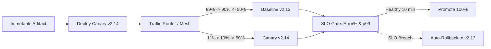

# Cloud, Containers & Deployments
## Zero-drop pod draining, safe probes, canary SLO gates & schema safety

StackShade · System Design · Module 07

<!-- note: Today we tackle the #1 trigger of production incidents—deployments—covering VPC blast radius, Kubernetes probe pitfalls, SIGTERM races, and automated canary rollouts. -->

---

# 1. Anatomy of a Routine Deploy Outage

A `v2.14` deploy across `30` pods breaks production in `90` seconds:

<!-- step -->
1. Pods exit instantly on `SIGTERM` while ALB takes `5 s` to update -> **`502` storm**
<!-- step -->
2. Liveness `/healthz` checks `SELECT 1` on DB -> `3 s` DB blip reboots **all `30` pods**
<!-- step -->
3. `v2.14` ran `DROP COLUMN` -> **instant rollback to `v2.13` crashes!**

<!-- note: Most outages aren't exotic hardware failures—they are self-inflicted rollout and probe misconfigurations. -->

---

# 2. Multi-AZ VPC Isolation

Separate blast radius across `3` Availability Zones (`< 2 ms` RTT):

<!-- step -->
- **Public Subnets:** Load Balancers & NAT Gateways only (`0` app pods or DBs)
<!-- step -->
- **Private App Subnets:** Stateless containers reachable only via LB/Mesh
<!-- step -->
- **Isolated Data Subnets:** DB & Redis (`SG` allows app subnets only; no public route)

<!-- note: Remind learners that Multi-AZ protects against single-DC power/cooling/fiber cuts at zero cross-region latency cost. -->

---

# 3. Liveness vs. Readiness Probes

| Probe | Question Answered | On Failure | Dependency Checks? |
|---|---|---|---|
| **Readiness (`/readyz`)** | Can this pod take traffic? | Remove from LB endpoints | Yes (cache warm, pool ready) |
| **Liveness (`/livez`)** | Is this process wedged? | **Kill & restart container** | **NEVER!** (causes fleet reboot) |

<!-- note: Repeat the golden rule: never put PostgreSQL, Redis, or external API checks inside a liveness probe. -->

---

# 4. Zero-Drop Graceful Shutdown (`preStop` + `SIGTERM`)

Deleting a pod triggers **two parallel async paths** (kubelet `SIGTERM` vs ALB endpoint removal):

<!-- step -->
1. Mark `/readyz` failing **immediately** (`ALB` stops routing new traffic in `~5–10 s`)
<!-- step -->
2. `preStop` hook (`sleep 10 s`) keeps HTTP listener open for in-flight ALB packets
<!-- step -->
3. `SIGTERM` calls `server.Shutdown(grace=20s)` -> drains active requests & closes DB pools

<!-- note: Also ensure server HTTP keep-alive idle timeout > ALB idle timeout so the app doesn't close a reused TCP socket mid-flight. -->

---

# 5. Progressive Canary Pipeline

<!-- note: Highlight comparing Canary against a live Baseline on the same time-of-day traffic mix to avoid diurnal false alarms. -->

---

# 6. Interactive Sim: Automated Canary Rollback

<!-- anim: anim-canary-rollback -->

Watch Canary traffic step `1% -> 10%`. Inject a memory leak / `500` surge at `10%` and observe the SLO gate halt promotion and shift traffic instantly back to `v1`.

<!-- note: Point out how Feature Flags go one step further: decouple code deploy from feature exposure for a 0-second kill switch. -->

---

# 7. Deployment Strategies Compared

| Strategy | Extra Compute | Rollback Speed | Key Risk |
|---|---|---|---|
| **Rolling** | `+10–25%` surge | Slow (minutes) | Mixed versions hit same DB |
| **Blue / Green** | **`+100%` (`2×`)** | **Instant (`< 5 s`)** | **Doubles DB connection pools!** |
| **Canary** | `+3–10%` | Instant weight zeroing | Needs enough QPS for signal |
| **Feature Flags** | `0%` | **`0 s` config flip** | Stale flag debt if uncleaned |

<!-- note: Call out the Blue/Green DB connection trap: 60 Blue + 60 Green pods booted together double open DB pool connections. -->

---

# 8. Worked Numbers: HPA Scale-Out Lag (`60` Pods)

Traffic doubles `12,500 -> 25,000 req/s` in `60 s`:

<!-- step -->
- Metrics scrape + HPA controller loop: **`~30 s`**
<!-- step -->
- Node/pod schedule + image pull + startup + `3×5 s` readiness: **`~45–90 s`**
<!-- step -->
- **Total scale-out lag = `75–120 s`!**
<!-- step -->
- **Fix:** Target `55%–60%` CPU headroom (never `90%`) + slim cached base images

<!-- note: Emphasize why teams running at 85% steady-state utilization drop requests during rapid traffic ramps while waiting 90s for pods. -->

---

# 9. Schema Safety: Expand-Contract Rule

Because `v1` and `v2` run **simultaneously** during Canary and Rollback:

<!-- step -->
1. **Expand:** Add nullable new column + dual-write in code
<!-- step -->
2. **Backfill:** Migrate historical rows asynchronously in batches
<!-- step -->
3. **Switch & Contract:** Deploy `v2` reading new column; drop old column **in a later PR**

<!-- note: Never couple a destructive DROP/RENAME migration with the application rollout that stops reading the old column. -->

---

# 10. Recap & Retrieval Check

<!-- step -->
1. Why should `/livez` never query PostgreSQL?
<!-- step -->
2. How does a `10 s` `preStop` sleep stop `502` errors during rolling updates?
<!-- step -->
3. Why does Blue/Green threaten `max_connections` on a relational DB?

<!-- note: Answers: (1) transient DB blips trigger simultaneous fleet-wide container restarts, (2) keeps listener open until ALB endpoint removal propagates, (3) Blue and Green fleets stay booted simultaneously with full pools. -->
