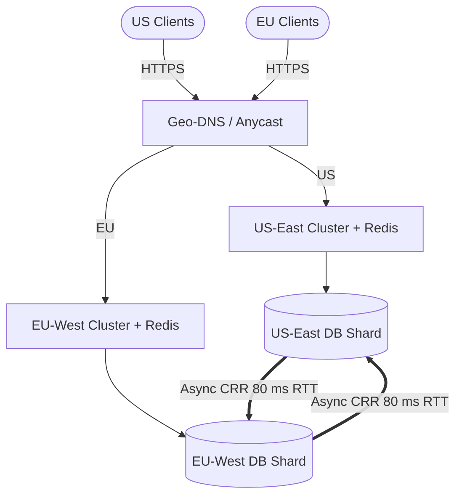

# Multi-Region, DR & FinOps
## Active-Active vs. Active-Passive, real RPO/RTO math & unit economics

StackShade · System Design · Module 07

<!-- note: Today we conclude Module 07 by separating Multi-AZ from Multi-Region, modeling realistic RPO/RTO failover timelines, solving GDPR residency, and quantifying FinOps cloud costs. -->

---

# 1. Why "We're Multi-Region" Failed in Practice

Team claims `"RPO = 0, RTO = 1 min"` across `US-East` and `EU-West`. Outage hits:

<!-- step -->
- `4 s` async lag lost **`~20,000` acknowledged writes** (`RPO != 0`)
<!-- step -->
- ISP DNS resolvers cached dead `US-East` IP for `10 min` (ignored `60 s` TTL)
<!-- step -->
- `25%` warm standby + cold Redis **collapsed under `100%` global traffic**
<!-- step -->
- Undetected cross-AZ/region transfer quietly cost **`$42,000/month`**

<!-- note: Multi-region is expensive and error-prone—justify it by SLA, continent RTT, or data residency, and drill failovers continuously. -->

---

# 2. Multi-AZ vs. Multi-Region

| Scope | Network RTT | Protects Against | Replication |
|---|---:|---|---|
| **Multi-AZ (1 Region)** | `< 2 ms` | DC power, fiber, rack failure | Sync (`RPO = 0` easy!) |
| **Multi-Region** | `80–150 ms` | Full cloud region blackout + geo-RTT + GDPR | Async (`RPO > 0`) or slow WAN consensus |

<!-- note: Start with Single-Region Multi-AZ for 90% of products; add Multi-Region only when latency, residency, or regional SLA demands it. -->

---

# 3. Active-Active Architecture (`Home-Region` Pattern)

<!-- note: Explain how Home-Region partitioning gives <15 ms local writes AND keeps EU PII legally inside EU-West under GDPR. -->

---

# 4. Interactive Sim: Regional Blackout Failover

<!-- anim: anim-region-failover -->

Trigger a `US-East` blackout and trace health-check probes, async **`RPO`** write loss, Geo-DNS vs. Anycast cutover speed, and `EU-West` capacity survival.

<!-- note: Toggle standby capacity (25% cold vs 50/50 active headroom) so learners see cold-cache thundering herds crash under-provisioned standbys. -->

---

# 5. Real RTO Anatomy (Beyond "DNS TTL")

`RTO` is the **sum of four sequential delays**:

<!-- step -->
1. **Detection:** `3 × 10 s` failed health probes = `30 s`
<!-- step -->
2. **Routing Shift:** Geo-DNS (`60–600 s` sticky ISPs) vs **Anycast Edge (`~5–15 s`)**
<!-- step -->
3. **DB Promotion:** Promote replica & fence old writer = `~25 s`
<!-- step -->
4. **Warm-Up:** Surviving cluster autoscaling + cold cache fill

<!-- note: Highlight Anycast proxies (Cloudflare / AWS Global Accelerator) as the clean fix for sticky recursive DNS caches. -->

---

# 6. Worked RPO & FinOps Math (`5,000 writes/s`)

Global chat (`500 B`/msg = `2.5 MB/s` writes; `25k reads/s × 2 KB = 50 MB/s` egress):

<!-- step -->
- **RPO (`1.5 s` async lag):** `5,000 × 1.5 s = 7,500` msgs (`3.75 MB`) at risk
<!-- step -->
- **Cross-Region Replication:** `2.5 MB/s × 86,400 × 30 = 6.48 TB/mo` (`9.72 TB` w/ `1.5×` WAL × `$0.02/GB` = **`$194/mo`**)
<!-- step -->
- **Trap:** `50 KB` un-offloaded media payloads = `100×` -> **`$19,440/mo`**!
<!-- step -->
- **Internet Egress:** `129.6 TB/mo × $0.09/GB = $11,664/mo` (offload to CDN!)

<!-- note: Also point out intra-region cross-AZ chatter ($0.02/GB round-trip) and how AZ-aware routing eliminates it. -->

---

# 7. Active-Passive vs. Active-Active Trade-Offs

| Pattern | Cost Factor | Typical RTO | Primary Risk |
|---|---:|---:|---|
| **Warm Standby** | `~1.4×` | `5–20 min` | Untested failover; cold cache collapse |
| **Active-Active (Home-Region)** | `~2.2×` | `15–60 s` | Cross-border routing on failover |
| **Global Consensus (`Spanner`)** | `~2.5×+` | `< 30 s` | `80–150 ms` WAN write latency |

<!-- note: At 100x scale, 3+ Regional Cells cut per-cell failover headroom from +100% down to +33–50% (N+1 redundancy). -->

---

# 8. FinOps Unit Economics

Stop optimizing total monthly cloud bill in isolation—track **unit cost**:

<!-- step -->
- **`$ / 1M API requests`** and **`$ / active user / month`**
<!-- step -->
- Use **AZ-aware routing** (Topology Aware Hints) to cut noisy cross-AZ chatter
<!-- step -->
- Tier cold logs/blobs to object archive after `30–90` days

<!-- note: Unit metrics reveal whether a 20% bill increase came from healthy 40% user growth or an unoptimized egress leak. -->

---

# 9. Scaling & Fencing Reconnected Regions

When a blacked-out `US-East` finally recovers `2` hours later:

<!-- step -->
- **Never** automatically re-enable old primary writes before fencing!
<!-- step -->
- Demote old primary to follower, reconcile WAL/CRDT divergence, drain backlog
<!-- step -->
- Gradually shift `10% -> 50% -> 100%` of home-region traffic back

<!-- note: Reconnecting a stale primary directly is the #1 cause of post-recovery split-brain data corruption. -->

---

# 10. Lab, Checkpoint 05 & Next Module

- **Lab:** [Lab 14 · Multi-Region Failover & FinOps Audit](../labs/14-multi-region-failover.md)
- **Assess:** [Checkpoint 05 · Reliability, Security & Cloud](../assessments/checkpoint-05.md)
- **Next:** [38 · Problem Decomposition & High-Signal ADRs](../lessons/38-problem-decomposition.md)

<!-- note: Encourage learners to complete Lab 14 and Checkpoint 05 before moving into Module 08 architecture mastery and case studies. -->
