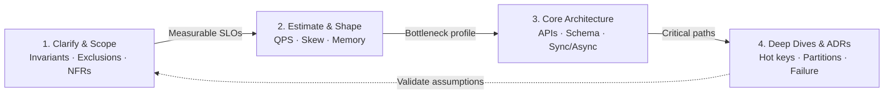
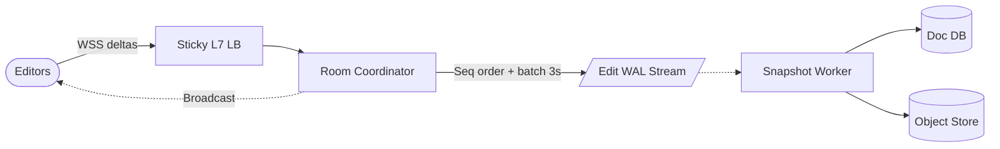

# Problem Decomposition & ADRs
## Turn vague prompts into defended architectures

StackShade · System Design · Module 08 · Lesson 38

<!-- note: Welcome to Module 08. Start by framing why staff-level design is about narrowing ambiguity into concrete invariants and reversible vs irreversible decisions. -->

---

# 1. The Trap of Premature Architecture

"Design a real-time collaborative workspace."

<!-- step -->
- Drawing **Kafka + Redis + K8s** in minute 1 is guessing, not engineering.
<!-- step -->
- Hidden ambiguities change everything:
  - Character-level CRDTs vs 2-second block saves?
  - 10 concurrent editors vs 5,000 viewers?
  - Offline airplane edits vs online-only?

<!-- note: Ask learners what breaks if you assume online-only locking and later discover offline mobile editing is required—you have to rewrite the entire data model. -->

---

# 2. The Constraint Funnel

Filter every design through four layers before picking tools:

<!-- step -->
1. **Invariants:** What must *never* go wrong (no lost edits, no tenant leaks).
<!-- step -->
2. **Workload Shape:** Read/write skew, hot-key concurrency, payload bytes.
<!-- step -->
3. **Component Boundaries:** Sync user path vs async durable work.
<!-- step -->
4. **Reversibility:** Lock one-way doors with ADRs; keep two-way doors cheap.

<!-- note: Emphasize one-way doors (shard keys, consistency models, public APIs) vs two-way doors (cache TTLs, pod counts). -->

---

# 3. The 4-Phase Design Loop

- **Time allocation:** 10% Scope → 15% Math → 35% Core → 40% Deep Dives & Failure Modes.

<!-- note: Point out that junior designers spend 80% of time drawing boxes and 5% on failure modes; senior/staff engineers flip that ratio. -->

---

# 4. Phase 1: Scope & Measurable NFRs

| Bad NFR | Defensible NFR |
|---|---|
| "Real-time updates" | `p95 < 200 ms` edit broadcast in primary region |
| "High availability" | `99.95%` doc reads · `99.9%` live edit writes |
| "Supports collaboration" | Up to `50` concurrent editors/doc; offline sync **out of scope** |

**Explicit exclusions prevent designing the wrong system.**

<!-- note: State clearly: naming what is out of scope for v1 is one of the highest-signal habits in an RFC or interview. -->

---

# 5. Phase 2: Calculate Only What Changes the Design

Collaborative Docs: **4M DAU**, **20% live editors**, **300 edits/day**, **5× peak**:

<!-- step -->
- Daily edits = `4M × 0.20 × 300 = 240M edits/day`
<!-- step -->
- Avg edit QPS = `240M ÷ 86,400 ≈ 2,778/s` → **Peak ≈ 13,890 edits/s**
<!-- step -->
- Avg 4 viewers/doc → **Fan-out ≈ 55,560 WS frames/s** (`~111 Mbps`)
<!-- step -->
- **Trigger insight:** `111 Mbps` is tiny, *but* `13.9k/s` row updates crush a single DB!

<!-- note: Highlight why bandwidth wasn't the bottleneck—lock contention and WAL fsyncs per 250-byte keystroke were! -->

---

# 6. Phase 3: Narrowest End-to-End Skeleton

- Stateful **Room Coordinator** serializes `doc_id` edits & batches durable flushes.

<!-- note: Walk through sync vs async arrows: WebSocket deltas are low-latency sync to the Room Coordinator; DB/S3 snapshot flushing is asynchronous via the WAL stream. -->

---

# 7. Phase 4: High-Signal ADRs

Capture **one-way doors** concisely using `templates/adr.md`:

<!-- step -->
- **Context:** `13.9k` peak edits/s with 50 concurrent editors/doc.
<!-- step -->
- **Decision:** Single-writer Room Coordinator (`consistent hash on doc_id`) + OT.
<!-- step -->
- **Rejected Option:** Per-keystroke SQL row locks (IOPS saturation) or P2P CRDTs (NAT/auth leaks).
<!-- step -->
- **Consequences:** Needs sticky WebSocket routing + fast coordinator failover.

<!-- note: Remind learners: an ADR is 1 page, not 10 pages. Focus on what you rejected and what new operational burden you accepted. -->

---

# 8. Trade-Off Radar & Scaling Triggers

<!-- anim: anim-adr-tradeoff-radar -->

| Scale Jump | Primary Failure Mode | Architectural Pivot |
|---|---|---|
| **10×** (`140k` edits/s) | Pub/sub fan-out saturates | Split Room Coordinators from Edge WS Gateways |
| **100×** (`1.4M` edits/s) | Cross-region RTT > 200 ms | Regional workspace pinning + edge read relays |

<!-- note: Use the interactive radar to compare Latency, Consistency, Ops Complexity, and Cost across alternatives. -->

---

# 9. Failure Modes to Attack First

1. **Celebrity town-hall doc:** `100,000` viewers overwhelm one Room Coordinator → split read-only relay tier.
2. **Coordinator crash:** Unflushed 3-second memory buffer lost → replay from `Edit WAL Stream` on new owner.
3. **Network partition:** Two coordinators think they own `doc_id` → require monotonic **fencing token** on WAL/DB writes.

<!-- note: Connect back to Lesson 29 (fencing tokens) and Lesson 17 (hot keys)—Module 08 synthesizes prior modules. -->

---

# 10. Retrieval Practice

1. Why write an explicit **"Out of Scope for v1"** list before drawing components?
2. Which three numbers usually dominate architecture shape in Phase 2?
3. Why did `13,890` edits/s force a Room Coordinator even though ingress bandwidth was only `28 Mbps`?

<!-- note: Pause for learners to answer before pointing them to Case Studies 02–16 and `templates/adr.md`. -->

**Next:** [39 · Modern AI & High-Throughput Workloads](../lessons/39-ai-systems-architecture.md)
