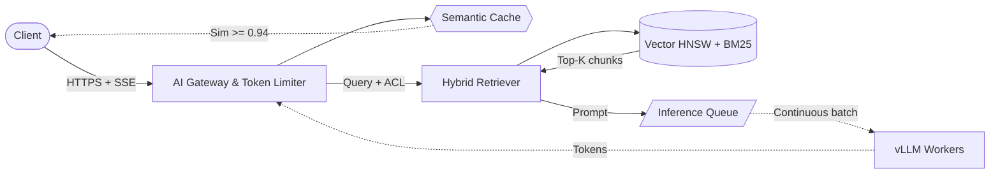

# Modern AI & High-Throughput Workloads
## GPU physics, LLM gateways, and hybrid RAG at scale

StackShade · System Design · Module 08 · Lesson 39

<!-- note: Frame why naive REST + CPU autoscaling fails on LLM workloads: long-lived streams, asymmetric token costs, and GPU VRAM bottlenecks. -->

---

# 1. Why Classic Web Scaling Breaks on LLMs

- **CPU is idle while users time out:** Request counts (`100 req/min`) ignore that one 64k-token prompt costs 300× more than a 200-token prompt.
<!-- step -->
- **VRAM OOMs before compute saturates:** Attention **KV-cache** for concurrent long contexts fills 80 GiB HBM quickly.
<!-- step -->
- **Stale or blind retrieval:** Nightly embedding batches miss updates; pure vector search misses exact IDs (`ERR_QUOTA_429`).

<!-- note: Emphasize that AI systems are still distributed systems—queues, caches, backpressure, and indexing rules still govern reliability. -->

---

# 2. Mental Model: Prefill vs Decode

| Phase | Operation | Bottleneck | User Metric |
|---|---|---|---|
| **Prefill** | Read entire input prompt in parallel | **Compute (`TFLOPS`)** | **TTFT** (Time-To-First-Token) |
| **Decode** | Generate 1 output token per step | **HBM Memory Bandwidth** | **ITL** (Inter-Token Latency) |

**Insight:** Streaming via **SSE** hides total latency as long as `TTFT < 500 ms` and `ITL < 50 ms`.

<!-- note: Explain why decode is memory-bandwidth bound: every single generated token requires streaming model weights + KV-cache from HBM. -->

---

# 3. End-to-End AI Gateway & Hybrid RAG

<!-- note: Point out the two planes: online retrieval/streaming vs async document CDC ingestion into the Hybrid Index. -->

---

# 4. Continuous Batching & PagedAttention

<!-- anim: anim-llm-token-streaming -->

<!-- step -->
- **Static batching:** Fast 50-token answer waits behind a 2,000-token answer.
<!-- step -->
- **Continuous batching:** New requests enter freed GPU slots at *every* decode step.
<!-- step -->
- **PagedAttention:** Splits KV-cache into virtual pages—eliminates contiguous VRAM waste and boosts concurrency `2×–4×`.

<!-- note: Walk through the interactive streaming animation showing TTFT and ITL stability when continuous batching is active. -->

---

# 5. Token-Bucket Rate Limiting (By Tokens!)

Never rate-limit LLMs by raw HTTP requests alone:

<!-- step -->
1. Estimate `reserved = prompt_tokens + max_output_cap`.
<!-- step -->
2. Deduct atomically from tenant **TPM (Tokens/Min)** bucket at gateway.
<!-- step -->
3. Stream response via HTTP/2 **SSE**.
<!-- step -->
4. Reconcile & refund `max_output_cap - actual_output_tokens` on completion.

<!-- note: Remind learners: also cap concurrent open SSE streams per tenant to protect gateway file descriptors and GPU queue slots. -->

---

# 6. Worked Math: Throughput & GPU Sizing

**200k DAU**, **10 prompts/day**, **4× peak**, **30% semantic cache hit**:

<!-- step -->
- Peak QPS = `(2M ÷ 86,400) × 4 ≈ 92.6 QPS` → Origin GPU QPS = `92.6 × 0.70 ≈ 64.8 QPS`
<!-- step -->
- Avg `2,500` input + `350` output tokens → **`162k` input tok/s**, **`22.7k` output tok/s**
<!-- step -->
- `4× 80 GiB H100` (`320 GiB` HBM): `65 GiB` weights + `25 GiB` overhead = **`230 GiB` KV-cache**
<!-- step -->
- At `320 KiB/token` KV-cache → `~753k` concurrent tokens (`~264` requests/node)
<!-- step -->
- At `1,800` output tok/s per node → **14 replicas (`56` GPUs)** incl. `N+2` headroom

<!-- note: Note explicitly: binary GiB for GPU VRAM (`80 GiB`, `320 KiB`), decimal GB for disk/object storage. -->

---

# 7. Hybrid RAG: Retrieval Without Leaks

- **Lexical (BM25) + Vector (HNSW)** merged via **Reciprocal Rank Fusion (RRF)** + cross-encoder reranker.
<!-- step -->
- **Rule #1 — Pre-filter ACLs:** Apply `tenant_id` and `doc_acl` *inside* the index query, never after fetching Top-K.
<!-- step -->
- **Rule #2 — Scope Semantic Cache:** Cache key must hash `(tenant_id, acl_group, corpus_version, model_id)`.

<!-- note: Ask what happens if you post-filter Top-K: a user without permission to top 10 hits gets an empty context even though authorized docs ranked #11–#15. -->

---

# 8. Trade-Offs & 10× / 100× Evolution

| Choice | Benefit | Risk / Cost |
|---|---|---|
| **Semantic Cache** | `~25 ms` response; cuts GPU bill | Stale/leaked answers if poorly scoped |
| **Model Router (8B vs 70B)** | `5×–10×` lower cost on easy intents | Misrouting drops answer quality |
| **In-memory HNSW vs DiskANN** | Sub-15 ms high-recall retrieval | High RAM cost (`~2.4 KB` / 1k-d chunk) |

- **10×–100× Scale:** Disaggregate **Prefill** and **Decode** GPU pools; add prefix-cache-aware routing and speculative decoding.

<!-- note: Disaggregated serving prevents a huge 64k-token prefill from causing visible stuttering (ITL spikes) for other streaming users on the same GPU. -->

---

# 9. Retrieval Practice

1. Why is LLM decode bound by **HBM bandwidth** while prefill is bound by **compute**?
2. Why must ACL filters run *before/during* Top-K vector search instead of post-filtering?
3. What breaks if you rate-limit an LLM gateway solely by `requests/minute`?

<!-- note: Recap key takeaways and point to Case Study 03 (Rate Limiter) and Case Study 14 (High-throughput pipelines). -->

**Next:** [40 · System Evolution & Postmortems](../lessons/40-system-evolution.md)
