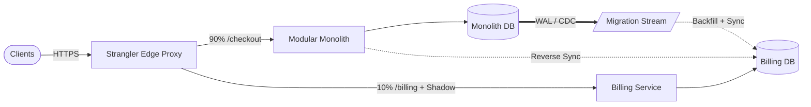

# System Evolution & Postmortems
## Decouple live systems safely without big-bang rewrites

StackShade · System Design · Module 08 · Lesson 40

<!-- note: Final lesson of the core curriculum. Connect technical evolution, data decoupling, and organizational resilience. -->

---

# 1. The Second-System Rewrite Trap

"Freeze features for 6 months and rewrite our monolith into 18 microservices."

<!-- step -->
- Legacy keeps running and changing every day (feature drift).
<!-- step -->
- Undocumented edge cases surface only on cutover day.
<!-- step -->
- **Result:** Two half-finished systems, double ops cost, zero business value for months.

<!-- note: Explain why systems must evolve while serving production traffic—like replacing an engine mid-flight. -->

---

# 2. Modular Monolith Before Microservices

Get **80% of isolation** with **0% network tax**:

<!-- step -->
- Enforce strict module interfaces inside one deployable repo.
<!-- step -->
- Forbid cross-domain SQL joins (`Checkout` calls `BillingAPI`, never `SELECT` on `invoices`).
<!-- step -->
- Isolate **worker pools & queues** first before spinning up separate databases.

<!-- note: Remind learners that microservices are an organizational and scaling tool, not a day-1 requirement. -->

---

# 3. Worked Trigger: Little's Law Starvation

Monolith serves **3,000 peak RPS**: `450` checkout (`25 ms`) + `150` billing PDFs (`1,200 ms`):

<!-- step -->
- Concurrency consumed by PDFs: `L = λ × W = 150 × 1.2 s = 180 workers`
<!-- step -->
- Checkout concurrency needed: `450 × 0.025 s = 11.25 workers`
<!-- step -->
- **Trigger:** Heavy tasks starve shared thread/DB pools → offload PDFs to a dedicated Outbox worker first (3 days, zero DB split).

<!-- note: Show how Little's Law reveals that slow tail jobs consume disproportionate concurrency slots even at low RPS. -->

---

# 4. Strangler Fig Extraction Architecture

<!-- note: Walk through why edge routing + CDC data sync makes every stage reversible in seconds. -->

---

# 5. The 5-Step Safe Extraction Playbook

<!-- anim: anim-strangler-cutover -->

<!-- step -->
1. **Carve Seam:** Enforce module ownership & drop cross-table joins.
<!-- step -->
2. **CDC Backfill:** Stream WAL (`Debezium`) to target DB; verify row checksums.
<!-- step -->
3. **Shadow Reads:** Mirror reads silently; log and fix parity diffs.
<!-- step -->
4. **Progressive Writes + Reverse Sync:** Shift `1% → 10% → 50% → 100%` behind SLO canary gates.
<!-- step -->
5. **Contract:** Stop reverse sync after burn-in and delete legacy code.

<!-- note: Emphasize Step 5! Leaving temporary dual-sync code running forever creates permanent tech debt. -->

---

# 6. Extraction Failure Modes

- **Silent dual-sync drift:** Checksum job (`count`, `sum`, row hash) catches divergence before cutover.
<!-- step -->
- **Unbounded rollback cliff:** Without reverse sync, rolling back after `100%` cutover loses new writes.
<!-- step -->
- **Missing scale in staging:** New DB passes `10k`-row staging tests, then sequential-scans `42M` rows in prod.

<!-- note: Connect the third bullet directly to the postmortem example on the next slides. -->

---

# 7. Blameless Postmortems

Assume engineers acted reasonably with the tools & info available:

<!-- step -->
- **Measure impact honestly:** `14 min` degraded EU checkout; `0` lost orders; **`2.1%` monthly error budget burned**.
<!-- step -->
- **Find systemic causes:** Not *"Bob forgot an index"* → *"Staging lacked prod row scale & canary lacked a p99 gate"*.
<!-- step -->
- **Ship permanent guardrails:** Automated `p99 > 500 ms` canary abort + CI `EXPLAIN` row-estimate check.

<!-- note: Blameless postmortems create psychological safety so teams report near-misses before they become multi-hour outages. -->

---

# 8. Trade-Offs & 10× / 100× Evolution

| Approach | Benefit | Cost / Failure Mode |
|---|---|---|
| **Modular Monolith** | Atomic SQL ACID, zero RPC lag | Shared OOM/deploy blast radius |
| **Strangler Fig** | Incremental value, instant rollback | Temporary dual-sync complexity |
| **Cell Architecture (100×)** | Caps blast radius to `1%–5%` cell | Cross-cell global routing & ops tooling |

<!-- note: Introduce Cell-Based Architecture as the 100× pattern for massive multi-tenant SaaS and global platforms. -->

---

# 9. Retrieval Practice

1. Why does isolating **worker pools** often beat extracting a database as Step 1?
2. What roles do **shadow reads** and **reverse sync** play during cutover?
3. How does **Little's Law (`L = λ × W`)** explain why `150 RPS` of slow PDFs starves `450 RPS` of fast checkout?

<!-- note: Pause for learners to answer before introducing the Capstone. -->

---

# 10. Your Course Capstone

Apply all 40 lessons in **[projects/04-capstone/README.md](../projects/04-capstone/README.md)**:

<!-- step -->
1. Full **System Design Document** + **2 ADRs**
<!-- step -->
2. Working **vertical slice** + **k6 load benchmark**
<!-- step -->
3. Injected **failure drill** + **blameless postmortem**
<!-- step -->
4. **15-minute recorded architecture review**

<!-- note: Congratulate learners on completing Module 08 and direct them to the 16 case studies and Capstone project. -->

**Continue:** [Capstone Project](../projects/04-capstone/README.md) · [Case Studies](../case-studies/01-url-shortener.md)
