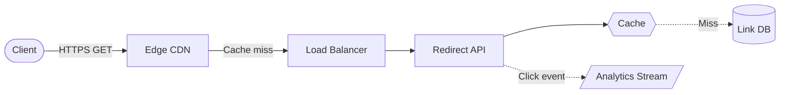

# Slide Grid, Mermaid Visual Grammar & Animation Spec

To keep every article, Mermaid diagram, interactive simulation, and downloadable HTML slide deck visually unified without bloat, follow this exact visual grammar.

---

## 1. Slide Visual Grammar (16:9 Teaching Decks)

### Minimal Layout Rules
- **Aspect ratio:** `16:9` (`1280×720` logical canvas, scales smoothly to 1080p/4K screen capture).
- **One idea per slide:** Either **one diagram + 2 bullet takeaways**, **one worked calculation**, or **one comparison table (max 4 columns × 5 rows)**.
- **Safe margins:** `56px` padding on all sides (`96px` bottom clearance if recording with a corner webcam bubble).
- **Typography on slides:**
  - Slide Title (`H1`): `38px`, bold, accent color (`#A3E635` dark / `#4F46E5` light).
  - Subtitle / Lead (`H2`): `24px`, muted ink.
  - Body bullets: `22px`, line-height `1.45`, max `5` lines per bullet list.
  - Code / HTTP / SQL snippets: `18px` monospace, max `12` lines per slide.

### Standard Slide Archetypes (Reuse Only These 6)
1. **Title Slide:** Course badge + Deck Title + 1-line learning promise + Lesson link.
2. **Problem Statement Slide:** Concrete user scenario + "Why naive solutions break".
3. **Architecture / Diagram Slide:** Full-width Mermaid or animated SVG diagram on left/top + 2 concise takeaways.
4. **Split Comparison Slide:** 2 equal columns (`Option A` vs `Option B` with green/amber trade-off bullets).
5. **Worked Math Slide:** Step-by-step equation reveal using `<!-- step -->` fragments + highlighted assumptions box.
6. **Interactive Sim / Recap Slide:** Embedded offline animation widget or 3 retrieval questions.

---

## 2. Consistent Mermaid Diagram Grammar

Across **all 40 lessons, 16 case studies, and all slide decks**, use the exact same shapes and arrow semantics so learners build instant pattern recognition:

| System Concept | Mermaid Node Syntax | Shape Meaning |
|---|---|---|
| **User / Browser / Client** | `U([Client])` | Stadium pill (external actor) |
| **DNS / Edge / CDN / LB** | `E[Edge / CDN]` | Sharp rectangle (stateless infra) |
| **Application / Worker** | `S[Order Service]` | Rectangle (compute process) |
| **Database / Durable Store** | `DB[(Primary DB)]` | Cylinder (durable storage) |
| **Cache / Derived Memory** | `C{{Redis / Cache}}` | Hexagon (ephemeral fast state) |
| **Queue / Event Stream** | `Q[/Event Stream/]` | Parallelogram (async buffer) |
| **External / 3rd Party** | `X(Payment Gateway)` | Rounded box (untrusted/external) |

### Arrow Semantics (Mandatory)
- **Synchronous request/query:** `A -->|HTTP POST /order| B` (solid arrow + action/protocol label)
- **Response / return data:** `B -.->|201 Created| A` or `DB -- rows --> A`
- **Asynchronous event / control plane:** `A -.->|OrderCreated event| Q` (dashed arrow)
- **Hot path / critical replication:** `A ==>|WAL stream| R` (thick arrow)

### Minimal Mermaid Init Header (Light & Dark Safe)
Keep diagrams readable in both GitHub Markdown, Next.js, and downloaded HTML slides by avoiding hard-coded bright neon fills inside `.mmd` files. Use clean semantic class definitions only when needed:



> **Diagram Rule:** One Mermaid diagram must answer **one clear question** and stay under **10–12 nodes**. Split complex systems into Overview + Deep-Dive sequence diagrams.

---

## 3. Minimal Animation & Motion Rules

Animations must **clarify causality** (data movement, state change, queue buildup, cache hit vs. miss), never entertain for free.

### Timing Tokens
```css
--ease-out: cubic-bezier(0.2, 0.8, 0.2, 1);
--dur-fast: 160ms;   /* Step fragment reveal, hover, tab underline */
--dur-flow: 480ms;   /* Animated SVG packet hop, node state change */
```

### Approved Animation Patterns
1. **Fragment Step Reveal (`<!-- step -->`):** Reveals bullets, calculation lines, or sequence steps one click at a time during video teaching (`opacity: 0 → 1`, `translateY(6px → 0)` over `160ms`).
2. **SVG Packet Hop Animation:** Moves a crisp `8px` accent dot along an SVG `<path>` (`stroke-dashoffset` or `animateMotion`) to show sync blocking vs. async queuing or cache hit short-circuiting.
3. **Interactive Parameter State Machine:** Pure vanilla JS + SVG (`< 150 lines` per widget) where changing **one input** (e.g. `Peak Multiplier`, `Quorum W`, `Token Refill Rate`, `Shard Count`) updates numbers and visual bars/rings smoothly.
4. **Reduced Motion Compliance:**
   ```css
   @media (prefers-reduced-motion: reduce) {
     *, *::before, *::after {
       animation-duration: 0.01ms !important;
       transition-duration: 0.01ms !important;
     }
   }
   ```
