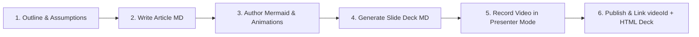

# StackShade Authoring Playbook

A practical, step-by-step guide for writing **articles**, **Mermaid diagrams**, **animations & interactive visualizations**, **downloadable HTML slides & PPTs**, **curated resource links**, and recording **YouTube lessons**.

---

## 1. End-to-End Lesson Production Workflow

Every lesson goes through six clean stages—you never need to guess what comes next:



### Honest Status Progression
Update the lesson status strictly as work finishes:
- `planned` — Listed in [syllabus.md](../../courses/system-design/syllabus.md); no article file yet.
- `draft` — Article written and peer/self-reviewed against primary sources.
- `recorded` — Slide deck finalized, downloadable HTML generated, YouTube video recorded.
- `published` — YouTube `videoId` + chapters added, relative links verified, retrieval questions tested.

---

## 2. How to Write a Course Article (`lessons/NN-slug.md`)

### Recommended Frontmatter Metadata
Add clean YAML frontmatter at the top of new/updated lessons so the website, syllabus, search index, and YouTube embeds load automatically without hardcoded lists:

```yaml
---
id: "01"
module: "00"
title: "Thinking in Systems"
level: "Beginner"
status: "draft"                 # planned | draft | recorded | published
durationMinutes: 15
prerequisites: []
objectives:
  - "Decompose a product into actors, interfaces, compute, state, and ops"
  - "Separate requirements from implementation choices"
slides: "../slides/01-course-kickoff.md"
downloadHtml: "../downloads/01-course-kickoff.html"
diagrams:
  - "../diagrams/system-overview.mmd"
animations:
  - "anim-request-layers"
youtube:
  videoId: null                 # e.g. "dQw4w9WgXcQ" once uploaded
  publishedAt: null
  chapters: []                  # [{ time: "00:00", title: "Why systems thinking?" }]
  transcriptUrl: null
---
```

### The 7-Step Pedagogical Article Structure
1. **The Problem (Concrete Before Abstract):** Start with a real product scenario ("Suppose 10,000 users click checkout in 3 seconds...") before naming any pattern or database.
2. **Mental Model:** Give a plain-English analogy or 5-line conceptual model; define every new technical term on first use.
3. **How It Works Under the Hood:** Walk through the mechanism step by step with a **Mermaid diagram** matching the [Visual Grammar](../design-system/slide-and-animation-spec.md).
4. **Worked Example / Interactive Visualization:** Show explicit numbers with units (`QPS`, `bytes/record`, `ms p95`, decimal `GB` vs binary `GiB`). Link or embed the lesson's interactive animation.
5. **Trade-Offs & Failure Modes:** Always include a Markdown comparison table (`Choice | Benefit | Cost / Risk | Fails When`). Answer *"What changes at 10× and 100× scale?"*
6. **Practical Exercise / Lab Link:** Concrete task where learners draw, calculate, or run a small local check.
7. **Retrieval Practice & Primary Sources:** 3–5 recall questions with collapsible `<details><summary>Hints</summary>` plus verified links to RFCs, official docs, papers, or engineering blogs.

---

## 3. How to Author Mermaid Diagrams

1. Keep reusable diagrams in `courses/<slug>/diagrams/<name>.mmd` **and/or** inline fenced ` ```mermaid ` blocks inside the lesson.
2. **One question per diagram:** Never merge client auth, write path, analytics pipeline, and multi-region failover into one crowded 30-node box tangle.
3. **Label every edge:** Replace bare `A --> B` with `A -->|HTTPS POST /links| B` or `Q -.->|At-least-once event| W`.
4. **Follow the shared node legend:** `([Client])`, `[Service]`, `[(Database)]`, `{{Cache}}`, `[/Queue/]`.
5. **Verify readability:** Check diagrams in both Light Mode and Dark Mode before committing.

---

## 4. How to Build Visualizations & Animations (3-Tier System)

Choose the lightest tier that makes the behavior unmistakable:

### Tier 1 — Declarative Step-by-Step Sequences (Markdown + HTML Slides)
- Used when order of operations matters (DNS → TCP → TLS → HTTP, Cache Miss → DB → Set TTL, Saga Compensating Rollback).
- Written directly using `<!-- step -->` markers in slide decks and numbered Mermaid sequence steps in articles.
- Zero custom JavaScript needed.

### Tier 2 — Portable Interactive Micro-Simulations (Vanilla SVG + JS)
- Used when learners need to **tweak an assumption and watch the system react** (e.g., *Capacity Estimator*, *Token Bucket Refill*, *Consistent Hash Ring*, *Quorum `R+W>N` Overlap*, *Circuit Breaker States*).
- **Design rule:** Built as small, self-contained HTML/SVG/JS blocks (`< 150 lines`, zero external npm runtime required) using CSS variables (`--bg`, `--ink`, `--accent`).
- **Why this matters:** Because they have zero framework dependencies, the **exact same visualization runs inside both the website AND the downloaded offline `.html` slide deck**.

### Tier 3 — Complex Node Playgrounds (`@xyflow/react` on Website Only)
- Used sparingly on the web platform for multi-node topology exploration (e.g., Multi-Region Active-Active failover).
- **Mandatory rule:** Every Tier-3 playground MUST include a clean static Mermaid fallback diagram so offline readers, printouts, and PDFs never lose the explanation.

---

## 5. How to Create Slides, Downloadable HTML Decks & PPTs

Follow the full spec in [downloadable-html-slides.md](downloadable-html-slides.md):

1. Create `courses/<slug>/slides/NN-topic.md` directly from the 7 sections of your finished article (`10–14` concise slides).
2. Add `<!-- step -->` markers where you want bullets, equations, or SVG states to animate in sequentially while speaking.
3. Add `<!-- note: ... -->` blocks containing your talking points, key numbers, and edge cases so you never stare at text-heavy slides during recording.
4. Embed inline Mermaid blocks or `<!-- anim: widget-id -->` hooks for live demonstrations.
5. Generate outputs:
   - **Self-contained animated `.html`** saved/published for learner download (`downloads/NN-topic.html`).
   - **PPTX / PDF** export for learners who want printable notes or editable presentation slides.

---

## 6. How to Curate & Cite Resource Links

Never drop an unannotated link list. Every external resource in `resources/` or a lesson footer follows this priority ladder:

| Tier | Source Type | Examples | Citation Requirement |
|---:|---|---|---|
| **1** | **Standards & RFCs** | RFC 9110 (HTTP), RFC 8446 (TLS 1.3), RFC 9700 (OAuth) | Link exact RFC number + section |
| **2** | **Official Docs** | PostgreSQL, Redis, Kafka, Kubernetes, OpenTelemetry | Link `/docs/current/` + checked date |
| **3** | **Research Papers & Courses** | Raft, Dynamo, Spanner, MIT 6.5840, Jepsen | Link PDF/analysis + note limitations |
| **4** | **First-Party Eng Blogs** | Netflix, Cloudflare, Discord, Stripe, Uber, AWS Builders' Library | Summarize workload, failure trigger & trade-off |
| **5** | **Books & Guides** | DDIA, Google SRE Book, System Design Primer | Mark clearly if paid/book (`not free full-text`) |

---

## 7. YouTube Recording & Linking Workflow

1. Open the deck in **Presenter Mode** (`/present/system-design/01-course-kickoff`).
2. Switch to Dark Teaching Theme (`T` key) and optionally enable the **Local Webcam Bubble** (bottom-right circular crop, mirror checked).
3. Press `N` if you want speaker notes open on a second display or off-capture region.
4. Record the browser window at `1920×1080` using OBS or your screen recorder.
5. Upload the video to `@StackShade` on YouTube with timestamped chapters and curated description links back to the lesson URL.
6. Update `videoId` and `chapters` in the lesson frontmatter and `courses/system-design/course.json`, set `status: "published"`, and commit.
