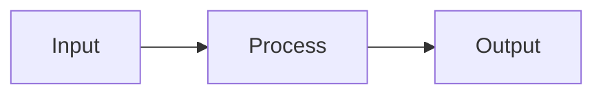

# NN · Lesson title

**Level:** Beginner / Intermediate / Advanced · **Status:** Draft · **Prerequisites:** 

## Learning objectives

By the end, you should be able to:
- 
- 
- 

## 1. The problem

What problem does this concept solve? Describe a concrete scenario before introducing terminology.

## 2. Mental model

Explain the simplest useful model. Define new terms.

## 3. How it works

Describe the mechanism step by step. Include a diagram when relationships or flows matter.

## 4. Worked example

State assumptions, units, calculations and limitations.

## 5. Trade-offs and failure modes

| Choice | Benefit | Cost / risk | Good fit |
|---|---|---|---|
| | | | |

## 6. Practical exercise

Give a task with clear deliverables and a way to check the result.

## 7. Retrieval practice

1. 
2. 
3. 

Hints

Add hints or short answers here.

## Sources and further reading

- Prefer primary documentation, standards, research papers and first-party engineering posts.
- Clearly distinguish source-backed facts from the course's own interpretation.

## Next lesson

[Link to the next topic](next-topic.md).
